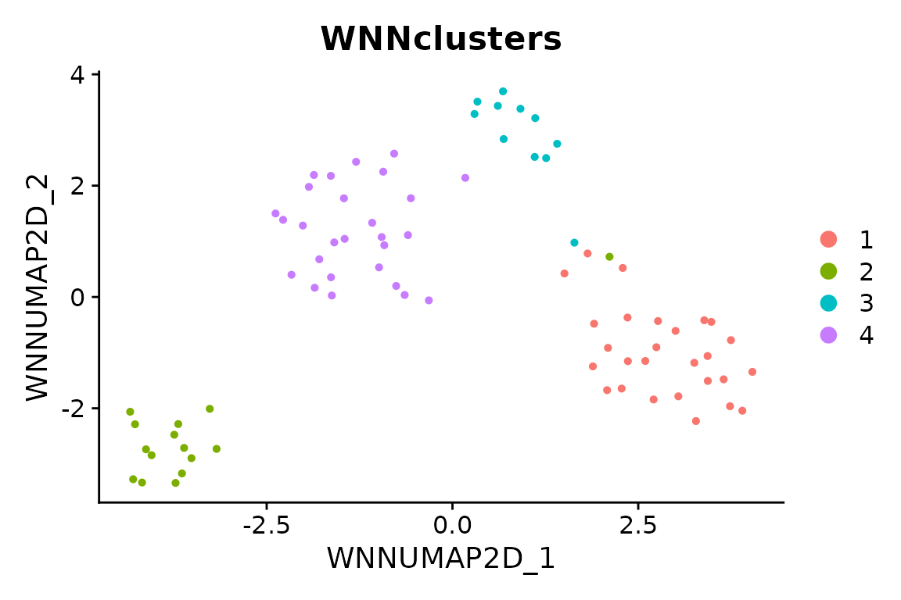

# Paired RNA and ATAC with WNN

## Scope

This small example executes weighted nearest-neighbor analysis on 80
paired cells from the packaged `pbmcmultiome_sub` object. It needs no
downloaded fragments, reference sequence or Python environment. The
subset and small feature/dimension settings illustrate the interface;
they are not recommended parameters for a complete biological analysis.

For your own paired 10x ARC data, import with
`scop::ReadMultiomeData("filtered_feature_bc_matrix.h5", genome = "hg38")`,
then pass the returned object to the same WNN call below. Use the
verified genome for your data. Both selected assays must contain the
same paired cells; WNN reports incomplete pairing before preprocessing
instead of silently intersecting or imputing cells.

WNN combines RNA and ATAC neighborhoods. It does not correct sample
batch effects. Supplying `batch` emits a warning rather than silently
implying that correction occurred. Review batch effects separately
before interpreting joint clusters. See
[WNN_integrate()](https://mengxu98.github.io/scop/reference/WNN_integrate.md)
for the method contract.

## Run paired preprocessing and WNN

``` r

data("pbmcmultiome_sub", package = "scop")
paired <- subset(pbmcmultiome_sub, cells = colnames(pbmcmultiome_sub)[1:80])
#> Loading required namespace: SeuratObject
#> Loading required namespace: Signac
paired <- scop::WNN_integrate(
  srt_merge = paired, assay = c("RNA", "peaks"),
  linear_reduction_dims = 10, linear_reduction_dims_use = 2:8,
  nHVF = 100, neighbor_k = 10, nonlinear_reduction_dims = 2,
  verbose = FALSE
)
#> ℹ [2026-11-02 15:35:03] Skip `log1p()` because `layer = data` is not "counts"
#> ℹ [2026-11-02 15:35:06] Skip `log1p()` because `layer = data` is not "counts"
#> ℹ [2026-11-02 15:35:09] Reorder clusters...
#> ℹ [2026-11-02 15:35:09] Skip `log1p()` because `layer = data` is not "counts"
#> Warning: Key 'RNApcaUMAP2D_' taken, using 'rnaumap2d_' instead
#> Warning: Key 'ATACsvdUMAP2D_' taken, using 'atacumap2d_' instead
SeuratObject::Reductions(paired)
#> [1] "RNApca"        "RNApcaUMAP2D"  "RNAUMAP2D"     "ATACsvd"      
#> [5] "ATACsvdUMAP2D" "ATACUMAP2D"    "ATAClsi"       "WNNUMAP2D"
```

Explicit assay selection keeps derived `chromvar` and `ACTIVITY` assays
out of the RNA input. Custom RNA assay names must be supplied
explicitly. Gene activity is an accessibility-derived proxy, and
chromVAR measures motif-related accessibility deviations; neither is
measured RNA.

## Inspect reusable outputs

Both the default append mode and `append = FALSE` retain the RNA PCA,
ATAC LSI, complete processed assays (including scaled RNA), WNN graphs,
modality weights and clustering results. The RNA assay is active on
return. The reduction receipt records the actual cells, peaks and
selected dimensions at calculation time.

``` r

paired@misc$WNN_reduction_list
#> [1] "RNApca"  "ATAClsi"
paired@misc$WNN_dims_list
#> $rna
#> [1] 2 3 4 5 6 7 8
#> 
#> $atac
#> [1] 2 3 4 5 6 7 8
stopifnot(all(paired@misc$WNN_reduction_list %in% SeuratObject::Reductions(paired)))
head(paired[[]][, c("RNA.weight", "ATAC.weight", "WNNclusters")])
#>                    RNA.weight ATAC.weight WNNclusters
#> AAAGCCCGTGTTGCTT-1  0.5756016   0.4243984           2
#> AAAGCTTGTTAGAGGG-1  0.7922759   0.2077241           1
#> AAAGGCTCAATGCCCG-1  0.5354935   0.4645065           2
#> AAATGGCCAAGGTACG-1  0.5100399   0.4899601           4
#> AACAGGATCGTTAGCG-1  0.5961708   0.4038292           4
#> AACCGGCTCAGGCCTA-1  0.4708434   0.5291566           4
SeuratObject::Misc(paired[["ATAClsi"]], "scop_atac_representation")$dimensions
#> [1] 2 3 4 5 6 7 8
stopifnot(nrow(SeuratObject::LayerData(paired, assay = "RNA", layer = "scale.data")) > 0)
```

``` r

Seurat::DimPlot(paired, reduction = "WNNUMAP2D", group.by = "WNNclusters")
```



For the common dispatcher, use
`RunIntegration(srt_merge = paired, batch = NULL, integration_methods = "WNN", assay = c("RNA", "peaks"), ...)`
with the same analysis parameters. Native counts remain available for a
subsequent
[RunLinkPeaks()](https://mengxu98.github.io/scop/reference/RunLinkPeaks.md)
analysis, which additionally requires compatible gene coordinates and
verified sequence statistics. WNN clusters and peak-gene associations do
not by themselves establish causal regulation.

Use `normalization_method = "SCT"` to normalize RNA with SCTransform;
ATAC continues to use TF-IDF and LSI. An explicit `HVF` vector selects
RNA features only. Set `nonlinear_reduction = character()` for graphs
and clusters without an embedding. WNN supports UMAP and force-directed
embeddings; unsupported methods are reported before analysis instead of
being replaced silently.
