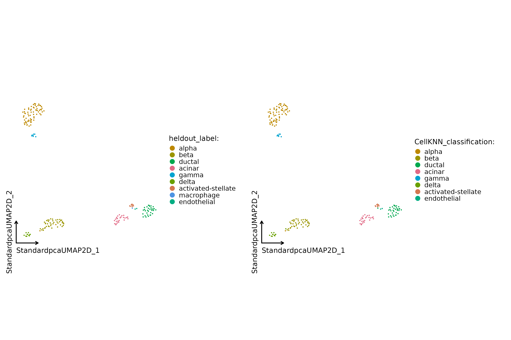
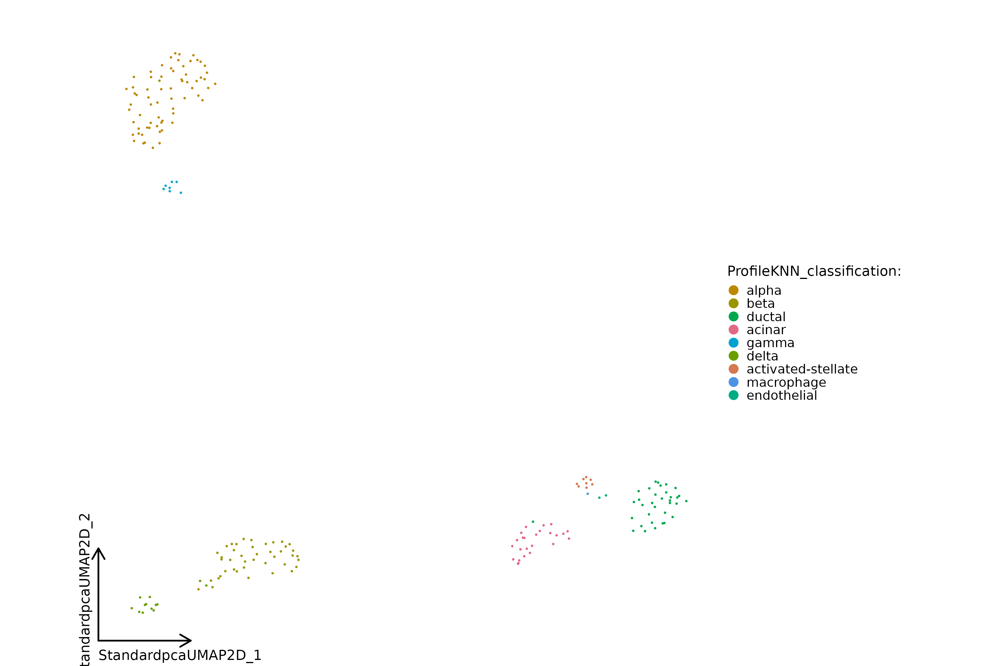
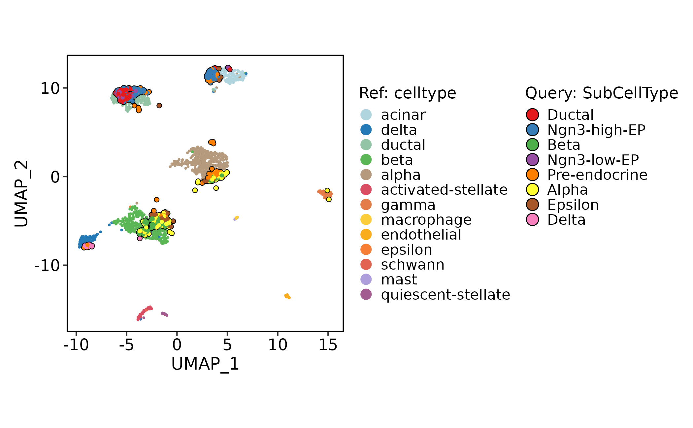
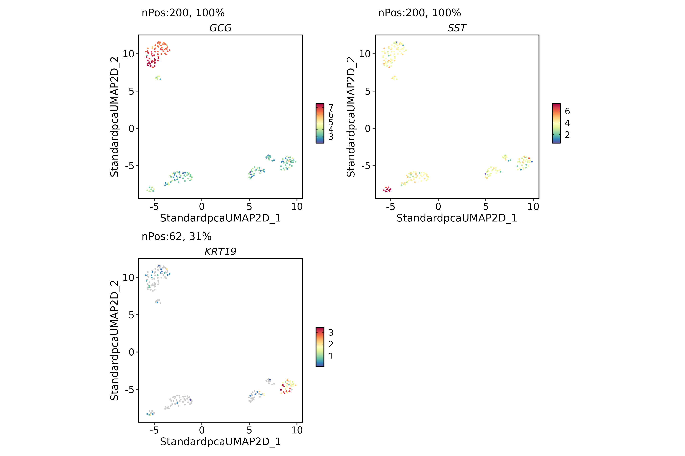
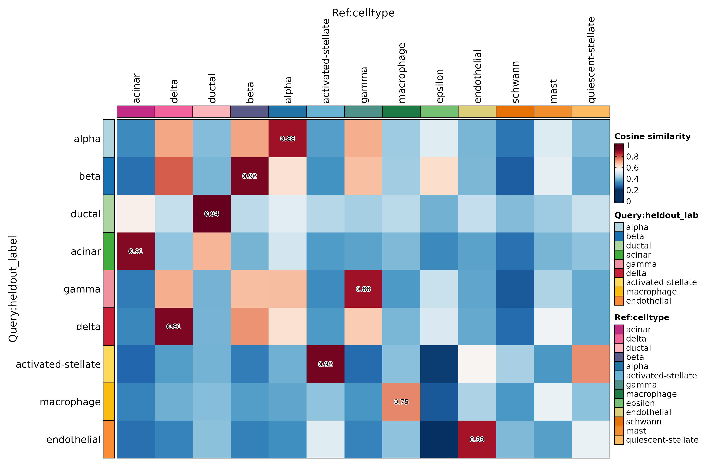

# Cell annotation workflow

## What you will do

**Question:** which reference cell types resemble each query cell, and
where is that assignment uncertain? You will transfer labels, compare
them with held-out annotations, inspect marker expression and save the
prediction evidence.

The example uses all 1,600 cells of the bundled human `panc8_sub`
object. Every `celseq2` cell is a query; every other technology is
reference. This is a technology-defined holdout, with no random sampling
and no shared cells. It illustrates transfer within one tissue/species,
not a validated classifier for arbitrary tissue. The original package
dataset is itself a study subset.

The old human-to-mouse capitalization shortcut is intentionally avoided:
changing letter case is not ortholog mapping. For cross-species work,
prepare and report a versioned ortholog table first, resolving
one-to-many mappings.

## Prepare disjoint query and reference inputs

``` r

library(scop)
set.seed(11)
data(panc8_sub)
stopifnot(!anyNA(panc8_sub$tech), !anyNA(panc8_sub$celltype))
query_ids <- colnames(panc8_sub)[panc8_sub$tech == "celseq2"]
reference_ids <- setdiff(colnames(panc8_sub), query_ids)
stopifnot(
  length(intersect(query_ids, reference_ids)) == 0,
  length(query_ids) + length(reference_ids) == ncol(panc8_sub)
)
query <- panc8_sub[, query_ids]
reference <- panc8_sub[, reference_ids]
query <- RunStandardWorkflow(query,
  assay = "RNA", seed = 11, cores = 1,
  verbose = FALSE
)
reference <- RunStandardWorkflow(reference,
  assay = "RNA", seed = 11, cores = 1,
  verbose = FALSE
)
query$heldout_label <- query$celltype
shared_features <- intersect(
  SeuratObject::VariableFeatures(query),
  SeuratObject::VariableFeatures(reference)
)
stopifnot(length(shared_features) > 30)
data.frame(
  input = c("query", "reference"),
  cells = c(ncol(query), ncol(reference)),
  species = "Homo sapiens"
)
#>       input cells      species
#> 1     query   200 Homo sapiens
#> 2 reference  1400 Homo sapiens
table(reference$celltype)
#> 
#>             acinar activated-stellate              alpha               beta 
#>                138                 42                413                386 
#>              delta             ductal        endothelial            epsilon 
#>                100                204                 24                  3 
#>              gamma         macrophage               mast quiescent-stellate 
#>                 60                  8                  7                 14 
#>            schwann 
#>                  1
setdiff(unique(query$heldout_label), unique(reference$celltype))
#> character(0)
length(shared_features)
#> [1] 653
label_colors <- stats::setNames(
  grDevices::hcl.colors(length(unique(reference$celltype)), "Dark 3"),
  sort(unique(as.character(reference$celltype)))
)
```

The final check prints query labels absent from the reference, if any.
Such states cannot be correctly named by closed-reference label
transfer. Reference labels and highly variable genes are model inputs;
held-out query labels are used only for evaluation. Neither UMAP
appearance nor prediction scores prove cell identity.

## Predict from individual reference cells

`ref_collapsing = FALSE` explicitly uses individual reference cells; the
default collapses reference groups to averages. The prefix keeps these
labels separate from the next method and from the original annotations.

``` r

query <- RunKNNPredict(
  srt_query = query, srt_ref = reference, ref_group = "celltype",
  query_assay = "RNA", ref_assay = "RNA", features = shared_features,
  ref_collapsing = FALSE, k = 30, filter_lowfreq = 0,
  prefix = "CellKNN", verbose = FALSE
)
stopifnot(
  identical(colnames(query), query_ids),
  "CellKNN_classification" %in% colnames(query@meta.data)
)
table(observed = query$heldout_label, predicted = query$CellKNN_classification)
#>                     predicted
#> observed             acinar activated-stellate alpha beta delta ductal
#>   acinar                 26                  0     0    0     0      0
#>   activated-stellate      0                  8     0    0     0      0
#>   alpha                   0                  0    68    2     0      0
#>   beta                    0                  0     0   41     1      0
#>   delta                   0                  0     0    0    11      0
#>   ductal                  0                  0     0    0     0     33
#>   endothelial             0                  0     0    0     0      0
#>   gamma                   0                  0     0    0     0      0
#>   macrophage              0                  0     0    0     0      1
#>                     predicted
#> observed             endothelial gamma
#>   acinar                       0     0
#>   activated-stellate           0     0
#>   alpha                        0     0
#>   beta                         0     0
#>   delta                        0     0
#>   ductal                       0     0
#>   endothelial                  2     0
#>   gamma                        0     7
#>   macrophage                   0     0
CellDimPlot(query,
  group.by = c("heldout_label", "CellKNN_classification"),
  reduction = "UMAP", label = FALSE, theme_use = "theme_blank",
  palcolor = label_colors
)
```



Read the contingency table row by row. A strong diagonal supports
agreement with the supplied labels; off-diagonal entries identify cells
to inspect. Agreement is descriptive here, because labels come from
related pancreas data. `filter_lowfreq = 0` preserves rare predictions
so their uncertainty is visible; it does not discard rare cells or
relabel a failed transfer as correct.

## Compare with bulk-like reference profiles

These are average expression profiles derived from the same reference
cells, not an independent bulk experiment. They test the effect of
reference aggregation. `AverageExpression(..., layer = "data")` averages
expression on its unlogged scale, so we explicitly apply
[`log1p()`](https://rdrr.io/r/base/Log.html) afterward to match the
query RNA `data` layer. Each column is a named reference cell type.
`k = 1` selects the nearest profile; 30 cell neighbors and one group
profile are different models, not a controlled change in only one
parameter.

``` r

profiles <- Seurat::AverageExpression(reference,
  assays = "RNA", layer = "data",
  group.by = "celltype", verbose = FALSE
)$RNA
profiles <- log1p(profiles)
query <- RunKNNPredict(
  srt_query = query, bulk_ref = profiles,
  query_assay = "RNA", features = shared_features,
  k = 1, filter_lowfreq = 0, prefix = "ProfileKNN", verbose = FALSE
)
table(
  cell_reference = query$CellKNN_classification,
  profile_reference = query$ProfileKNN_classification
)
#>                     profile_reference
#> cell_reference       acinar activated-stellate alpha beta delta ductal
#>   acinar                 25                  0     0    0     0      1
#>   activated-stellate      0                  8     0    0     0      0
#>   alpha                   0                  0    68    0     0      0
#>   beta                    0                  0     0   42     1      0
#>   delta                   0                  0     0    0    12      0
#>   ductal                  0                  0     0    0     0     33
#>   endothelial             0                  0     0    0     0      0
#>   gamma                   0                  0     0    0     0      0
#>                     profile_reference
#> cell_reference       endothelial gamma macrophage
#>   acinar                       0     0          0
#>   activated-stellate           0     0          0
#>   alpha                        0     0          0
#>   beta                         0     0          0
#>   delta                        0     0          0
#>   ductal                       0     0          1
#>   endothelial                  2     0          0
#>   gamma                        0     7          0
names(query@tools)
#> [1] "CellKNN_classification"    "ProfileKNN_classification"
CellDimPlot(query,
  group.by = "ProfileKNN_classification", reduction = "UMAP",
  theme_use = "theme_blank", palcolor = label_colors
)
```



``` r

comparison <- data.frame(
  method = c("30 individual neighbors", "1 log-scale mean profile"),
  cells = ncol(query),
  matches_supplied_label = c(
    sum(query$heldout_label == query$CellKNN_classification),
    sum(query$heldout_label == query$ProfileKNN_classification)
  )
)
comparison$agreement <- comparison$matches_supplied_label / comparison$cells
comparison
#>                     method cells matches_supplied_label agreement
#> 1  30 individual neighbors   200                    196     0.980
#> 2 1 log-scale mean profile   200                    195     0.975
```

Both prediction columns remain in the object. Different answers are a
reason to inspect neighbors and markers, not a reason to silently
replace one label. Scores are similarity/vote evidence, not calibrated
clinical probabilities.

## Project onto the reference and inspect markers

Projection places query cells in the reference’s coordinate system. We
request `projection_method = "knn"` explicitly: this is
neighbor-weighted projection, not a newly learned joint embedding or
evidence of successful batch correction.

``` r

ref_umap <- DefaultReduction(reference, pattern = "UMAP")
query <- RunKNNMap(
  srt_query = query, srt_ref = reference,
  features = shared_features, ref_umap = ref_umap,
  projection_method = "knn", verbose = FALSE
)
ProjectionPlot(
  srt_query = query, srt_ref = reference,
  query_group = "CellKNN_classification", ref_group = "celltype",
  query_param = list(palcolor = label_colors, cells.highlight = TRUE),
  ref_param = list(palcolor = label_colors)
)
```



``` r

markers <- c("INS", "GCG", "SST", "KRT19")
data.frame(marker = markers, present = markers %in% rownames(query))
#>   marker present
#> 1    INS   FALSE
#> 2    GCG    TRUE
#> 3    SST    TRUE
#> 4  KRT19    TRUE
FeatureDimPlot(query,
  features = intersect(markers, rownames(query)),
  reduction = "UMAP", ncol = 2
)
```



INS, GCG, SST and KRT19 provide marker checks for beta, alpha, delta and
ductal labels, respectively. INS is absent from this feature-filtered
package input, so the receipt records it as unavailable and the plot
cannot assess that gene. Absence from the matrix is different from
measured zero expression. Check multiple markers per state on your own
data; ambient RNA and mixed cells can create misleading single-marker
signals.

``` r

ht <- CellCorHeatmap(
  srt_query = query, srt_ref = reference,
  query_group = "heldout_label", ref_group = "celltype",
  features = shared_features, nlabel = 1, label_by = "row", label_size = 8,
  show_row_names = TRUE, show_column_names = TRUE
)
print(ht$plot)
```



This is group-level expression similarity. Similar support for several
reference labels flags ambiguity; these groups should remain under
review.

## Save, reload, and check the hand-off

The code below saves to a temporary directory. Choose a persistent
output folder when saving your analysis. Save the object **and**
plain-text metadata; a figure alone cannot reproduce the analysis. No
cells are sampled for this export.

``` r

output_dir <- file.path(tempdir(), "cell-annotation-workflow")
dir.create(output_dir, recursive = TRUE, showWarnings = FALSE)
result_file <- file.path(output_dir, "analysis.rds")
saveRDS(query, result_file)
reference_file <- file.path(output_dir, "reference.rds")
saveRDS(reference, reference_file)
utils::write.csv(as.matrix(profiles), file.path(output_dir, "log-scale-reference-profiles.csv"))
writeLines(shared_features, file.path(output_dir, "shared-prediction-features.txt"))
utils::write.csv(comparison, file.path(output_dir, "prediction-agreement.csv"), row.names = FALSE)
utils::write.csv(query@meta.data, file.path(output_dir, "cell-metadata.csv"))
reloaded <- readRDS(result_file)
reloaded_reference <- readRDS(reference_file)
stopifnot(
  identical(colnames(reloaded_reference), reference_ids),
  identical(reloaded_reference@meta.data, reference@meta.data)
)
stopifnot(
  identical(colnames(reloaded), colnames(query)),
  identical(reloaded@meta.data, query@meta.data),
  identical(
    SeuratObject::Reductions(reloaded),
    SeuratObject::Reductions(query)
  )
)
data.frame(
  file = basename(list.files(output_dir, full.names = TRUE)),
  bytes = file.info(list.files(output_dir, full.names = TRUE))$size
)
#>                               file    bytes
#> 1                     analysis.rds  8030268
#> 2                cell-metadata.csv    30269
#> 3 log-scale-reference-profiles.csv  2562291
#> 4         prediction-agreement.csv      134
#> 5                    reference.rds 36647945
#> 6   shared-prediction-features.txt     4005
```

## Use your own data and recover common errors

- Replace the `data(...)` input with `readRDS("your-object.rds")`, or
  create a Seurat object from a gene-by-cell raw-count matrix. Check
  that cell IDs are unique and metadata row names equal the expression
  column names.
- Set the assay and grouping columns explicitly. Species, gene
  identifiers and reference labels must match your experiment; do not
  copy pancreas labels to unrelated tissue.
- If a reduction or metadata column is missing, inspect
  `SeuratObject::Reductions(object)` and `colnames(object@meta.data)`,
  then run its producer chunk. A plot does not create the result it
  needs.
- If a dependency is unavailable, install it in the analysis
  environment, restart R and rerun from the input chunk. A skipped or
  failed method is not evidence that it worked. Preserve warnings and
  the exact error in your report.

## Analysis provenance

The receipt records the R seed. Python methods retain their documented
backend seeds and parameters; setting the R seed alone does not control
every backend. Package versions, BLAS libraries and backend changes can
alter numerical results. Keep this receipt with the exported object.

``` r

source_revision <- Sys.getenv("GITHUB_SHA")
if (!nzchar(source_revision) && nzchar(Sys.which("git"))) {
  source_revision <- tryCatch(system2("git", c("rev-parse", "HEAD"),
    stdout = TRUE,
    stderr = FALSE
  )[1], error = function(e) NA_character_)
}
article_source <- knitr::current_input(dir = TRUE)
build_receipt <- data.frame(
  article = "cell-annotation-workflow",
  built_utc = format(Sys.time(), tz = "UTC", usetz = TRUE),
  scop = as.character(utils::packageVersion("scop")),
  R = as.character(getRversion()),
  source_revision = source_revision,
  source_has_local_changes = if (nzchar(Sys.which("git"))) {
    length(system2("git", c("status", "--porcelain"), stdout = TRUE, stderr = FALSE)) > 0
  } else {
    NA
  },
  article_md5 = unname(tools::md5sum(article_source)),
  R_seed = 11,
  cells_retained = ncol(query),
  genes_in_active_assay = nrow(query),
  stringsAsFactors = FALSE
)
build_receipt
#>                    article               built_utc  scop     R
#> 1 cell-annotation-workflow 2026-10-30 06:54:08 UTC 0.9.2 4.6.2
#>                            source_revision source_has_local_changes
#> 1 8288c84cc97261b547b7847031f1f2e5a8fcdbe7                    FALSE
#>                        article_md5 R_seed cells_retained genes_in_active_assay
#> 1 fb85a2913df817dbe406011c397667b4     11            200                 12932
utils::write.csv(build_receipt, file.path(output_dir, "build-receipt.csv"),
  row.names = FALSE
)
writeLines(capture.output(sessionInfo()), file.path(output_dir, "session-info.txt"))
```

Show the complete R session used for this page

``` r

sessionInfo()
#> R version 4.6.2 (2026-10-29)
#> Platform: x86_64-pc-linux-gnu
#> Running under: Ubuntu 24.04.5 LTS
#> 
#> Matrix products: default
#> BLAS:   /usr/lib/x86_64-linux-gnu/openblas-pthread/libblas.so.3 
#> LAPACK: /usr/lib/x86_64-linux-gnu/openblas-pthread/libopenblasp-r0.3.26.so;  LAPACK version 3.12.0
#> 
#> locale:
#>  [1] LC_CTYPE=C.UTF-8       LC_NUMERIC=C           LC_TIME=C.UTF-8       
#>  [4] LC_COLLATE=C.UTF-8     LC_MONETARY=C.UTF-8    LC_MESSAGES=C.UTF-8   
#>  [7] LC_PAPER=C.UTF-8       LC_NAME=C              LC_ADDRESS=C          
#> [10] LC_TELEPHONE=C         LC_MEASUREMENT=C.UTF-8 LC_IDENTIFICATION=C   
#> 
#> time zone: UTC
#> tzcode source: system (glibc)
#> 
#> attached base packages:
#> [1] stats     graphics  grDevices utils     datasets  methods   base     
#> 
#> other attached packages:
#> [1] scop_0.9.2
#> 
#> loaded via a namespace (and not attached):
#>   [1] RColorBrewer_1.1-3     jsonlite_2.0.0         shape_1.4.6.1         
#>   [4] magrittr_2.0.5         spatstat.utils_3.2-5   farver_2.1.2          
#>   [7] rmarkdown_2.32         GlobalOptions_0.1.4    fs_2.1.0              
#>  [10] ragg_1.5.2             vctrs_0.7.3            ROCR_1.0-12           
#>  [13] spatstat.explore_3.8-3 htmltools_0.5.9        sass_0.4.10           
#>  [16] thisutils_0.5.3        sctransform_0.4.3      parallelly_1.48.0     
#>  [19] KernSmooth_2.23-27     bslib_0.12.0           htmlwidgets_1.6.4     
#>  [22] desc_1.4.3             ica_1.0-3              plyr_1.8.9            
#>  [25] plotly_4.12.1          zoo_1.9-1              cachem_1.1.0          
#>  [28] igraph_2.3.4           iterators_1.0.14       mime_0.13             
#>  [31] lifecycle_1.0.5        pkgconfig_2.0.3        Matrix_1.7-6          
#>  [34] R6_2.6.1               fastmap_1.2.0          clue_0.3-68           
#>  [37] fitdistrplus_1.2-6     future_1.80.0          shiny_1.14.0          
#>  [40] digest_0.6.39          thisplot_0.4.6         colorspace_2.1-4      
#>  [43] ggnewscale_0.5.2       S4Vectors_0.50.3       patchwork_1.3.2       
#>  [46] Seurat_5.6.0           tensor_1.5.1           RSpectra_0.16-2       
#>  [49] irlba_2.4.1            textshaping_1.0.5      labeling_0.4.3        
#>  [52] progressr_1.1.0        spatstat.sparse_3.2-0  httr_1.4.9            
#>  [55] polyclip_1.10-7        abind_1.4-8            compiler_4.6.2        
#>  [58] doParallel_1.0.17      withr_3.0.3            S7_0.2.2              
#>  [61] fastDummies_1.7.6      MASS_7.3-66            proxyC_0.5.2          
#>  [64] rjson_0.2.23           tools_4.6.2            lmtest_0.9-40         
#>  [67] otel_0.2.0             httpuv_1.6.17          future.apply_1.21.0   
#>  [70] goftest_1.2-3          glue_1.8.1             nlme_3.1-171          
#>  [73] promises_1.5.0         grid_4.6.2             Rtsne_0.17            
#>  [76] cluster_2.1.8.3        reshape2_1.4.5         generics_0.1.4        
#>  [79] gtable_0.3.6           spatstat.data_3.1-9    tidyr_1.3.2           
#>  [82] data.table_1.18.6.1    sp_2.2-4               BiocGenerics_0.58.1   
#>  [85] spatstat.geom_3.8-3    RcppAnnoy_0.0.23       foreach_1.5.2         
#>  [88] ggrepel_0.9.8          RANN_2.6.3             pillar_1.11.1         
#>  [91] stringr_1.6.0          spam_2.11-4            RcppHNSW_0.7.0        
#>  [94] later_1.4.8            circlize_0.4.18        splines_4.6.2         
#>  [97] dplyr_1.2.1            lattice_0.23-1         survival_3.8-12       
#> [100] deldir_2.0-4           tidyselect_1.2.1       ComplexHeatmap_2.28.0 
#> [103] miniUI_0.1.2           pbapply_1.7-5          knitr_1.52            
#> [106] gridExtra_2.3.1        IRanges_2.46.0         scattermore_1.2       
#> [109] stats4_4.6.2           xfun_0.62              matrixStats_1.5.0     
#> [112] stringi_1.8.9          yaml_2.3.12            evaluate_1.0.5        
#> [115] codetools_0.2-20       tibble_3.3.1           cli_3.6.6             
#> [118] uwot_0.2.5             xtable_1.8-8           reticulate_1.47.0     
#> [121] systemfonts_1.3.2      jquerylib_0.1.4        dichromat_2.0-1       
#> [124] Rcpp_1.1.2             globals_0.20.0         spatstat.random_3.5-2 
#> [127] png_0.1-9              spatstat.univar_3.2-0  parallel_4.6.2        
#> [130] pkgdown_2.2.1          ggplot2_4.0.3          dotCall64_1.2         
#> [133] listenv_1.1.0          viridisLite_0.4.3      scales_1.4.0          
#> [136] ggridges_0.5.7         crayon_1.5.3           SeuratObject_5.4.0    
#> [139] purrr_1.2.2            GetoptLong_1.1.1       rlang_1.3.0           
#> [142] cowplot_1.2.0
```

## What to Report

A compact annotation report should include:

- the disjoint query/reference cells, species, feature set and any
  ortholog mapping;
- the reference label column and embedding used for projection;
- whether labels came from bulk-like profiles or single-cell neighbors;
- neighbor count and filtering thresholds such as `filter_lowfreq`;
- projection plots, predicted label plots, and marker-gene checks;
- ambiguous groups where several labels have similar support.

Treat annotation as an evidence layer. Keep transferred labels separate
from manual labels until marker genes and biological context support the
assignment.
