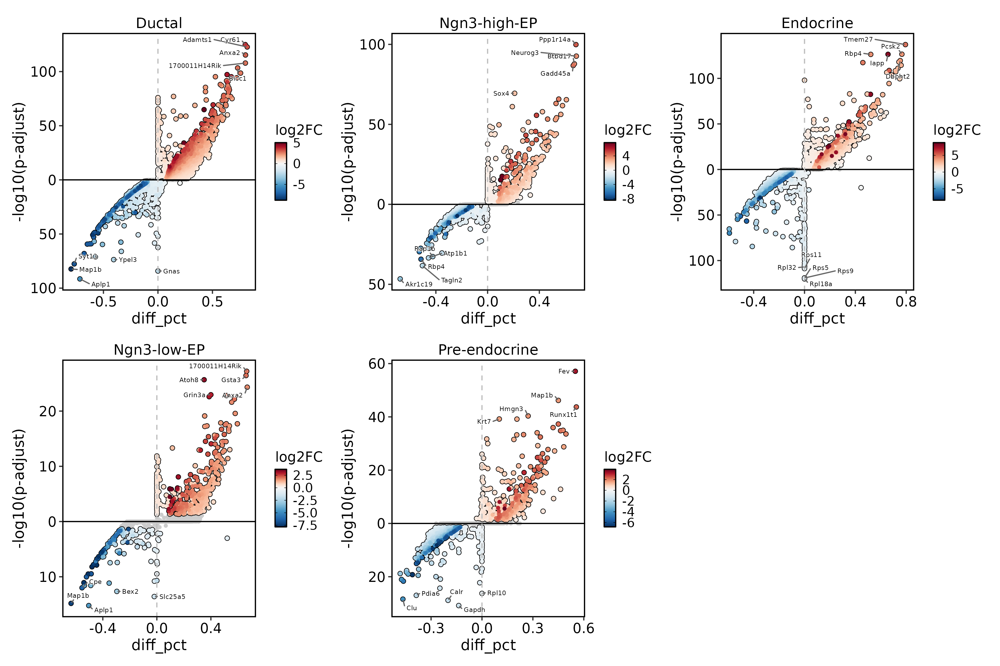
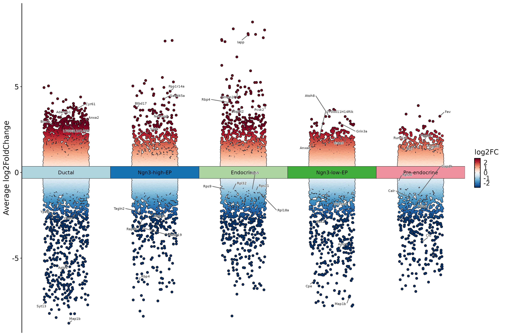
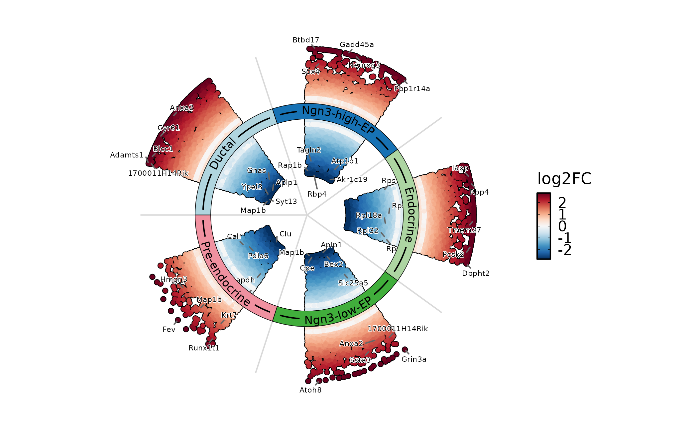
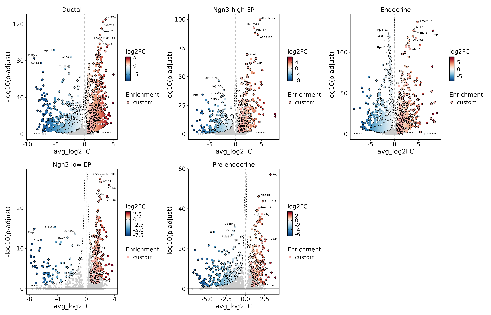
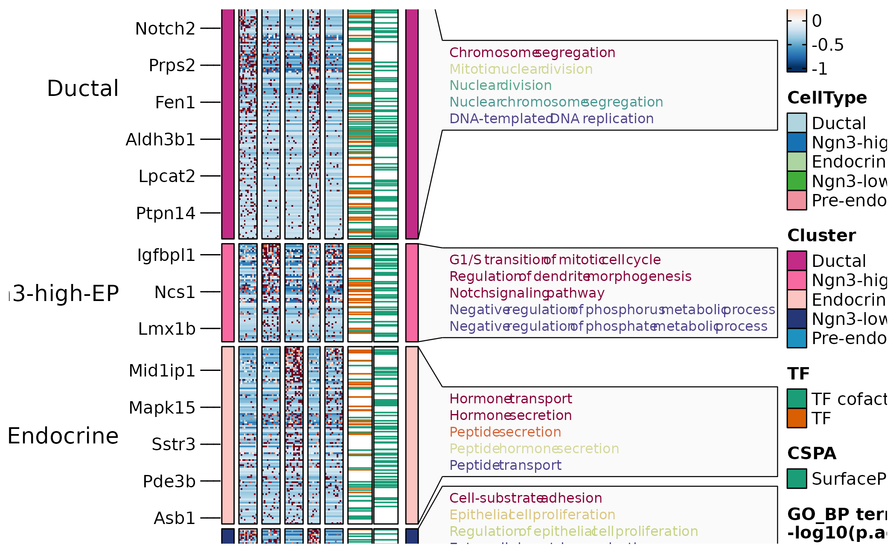
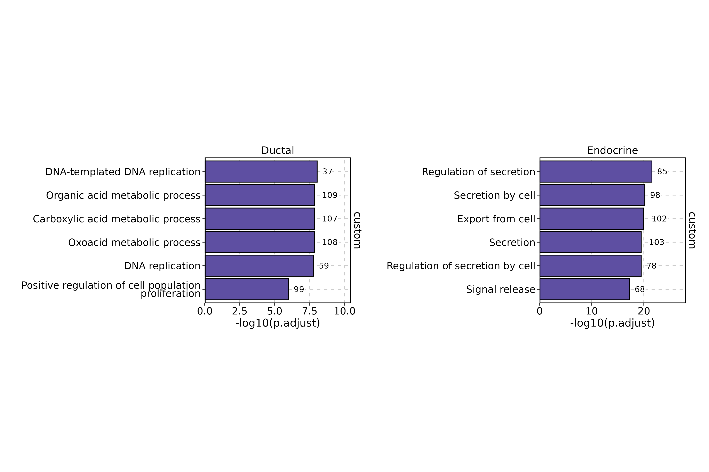
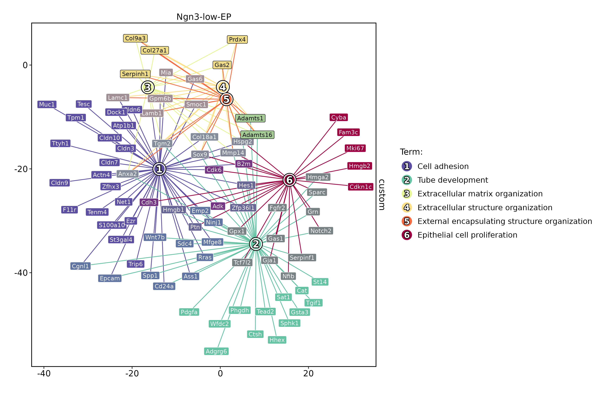
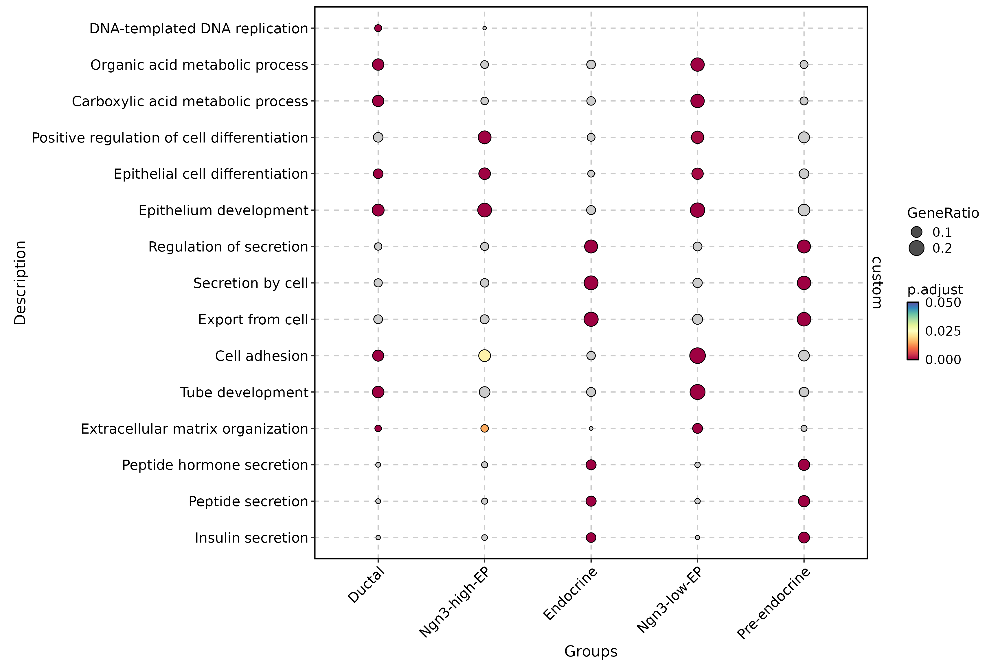
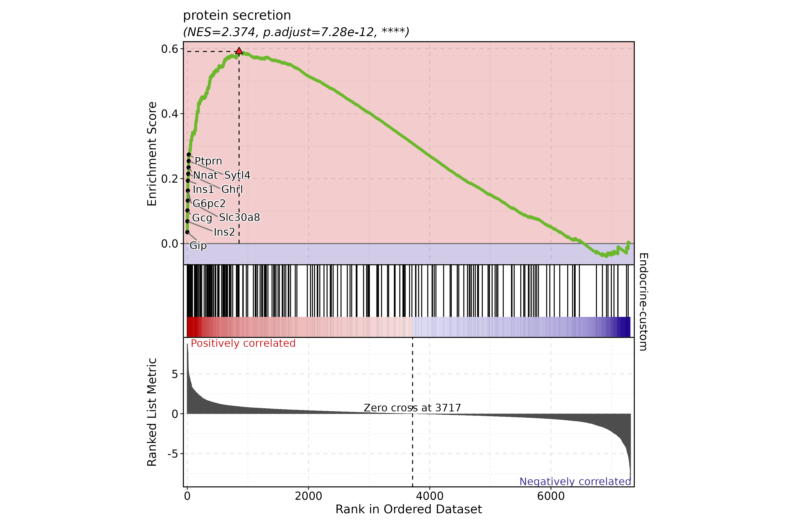
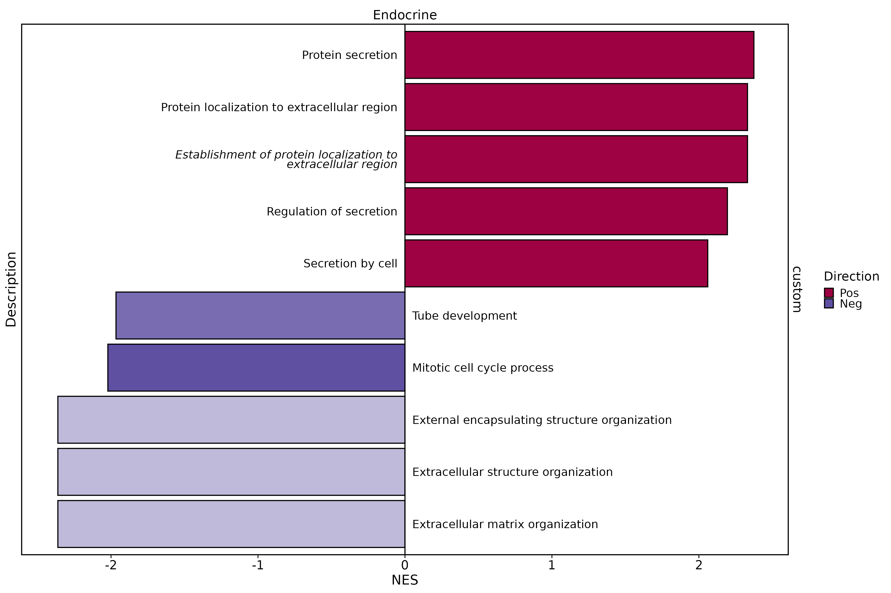

# Differential expression and enrichment workflow

## What you will do

- **Question:** which genes distinguish cell states, and which pathways
  summarize those differences?
- **Input:** All 1,000 cells in the bundled mouse pancreas object, with
  `CellType` labels. Cells are observational units for this marker
  example, not biological replicates.
- **Output:** A complete marker table, over-representation and ranked
  enrichment results, diagnostic plots and reusable tables.
- **How to run:** start a fresh R session and run the chunks in order.
  Printed tables and figures below are generated from that run;
  code-only alternatives are identified explicitly.

This article shows how to organize differential expression, marker
visualization, and pathway enrichment in `scop`. The main distinction is
between testing genes, summarizing gene sets, and interpreting enriched
biological terms.

Use this workflow after cell identities and major covariates are stable.
Differential expression is gene-level evidence. Enrichment is a summary
of a gene list or ranked statistic against a named database. Keep those
two evidence layers separate in the text of a report.

Before the first analysis chunk, install the extra packages in the same
R library as SCOP. Use BiocManager for `AnnotationDbi`, `org.Mm.eg.db`,
`GO.db` and `clusterProfiler`, and CRAN for `shadowtext` (used by the
network plot). These setup commands are run once, outside the analysis
render:

``` r

BiocManager::install(c("AnnotationDbi", "org.Mm.eg.db", "GO.db", "clusterProfiler"))
install.packages("shadowtext")
```

## Prepare the Object

``` r

library(scop)
set.seed(11)

data(pancreas_sub)
input_cells <- colnames(pancreas_sub)
pancreas_sub <- RunStandardWorkflow(pancreas_sub,
  assay = "RNA",
  seed = 11, cores = 1, verbose = FALSE
)
stopifnot(identical(colnames(pancreas_sub), input_cells))
data.frame(cells = ncol(pancreas_sub), genes = nrow(pancreas_sub))
#>   cells genes
#> 1  1000 15998

table(pancreas_sub$CellType)
#> 
#>        Ductal     Endocrine  Ngn3-high-EP   Ngn3-low-EP Pre-endocrine 
#>           253           355           169            67           156
```

## Run Differential Expression

[`RunDEtest()`](https://mengxu98.github.io/scop/reference/RunDEtest.md)
writes differential-expression tables under `srt@tools`. The default
single-cell marker workflow is appropriate for exploratory marker
finding. Use sample-aware or pseudobulk methods when biological
replicates are part of the question.

``` r

pancreas_sub <- RunDEtest(
  pancreas_sub,
  group.by = "CellType",
  fc.threshold = 1,
  only.pos = FALSE,
  assay = "RNA", layer = "data", test.use = "wilcox",
  max.cells.per.ident = Inf, min.pct = 0.1,
  p.adjust.method = "bonferroni", cores = 1, seed = 11
)

de <- pancreas_sub@tools$DEtest_CellType$AllMarkers_wilcox
stopifnot(nrow(de) > 0, all(c("gene", "group1", "avg_log2FC", "p_val_adj") %in% names(de)))
data.frame(
  rows = nrow(de), unique_genes = length(unique(de$gene)),
  contrasts = length(unique(de$group1))
)
#>    rows unique_genes contrasts
#> 1 36764         8465         5
head(de)
#>           p_val avg_log2FC pct.1 pct.2     p_val_adj          gene group1
#> 1 7.287773e-130   3.679046 0.897 0.096 1.165898e-125         Cyr61 Ductal
#> 2 1.168267e-127   3.217619 0.937 0.118 1.868994e-123       Adamts1 Ductal
#> 3 2.900413e-120   2.956891 0.976 0.173 4.640081e-116         Anxa2 Ductal
#> 4 8.561291e-113   2.733121 0.949 0.147 1.369635e-108 1700011H14Rik Ductal
#> 5 2.559824e-108   2.764483 0.960 0.229 4.095207e-104         Bicc1 Ductal
#> 6 1.495170e-103   2.646007 0.905 0.147  2.391972e-99         Gsta3 Ductal
#>   group2 test_group_number
#> 1 others                 5
#> 2 others                 5
#> 3 others                 5
#> 4 others                 5
#> 5 others                 5
#> 6 others                 5
#>                                                test_group
#> 1 Ductal;Ngn3-high-EP;Endocrine;Ngn3-low-EP;Pre-endocrine
#> 2 Ductal;Ngn3-high-EP;Endocrine;Ngn3-low-EP;Pre-endocrine
#> 3 Ductal;Ngn3-high-EP;Endocrine;Ngn3-low-EP;Pre-endocrine
#> 4 Ductal;Ngn3-high-EP;Endocrine;Ngn3-low-EP;Pre-endocrine
#> 5 Ductal;Ngn3-high-EP;Endocrine;Ngn3-low-EP;Pre-endocrine
#> 6 Ductal;Ngn3-high-EP;Endocrine;Ngn3-low-EP;Pre-endocrine
```

`fc.threshold = 1` is a fold-change ratio of one (log2 cutoff zero), not
a log2-fold-change cutoff of one. Both directions are retained, with no
cell subsampling. The detection filter is 10% in at least one group and
adjusted p-values use Bonferroni here. An adjusted p-value displayed as
zero reflects numerical underflow, not certainty.

Keep the contrast, grouping column, test method, and threshold in the
report. Those choices define the meaning of each marker table. For
`FindAllMarkers`-style results, `group1` names the group being compared
against the remaining cells unless a specific contrast is stated.

## Plot Differential Results

Use volcano, Manhattan, and ring views for different levels of detail.
Volcano plots are useful for one group or contrast; Manhattan and ring
plots are useful when scanning many groups.

In the first volcano view, the horizontal coordinate is the difference
in detected-cell fractions (`pct.1 - pct.2`), not log-fold change. The
vertical coordinate is signed significance: downregulated genes are
drawn below zero; its magnitude is `-log10(p_val_adj)`. Colour shows
log2-fold change. The enrichment-annotated volcano below instead uses
the conventional log2-fold change horizontal coordinate and unsigned
significance.

``` r

DEtestPlot(
  pancreas_sub,
  group.by = "CellType",
  plot_type = "volcano",
  label.size = 2
)
```



``` r


DEtestPlot(
  pancreas_sub,
  group.by = "CellType",
  plot_type = "manhattan",
  label.size = 2
)
```



``` r


DEtestPlot(
  pancreas_sub,
  group.by = "CellType",
  plot_type = "ring",
  label.size = 2
)
```



## Prepare a tested-gene GO background

Install the mouse annotation resources in advance (`org.Mm.eg.db`,
`GO.db` and `AnnotationDbi`), `clusterProfiler` for GSEA and
`shadowtext` for network labels. The native ORA backend does not need
clusterProfiler. This chunk reads real, locally installed GO Biological
Process annotations and records their versions. The common background
contains only genes returned by every DE comparison, before significance
filtering. This conservative shared universe avoids treating genes
excluded from the tests as eligible negative results. No database
downloads or invented pathway memberships occur during this step.

``` r

tested_by_group <- split(de$gene, de$group1)
measured_genes <- Reduce(intersect, tested_by_group)
stopifnot(length(measured_genes) > 0)
valid_symbols <- intersect(
  measured_genes,
  AnnotationDbi::keys(org.Mm.eg.db::org.Mm.eg.db, keytype = "SYMBOL")
)
go_map <- AnnotationDbi::select(org.Mm.eg.db::org.Mm.eg.db,
  keys = valid_symbols, keytype = "SYMBOL",
  columns = c("GOALL", "ONTOLOGYALL")
)
go_term2gene <- unique(go_map[
  !is.na(go_map$GOALL) & go_map$ONTOLOGYALL == "BP",
  c("GOALL", "SYMBOL")
])
colnames(go_term2gene) <- c("Term", "symbol")
go_term2name <- AnnotationDbi::select(GO.db::GO.db,
  keys = unique(go_term2gene$Term),
  keytype = "GOID", columns = "TERM"
)
go_term2name <- unique(go_term2name[stats::complete.cases(go_term2name), ])
colnames(go_term2name) <- c("Term", "Name")
go_version <- paste(
  "org.Mm.eg.db", utils::packageVersion("org.Mm.eg.db"),
  "; GO.db", utils::packageVersion("GO.db")
)
stopifnot(nrow(go_term2gene) > 0)
data.frame(
  database = "GO_BP", version = go_version,
  genes_tested_in_every_group = length(measured_genes),
  GO_annotated_background = length(unique(go_term2gene$symbol)),
  terms = length(unique(go_term2gene$Term))
)
#>   database                            version genes_tested_in_every_group
#> 1    GO_BP org.Mm.eg.db 3.23.0 ; GO.db 3.23.1                        6770
#>   GO_annotated_background terms
#> 1                    6109 11849
```

The ORA universe is the union of genes in this restricted GO mapping,
not the whole genome. Genes outside the common tested set or without GO
annotation cannot contribute. Because we supply `TERM2GENE`, SCOP stores
the database key as `custom`; its biological source remains the
versioned GO_BP mapping above. Keep that source information with the
exported result.

When enrichment results are available, volcano plots can annotate
enriched terms to connect marker genes with pathway-level
interpretation. The enrichment overlay circles genes that belong to
selected enriched terms. The legend title is the analysis layer
(`Enrichment`), and the legend item is the database, here `custom` for
the explicitly supplied GO_BP mapping.

``` r

pancreas_sub <- RunEnrichment(
  pancreas_sub,
  group.by = "CellType",
  species = "Mus_musculus",
  TERM2GENE = go_term2gene, TERM2NAME = go_term2name,
  DE_threshold = "avg_log2FC > log2(1.5) & p_val_adj < 0.05"
)

DEtestPlot(
  pancreas_sub,
  group.by = "CellType",
  plot_type = "volcano",
  threshold_method = "hyperbolic",
  hyperbola_c = 6,
  annotate_enrichment = TRUE,
  enrich_from = "Enrichment",
  enrich_db = "custom",
  enrich_top_terms = 3,
  enrich_nlabel = 5,
  label.size = 2
)
```



Only five enrichment-associated gene labels per cell group are shown to
keep the panels readable; the full marker and enrichment tables are
exported. The dashed hyperbolic guide is a display selection rule, not
an additional statistical test or the cutoff used to create the ORA
input.

## Summarize Markers in Heatmaps

Feature heatmaps are useful after markers have been filtered. Keep the
filter explicit and avoid showing very large marker sets without
grouping or splitting. The complete DE table is retained. Only the ten
strongest positive markers per group are selected for this readable
figure; this is a declared display choice, not a change to the test or
its cell population. All cells remain in the plot.

``` r

DEGs <- pancreas_sub@tools$DEtest_CellType$AllMarkers_wilcox
DEGs <- DEGs[with(DEGs, avg_log2FC > 1 & p_val_adj < 0.05), ]

display_markers <- do.call(rbind, lapply(split(DEGs, DEGs$group1), function(x) {
  head(x[order(x$avg_log2FC, decreasing = TRUE), ], 10)
}))
display_markers <- display_markers[!duplicated(display_markers$gene), ]
stopifnot(nrow(display_markers) > 0)

ht <- FeatureHeatmap(
  pancreas_sub,
  group.by = "CellType",
  features = display_markers$gene,
  feature_split = display_markers$group1,
  max_cells = Inf,
  exp_legend_title = "Z-score",
  anno_terms = FALSE
)
print(ht$plot)
```



## Run Over-Representation Analysis

[`RunEnrichment()`](https://mengxu98.github.io/scop/reference/RunEnrichment.md)
tests whether filtered marker sets are enriched for terms from the
selected database. `GO_BP` is Gene Ontology Biological Process. The
specific enriched terms are the rows shown by
[`EnrichmentPlot()`](https://mengxu98.github.io/scop/reference/EnrichmentPlot.md).

``` r

ora <- pancreas_sub@tools$Enrichment_CellType_wilcox$enrichment
head(ora)
#>           ID                                          Description GeneRatio
#> 1 GO:0006261                        DNA-templated DNA replication    37/973
#> 2 GO:0006082                       organic acid metabolic process   109/973
#> 3 GO:0019752                    carboxylic acid metabolic process   107/973
#> 4 GO:0043436                            oxoacid metabolic process   108/973
#> 5 GO:0006260                                      DNA replication    59/973
#> 6 GO:0008284 positive regulation of cell population proliferation    99/973
#>    BgRatio RichFactor FoldEnrichment   zScore       pvalue     p.adjust
#> 1  72/6109  0.5138889       3.226462 8.271120 2.435609e-12 9.187117e-09
#> 2 371/6109  0.2938005       1.844633 7.305803 1.142151e-11 1.459959e-08
#> 3 363/6109  0.2947658       1.850693 7.273391 1.442932e-11 1.459959e-08
#> 4 368/6109  0.2934783       1.842609 7.256876 1.548207e-11 1.459959e-08
#> 5 157/6109  0.3757962       2.359444 7.510573 2.188759e-11 1.651200e-08
#> 6 352/6109  0.2812500       1.765834 6.441710 1.595156e-09 1.002821e-06
#>         qvalue
#> 1 9.187117e-09
#> 2 1.459959e-08
#> 3 1.459959e-08
#> 4 1.459959e-08
#> 5 1.651200e-08
#> 6 1.002821e-06
#>                                                                                                                                                                                                                                                                                                                                                                                                                                                                                                                                                                                                                                   geneID
#> 1                                                                                                                                                                                                                                                                                                                                                                                                                           Mcm3/Lig1/Mcm6/Gmnn/Tk1/Mcm5/Cdk1/Prim1/Cdt1/Mcm4/Rfc4/Pcna/Tipin/Mcm7/Mcm2/Rrm1/Pold2/Rfc5/Rad50/Fbxo5/Timeless/Topbp1/Pole3/Dbf4/Cdk2/Rfc2/Rfc3/Pole4/Rbbp8/Parp1/Rfc1/Fgfr1/Mgme1/Pold3/Pola1/Endog/Gins4
#> 2 Hpgd/Nudt19/Psat1/Ldha/Sox9/Dbi/Phgdh/Galk1/Fmo2/Sphk1/Mif/Eno1/Gapdh/Acot1/Rbp1/Ldhb/Fabp5/Npl/Hsd17b10/Prdx4/Fads3/Tpi1/Gpx1/Vnn1/Shmt1/Akr1cl/Scd2/Ier3/Idh2/Atp1a2/Gstm2/Nr5a2/Gstp1/Spr/Yap1/Gpt2/Decr1/Aldoc/Ran/Cyb5a/Acaa2/Dhfr/Ces1d/Acsl5/Ptgr1/Acadm/Cdo1/Degs1/Suclg2/Ggt1/Mtap/Acadl/Errfi1/Mthfd1/Mgll/Fmo1/Slc4a4/Nit2/Cbs/Gsto1/Prmt3/Acot7/Gstm1/Sdsl/Aldh7a1/Bcat2/Mpc2/Acat2/Atic/Gcsh/Apoc1/Pecr/Mpst/Pter/Idh1/Fgfr1/Tnfrsf1a/Htatip2/Gnpda1/Acsl3/Oat/Echs1/Gpi1/Stard4/Elovl6/Etfb/Pgk1/Gamt/Cryl1/Fgfr4/Adipor2/Pon2/Ptgds/Ech1/Pdk1/Gstm7/Pank2/Ppat/Khk/Cyp2j6/Cs/Mecr/Cln3/Odc1/Ptges2/Aco1/Src/Elovl7/Adi1
#> 3            Hpgd/Nudt19/Psat1/Ldha/Sox9/Dbi/Phgdh/Galk1/Fmo2/Sphk1/Mif/Eno1/Gapdh/Acot1/Rbp1/Ldhb/Fabp5/Npl/Hsd17b10/Prdx4/Fads3/Tpi1/Gpx1/Vnn1/Shmt1/Akr1cl/Scd2/Ier3/Idh2/Atp1a2/Gstm2/Nr5a2/Gstp1/Spr/Yap1/Gpt2/Decr1/Aldoc/Ran/Cyb5a/Acaa2/Dhfr/Ces1d/Acsl5/Ptgr1/Acadm/Cdo1/Degs1/Suclg2/Ggt1/Mtap/Acadl/Errfi1/Mthfd1/Mgll/Fmo1/Slc4a4/Nit2/Cbs/Gsto1/Prmt3/Acot7/Gstm1/Sdsl/Aldh7a1/Bcat2/Mpc2/Acat2/Atic/Gcsh/Apoc1/Pecr/Mpst/Idh1/Tnfrsf1a/Htatip2/Gnpda1/Acsl3/Oat/Echs1/Gpi1/Stard4/Elovl6/Etfb/Pgk1/Gamt/Cryl1/Fgfr4/Adipor2/Pon2/Ptgds/Ech1/Pdk1/Gstm7/Pank2/Ppat/Khk/Cyp2j6/Cs/Mecr/Cln3/Odc1/Ptges2/Aco1/Src/Elovl7/Adi1
#> 4      Hpgd/Nudt19/Psat1/Ldha/Sox9/Dbi/Phgdh/Galk1/Fmo2/Sphk1/Mif/Eno1/Gapdh/Acot1/Rbp1/Ldhb/Fabp5/Npl/Hsd17b10/Prdx4/Fads3/Tpi1/Gpx1/Vnn1/Shmt1/Akr1cl/Scd2/Ier3/Idh2/Atp1a2/Gstm2/Nr5a2/Gstp1/Spr/Yap1/Gpt2/Decr1/Aldoc/Ran/Cyb5a/Acaa2/Dhfr/Ces1d/Acsl5/Ptgr1/Acadm/Cdo1/Degs1/Suclg2/Ggt1/Mtap/Acadl/Errfi1/Mthfd1/Mgll/Fmo1/Slc4a4/Nit2/Cbs/Gsto1/Prmt3/Acot7/Gstm1/Sdsl/Aldh7a1/Bcat2/Mpc2/Acat2/Atic/Gcsh/Apoc1/Pecr/Mpst/Idh1/Fgfr1/Tnfrsf1a/Htatip2/Gnpda1/Acsl3/Oat/Echs1/Gpi1/Stard4/Elovl6/Etfb/Pgk1/Gamt/Cryl1/Fgfr4/Adipor2/Pon2/Ptgds/Ech1/Pdk1/Gstm7/Pank2/Ppat/Khk/Cyp2j6/Cs/Mecr/Cln3/Odc1/Ptges2/Aco1/Src/Elovl7/Adi1
#> 5                                                                                                                                                                                                                                                                                                Nfib/Gins2/Mcm3/Lig1/Mcm6/Gmnn/Npm1/Tk1/Mcm5/Cdk1/Shmt1/Prim1/Tyms/Cdt1/Chaf1b/Chaf1a/Mcm4/Rfc4/Pcna/Rbbp7/Ccna2/Jun/Tipin/Mcm7/Mcm2/Rrm1/Pold2/Rpa2/Rfc5/Rad50/Fbxo5/Timeless/Topbp1/Pole3/Nfia/Dbf4/Cdk2/Rfc2/Rfc3/Pole4/Dnajc2/Fen1/Rbbp8/Rbms1/Ssrp1/Parp1/Nasp/Rfc1/Fgfr1/Grwd1/Rpa3/Mgme1/Pold3/Uchl5/Pola1/Cinp/Endog/Msh2/Gins4
#> 6                                                      Adamts1/Anxa2/Hpgd/Ccnd1/Sox9/Ptn/Vim/Hes1/Clu/Col18a1/Nrarp/Cyba/Sphk1/Mif/Hmga2/Wnt7b/Cdk6/Rps4x/Npm1/S100b/Gja1/Tgm2/Rpl23/Id2/Fgfr2/Rassf10/Cdk1/Adk/Gas6/Mycn/Gas1/Tgif1/Emp2/Ccnd2/Lifr/Cldn7/Hmgb2/Cxadr/Cdca7l/Nr5a2/Tspo/Yap1/Rrm2/Cdh3/Ccna2/Skp2/Nr4a1/Dkc1/Jun/Tcf7l2/Bex1/Epcam/Tipin/Smarcd3/Flna/Notch2/Ezh2/Hmgb1/Rara/Pdgfa/Crip2/Ccnb1/Fbxo5/Cdc20/Anp32b/Hspg2/Igfbp5/Cdk2/Shank2/Smo/Ccnd3/Igf2/Clcf1/Dnmt1/Fn1/Atf3/Tcf3/Igf1r/Erbb3/Meis1/Slc39a10/Fgfr1/Gata6/Fgfr3/Tfrc/Grn/Notch1/Fgfr4/Prkra/Fndc3b/Rela/Dab2ip/Mnat1/Pycard/Hilpda/Odc1/Saal1/Src/Nqo2
#>   Count Groups Database Version
#> 1    37 Ductal   custom  custom
#> 2   109 Ductal   custom  custom
#> 3   107 Ductal   custom  custom
#> 4   108 Ductal   custom  custom
#> 5    59 Ductal   custom  custom
#> 6    99 Ductal   custom  custom
data.frame(group = unique(ora$Groups), significant_terms = vapply(
  unique(ora$Groups), function(g) {
    sum(ora$p.adjust[ora$Groups == g] < 0.05,
      na.rm = TRUE
    )
  }, integer(1)
))
#>                       group significant_terms
#> Ductal               Ductal               363
#> Ngn3-high-EP   Ngn3-high-EP                50
#> Endocrine         Endocrine               184
#> Ngn3-low-EP     Ngn3-low-EP               287
#> Pre-endocrine Pre-endocrine               122
# Reuse the measured result above; plotting does not rerun enrichment.

EnrichmentPlot(
  pancreas_sub,
  db = "custom",
  group.by = "CellType",
  group_use = c("Ductal", "Endocrine"),
  plot_type = "bar"
)
```



Use different plot types for different questions: bar or lollipop plots
for ranked terms, word clouds for broad themes, and networks or
enrichmaps for term relationships. The exported table includes tested
terms that did not pass adjusted p \< 0.05; its row count is not a count
of significant pathways. Related GO terms often share genes, so several
similar terms are not independent biological findings.

``` r

EnrichmentPlot(
  pancreas_sub,
  db = "custom",
  group.by = "CellType",
  group_use = "Ngn3-low-EP",
  plot_type = "network"
)
```



``` r


EnrichmentPlot(
  pancreas_sub,
  db = "custom",
  group.by = "CellType",
  plot_type = "comparison",
  topTerm = 3
)
```



In the network, numbered circles refer to the GO terms in the legend;
rectangles are genes and edges are annotation membership. This is not an
inferred gene-regulatory network. Its axes are layout coordinates, not
expression or pseudotime. In the comparison plot, dot size is GeneRatio
and colour shows adjusted significance; use the exported table to
distinguish nonsignificant terms from missing results.

## Run GSEA

Use GSEA when ranked gene statistics are more appropriate than a hard
marker cutoff. ORA depends on a marker cutoff, while GSEA uses a ranked
gene list. Use GSEA when many genes shift modestly and a binary marker
threshold would discard useful signal. This run ranks all finite tested
log2-fold changes in both directions; it does not prefilter genes by
significance. Positive NES supports enrichment toward the positive end
of that group-versus-rest ranking, negative NES toward the other end.
Statistical significance and effect direction must both be read from the
real result table. GSEA performs substantial permutation work and can
take longer than DE or plotting.

GSEA uses a separate GO mapping covering the union of the tested genes.
Each group’s full ranking is retained. Reusing the ORA intersection
would remove known GO memberships from genes that remain in a group’s
ranking.

``` r

gsea_symbols <- intersect(
  unique(de$gene),
  AnnotationDbi::keys(org.Mm.eg.db::org.Mm.eg.db, keytype = "SYMBOL")
)
gsea_map <- AnnotationDbi::select(org.Mm.eg.db::org.Mm.eg.db,
  keys = gsea_symbols, keytype = "SYMBOL",
  columns = c("GOALL", "ONTOLOGYALL")
)
gsea_term2gene <- unique(gsea_map[
  !is.na(gsea_map$GOALL) & gsea_map$ONTOLOGYALL == "BP",
  c("GOALL", "SYMBOL")
])
colnames(gsea_term2gene) <- c("Term", "symbol")
gsea_term2name <- AnnotationDbi::select(GO.db::GO.db,
  keys = unique(gsea_term2gene$Term), keytype = "GOID", columns = "TERM"
)
gsea_term2name <- unique(gsea_term2name[stats::complete.cases(gsea_term2name), ])
colnames(gsea_term2name) <- c("Term", "Name")
stopifnot(all(go_term2gene$symbol %in% gsea_term2gene$symbol))
pancreas_sub <- RunGSEA(
  pancreas_sub,
  group.by = "CellType",
  species = "Mus_musculus",
  TERM2GENE = gsea_term2gene, TERM2NAME = gsea_term2name,
  DE_threshold = "is.finite(avg_log2FC)",
  nPermSimple = 10000,
  eps = 0
)

gsea_endocrine <- subset(
  pancreas_sub@tools$GSEA_CellType_wilcox$enrichment,
  Groups == "Endocrine" & Database == "custom"
)
gsea_id <- gsea_endocrine$ID[which.min(gsea_endocrine$p.adjust)]
print(head(gsea_endocrine[
  order(gsea_endocrine$p.adjust),
  c("ID", "Description", "NES", "p.adjust")
], 5))
#>              ID                                                   Description
#> 8228 GO:0009306                                             protein secretion
#> 8229 GO:0051046                                       regulation of secretion
#> 8230 GO:0035592 establishment of protein localization to extracellular region
#> 8231 GO:0071692                  protein localization to extracellular region
#> 8232 GO:0032940                                             secretion by cell
#>           NES     p.adjust
#> 8228 2.374474 7.275006e-12
#> 8229 2.194113 7.275006e-12
#> 8230 2.330899 7.531970e-12
#> 8231 2.330899 7.531970e-12
#> 8232 2.060459 7.531970e-12

print(GSEAPlot(
  pancreas_sub,
  db = "custom",
  group.by = "CellType",
  group_use = "Endocrine",
  id_use = gsea_id
))
```



``` r


print(GSEAPlot(
  pancreas_sub,
  db = "custom",
  group.by = "CellType",
  group_use = "Endocrine",
  plot_type = "bar",
  direction = "both",
  topTerm = 10
))
#> Warning: `guide_colourbar()` cannot be used for alpha.
#> ℹ Use one of colour, color, or fill instead.
```



In the running-score plot, black ticks locate gene-set members in the
ranked gene list; the green curve is the cumulative enrichment score.
The lower panel is the log2-fold-change ranking statistic. The
horizontal coordinate is a gene rank, not cell order or developmental
time. Read the signed NES and adjusted p-value together with the term’s
contributing genes.

## Save, reload, and check the hand-off

The code below saves to a temporary directory. Choose a persistent
output folder when saving your analysis. Save the object **and**
plain-text metadata; a figure alone cannot reproduce the analysis. No
cells are sampled for this export.

``` r

output_dir <- file.path(tempdir(), "differential-enrichment-workflow")
dir.create(output_dir, recursive = TRUE, showWarnings = FALSE)
result_file <- file.path(output_dir, "analysis.rds")
saveRDS(pancreas_sub, result_file)
utils::write.csv(de, file.path(output_dir, "all-markers.csv"), row.names = FALSE)
utils::write.csv(go_term2gene, file.path(output_dir, "GO-BP-measured-background.csv"), row.names = FALSE)
utils::write.csv(gsea_term2gene, file.path(output_dir, "GO-BP-GSEA-memberships.csv"), row.names = FALSE)
writeLines(paste("GO_BP", go_version), file.path(output_dir, "GO-source.txt"))
utils::write.csv(pancreas_sub@tools$Enrichment_CellType_wilcox$enrichment,
  file.path(output_dir, "ORA.csv"),
  row.names = FALSE
)
utils::write.csv(pancreas_sub@tools$GSEA_CellType_wilcox$enrichment,
  file.path(output_dir, "GSEA.csv"),
  row.names = FALSE
)
utils::write.csv(pancreas_sub@meta.data, file.path(output_dir, "cell-metadata.csv"))
reloaded <- readRDS(result_file)
stopifnot(
  identical(colnames(reloaded), colnames(pancreas_sub)),
  identical(reloaded@meta.data, pancreas_sub@meta.data),
  identical(
    SeuratObject::Reductions(reloaded),
    SeuratObject::Reductions(pancreas_sub)
  ),
  identical(
    GetAssayData5(reloaded, assay = "RNA", layer = "counts"),
    GetAssayData5(pancreas_sub, assay = "RNA", layer = "counts")
  )
)
stopifnot(
  identical(reloaded@tools$DEtest_CellType$AllMarkers_wilcox, de),
  identical(
    reloaded@tools$Enrichment_CellType_wilcox$enrichment,
    pancreas_sub@tools$Enrichment_CellType_wilcox$enrichment
  ),
  identical(
    reloaded@tools$GSEA_CellType_wilcox$enrichment,
    pancreas_sub@tools$GSEA_CellType_wilcox$enrichment
  )
)
data.frame(
  file = basename(list.files(output_dir, full.names = TRUE)),
  bytes = file.info(list.files(output_dir, full.names = TRUE))$size
)
#>                            file    bytes
#> 1               all-markers.csv  5268635
#> 2                  analysis.rds 50901269
#> 3             cell-metadata.csv   146525
#> 4    GO-BP-GSEA-memberships.csv 12612015
#> 5 GO-BP-measured-background.csv 10159062
#> 6                 GO-source.txt       41
#> 7                      GSEA.csv  6702982
#> 8                       ORA.csv  3986172
```

## Use your own data and recover common errors

- Replace the `data(...)` input with `readRDS("your-object.rds")`, or
  create a Seurat object from a gene-by-cell raw-count matrix. Check
  that cell IDs are unique and metadata row names equal the expression
  column names.
- Set the assay and grouping columns explicitly. Species, gene
  identifiers and reference labels must match your experiment; do not
  copy pancreas labels to unrelated tissue.
- If a reduction or metadata column is missing, inspect
  `SeuratObject::Reductions(object)` and `colnames(object@meta.data)`,
  then run its producer chunk. A plot does not create the result it
  needs.
- If GO returns no terms, inspect gene identifiers, overlap, set-size
  filters and the actual adjusted p-values. Do not loosen thresholds
  merely to force a positive result. A valid empty result and an
  unavailable database are different.
- If a dependency is unavailable, install it in the analysis
  environment, restart R and rerun from the input chunk. A skipped or
  failed method is not evidence that it worked. Preserve warnings and
  the exact error in your report.

## Analysis provenance

The receipt records the R seed. Python methods retain their documented
backend seeds and parameters; setting the R seed alone does not control
every backend. Package versions, BLAS libraries and backend changes can
alter numerical results. Keep this receipt with the exported object.

``` r

source_revision <- Sys.getenv("GITHUB_SHA")
if (!nzchar(source_revision) && nzchar(Sys.which("git"))) {
  source_revision <- tryCatch(system2("git", c("rev-parse", "HEAD"),
    stdout = TRUE,
    stderr = FALSE
  )[1], error = function(e) NA_character_)
}
article_source <- knitr::current_input(dir = TRUE)
build_receipt <- data.frame(
  article = "differential-enrichment-workflow",
  built_utc = format(Sys.time(), tz = "UTC", usetz = TRUE),
  scop = as.character(utils::packageVersion("scop")),
  R = as.character(getRversion()),
  source_revision = source_revision,
  source_has_local_changes = if (nzchar(Sys.which("git"))) {
    length(system2("git", c("status", "--porcelain"), stdout = TRUE, stderr = FALSE)) > 0
  } else {
    NA
  },
  article_md5 = unname(tools::md5sum(article_source)),
  R_seed = 11,
  cells_retained = ncol(pancreas_sub),
  genes_in_active_assay = nrow(pancreas_sub),
  stringsAsFactors = FALSE
)
build_receipt
#>                            article               built_utc  scop     R
#> 1 differential-enrichment-workflow 2026-10-31 18:55:54 UTC 0.9.2 4.6.2
#>                            source_revision source_has_local_changes
#> 1 2f44f8c52c247c5a5b42a8a2cb3a7c9800ae24cb                    FALSE
#>                        article_md5 R_seed cells_retained genes_in_active_assay
#> 1 1c730bbafc9f5f0c6783a90f73de724d     11           1000                 15998
utils::write.csv(build_receipt, file.path(output_dir, "build-receipt.csv"),
  row.names = FALSE
)
writeLines(capture.output(sessionInfo()), file.path(output_dir, "session-info.txt"))
```

Show the complete R session used for this page

``` r

sessionInfo()
#> R version 4.6.2 (2026-10-29)
#> Platform: x86_64-pc-linux-gnu
#> Running under: Ubuntu 24.04.5 LTS
#> 
#> Matrix products: default
#> BLAS:   /usr/lib/x86_64-linux-gnu/openblas-pthread/libblas.so.3 
#> LAPACK: /usr/lib/x86_64-linux-gnu/openblas-pthread/libopenblasp-r0.3.26.so;  LAPACK version 3.12.0
#> 
#> locale:
#>  [1] LC_CTYPE=C.UTF-8       LC_NUMERIC=C           LC_TIME=C.UTF-8       
#>  [4] LC_COLLATE=C.UTF-8     LC_MONETARY=C.UTF-8    LC_MESSAGES=C.UTF-8   
#>  [7] LC_PAPER=C.UTF-8       LC_NAME=C              LC_ADDRESS=C          
#> [10] LC_TELEPHONE=C         LC_MEASUREMENT=C.UTF-8 LC_IDENTIFICATION=C   
#> 
#> time zone: UTC
#> tzcode source: system (glibc)
#> 
#> attached base packages:
#> [1] stats     graphics  grDevices utils     datasets  methods   base     
#> 
#> other attached packages:
#> [1] scop_0.9.2
#> 
#> loaded via a namespace (and not attached):
#>   [1] fs_2.1.0                matrixStats_1.5.0       spatstat.sparse_3.2-0  
#>   [4] enrichplot_1.32.1       httr_1.4.9              RColorBrewer_1.1-3     
#>   [7] doParallel_1.0.17       tools_4.6.2             sctransform_0.4.3      
#>  [10] R6_2.6.1                lazyeval_0.2.3          uwot_0.2.5             
#>  [13] GetoptLong_1.1.1        withr_3.0.3             sp_2.2-4               
#>  [16] gridExtra_2.3.1         progressr_1.1.0         cli_3.6.6              
#>  [19] Biobase_2.72.0          textshaping_1.0.5       Cairo_1.7-0            
#>  [22] spatstat.explore_3.8-3  fastDummies_1.7.6       scatterpie_0.2.6       
#>  [25] labeling_0.4.3          sass_0.4.10             Seurat_5.6.0           
#>  [28] S7_0.2.2                spatstat.data_3.1-9     ggridges_0.5.7         
#>  [31] pbapply_1.7-5           pkgdown_2.2.1           systemfonts_1.3.2      
#>  [34] yulab.utils_0.2.5       gson_0.2.2              DOSE_4.6.0             
#>  [37] dichromat_2.0-1         parallelly_1.48.0       RSQLite_3.53.3         
#>  [40] generics_0.1.4          gridGraphics_0.5-1      shape_1.4.6.1          
#>  [43] ica_1.0-3               spatstat.random_3.5-2   dplyr_1.2.1            
#>  [46] GO.db_3.23.1            Matrix_1.7-6            S4Vectors_0.50.3       
#>  [49] abind_1.4-8             lifecycle_1.0.5         yaml_2.3.12            
#>  [52] qvalue_2.44.0           Rtsne_0.17              grid_4.6.2             
#>  [55] blob_1.3.0              thisplot_0.4.6          promises_1.5.0         
#>  [58] crayon_1.5.3            miniUI_0.1.2            ggtangle_0.1.4         
#>  [61] lattice_0.23-1          cowplot_1.2.0           KEGGREST_1.52.2        
#>  [64] magick_2.9.1            pillar_1.11.1           knitr_1.52             
#>  [67] ComplexHeatmap_2.28.0   fgsea_1.38.0            rjson_0.2.23           
#>  [70] future.apply_1.21.0     codetools_0.2-20        fastmatch_1.1-8        
#>  [73] glue_1.8.1              ggiraph_0.9.6           ggfun_0.2.2            
#>  [76] spatstat.univar_3.2-0   fontLiberation_0.1.0    data.table_1.18.6.1    
#>  [79] vctrs_0.7.3             png_0.1-9               treeio_1.36.1          
#>  [82] spam_2.11-4             org.Mm.eg.db_3.23.0     gtable_0.3.6           
#>  [85] cachem_1.1.0            xfun_0.62               mime_0.13              
#>  [88] Seqinfo_1.2.0           survival_3.8-12         aisdk_1.4.12           
#>  [91] iterators_1.0.14        thisutils_0.5.3         fitdistrplus_1.2-6     
#>  [94] ROCR_1.0-12             nlme_3.1-171            ggtree_4.2.1           
#>  [97] bit64_4.8.6             fontquiver_0.2.1        RcppAnnoy_0.0.23       
#> [100] bslib_0.12.0            irlba_2.4.1             KernSmooth_2.23-27     
#> [103] otel_0.2.0              colorspace_2.1-4        BiocGenerics_0.58.1    
#> [106] DBI_1.3.0               tidyselect_1.2.1        processx_3.9.0         
#> [109] proxyC_0.6.0            bit_4.6.0               compiler_4.6.2         
#> [112] geomtextpath_0.2.0      httr2_1.3.0             desc_1.4.3             
#> [115] fontBitstreamVera_0.1.1 plotly_4.12.1           shadowtext_0.1.6       
#> [118] scales_1.4.0            lmtest_0.9-40           callr_3.8.0            
#> [121] rappdirs_0.3.4          stringr_1.6.0           digest_0.6.39          
#> [124] goftest_1.2-3           spatstat.utils_3.2-5    presto_1.1.0           
#> [127] rmarkdown_2.32          XVector_0.52.0          htmltools_0.5.9        
#> [130] pkgconfig_2.0.3         fastmap_1.2.0           rlang_1.3.0            
#> [133] GlobalOptions_0.1.4     htmlwidgets_1.6.4       shiny_1.14.0           
#> [136] farver_2.1.2            jquerylib_0.1.4         zoo_1.9-1              
#> [139] jsonlite_2.0.0          BiocParallel_1.46.0     GOSemSim_2.38.3        
#> [142] magrittr_2.0.5          ggplotify_0.1.4         dotCall64_1.2          
#> [145] patchwork_1.3.2         Rcpp_1.1.2              ape_5.8-1              
#> [148] ggnewscale_0.5.2        gdtools_0.5.2           reticulate_1.47.0      
#> [151] stringi_1.8.9           MASS_7.3-66             plyr_1.8.9             
#> [154] parallel_4.6.2          listenv_1.1.0           ggrepel_0.9.8          
#> [157] deldir_2.0-4            Biostrings_2.80.2       splines_4.6.2          
#> [160] tensor_1.5.1            circlize_0.4.18         ps_1.9.3               
#> [163] igraph_2.3.4            spatstat.geom_3.8-3     enrichit_0.2.7         
#> [166] RcppHNSW_0.7.0          reshape2_1.4.5          stats4_4.6.2           
#> [169] evaluate_1.0.5          SeuratObject_5.4.0      foreach_1.5.2          
#> [172] tweenr_2.0.3            httpuv_1.6.17           RANN_2.6.3             
#> [175] tidyr_1.3.2             purrr_1.2.2             polyclip_1.10-7        
#> [178] future_1.80.0           clue_0.3-68             scattermore_1.2        
#> [181] ggplot2_4.0.3           ggforce_0.5.0           xtable_1.8-8           
#> [184] RSpectra_0.16-2         tidytree_0.4.8          tidydr_0.0.7           
#> [187] later_1.4.8             viridisLite_0.4.3       ragg_1.5.2             
#> [190] tibble_3.3.1            clusterProfiler_4.20.3  aplot_0.3.2            
#> [193] memoise_2.0.1           AnnotationDbi_1.74.0    IRanges_2.46.0         
#> [196] cluster_2.1.8.3         globals_0.20.0
```

## What to Report

A compact differential and enrichment report should include:

- the grouping column, contrast, and DE method;
- whether the test is single-cell marker detection, sample-level
  pseudobulk, or bulk-style differential testing;
- thresholds for log fold change, adjusted p value, and marker
  filtering;
- the gene-set database, species, and enrichment method;
- the exact `srt@tools` result names used for downstream plots;
- pathway interpretations separated from the gene-level DE evidence.

Use enrichment to summarize marker lists or ranked statistics. Do not
treat an enriched term as proof that every gene in the pathway changes
coherently.
