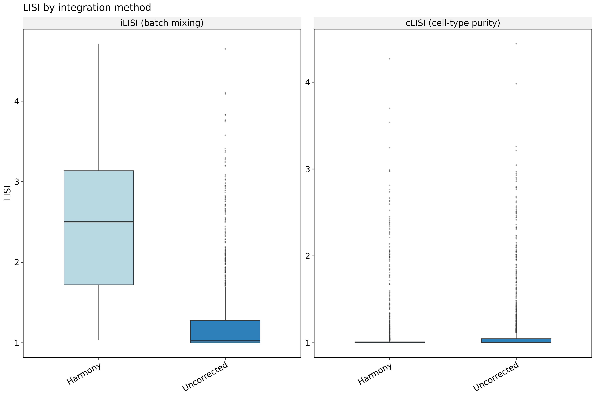
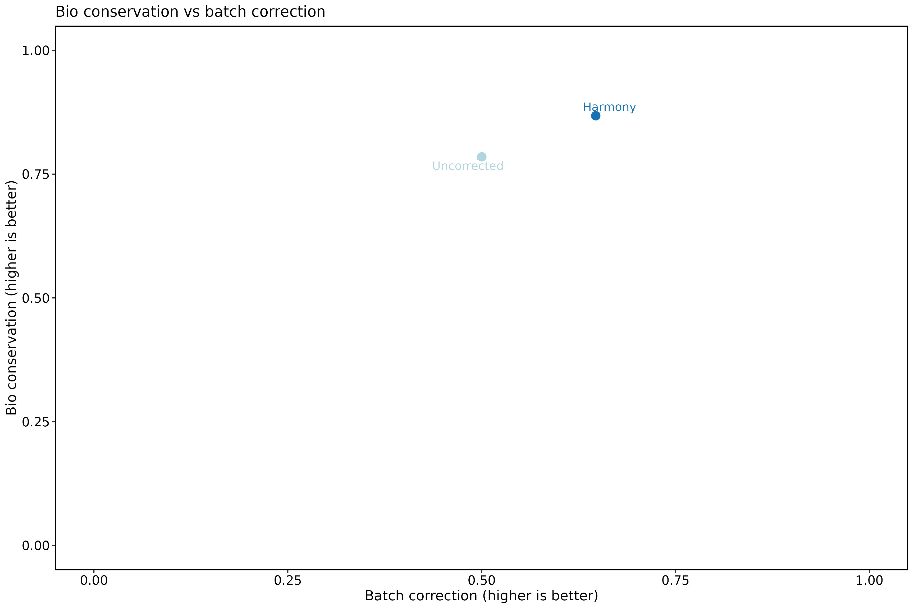
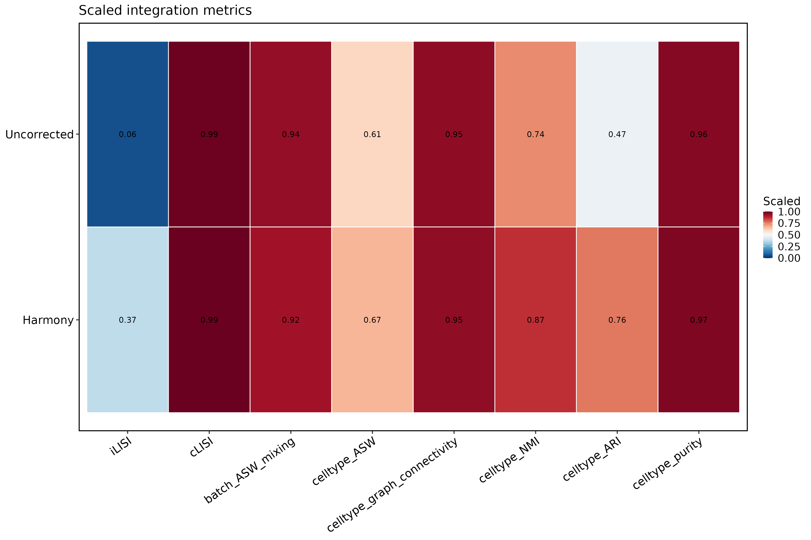
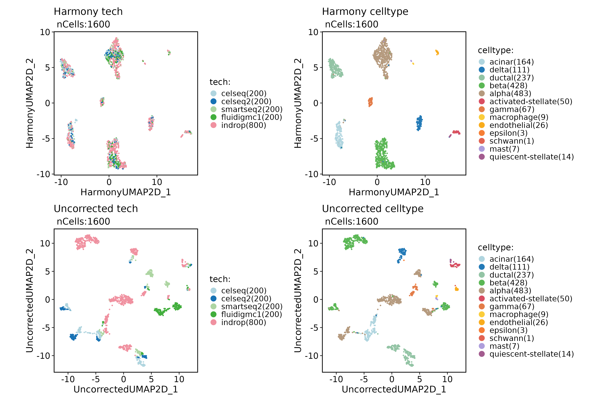

# Integration benchmark workflow

## What you will do

- **Question:** which method balances batch mixing and biological
  preservation on these cells?
- **Input:** All 1,600 cells in `panc8_sub`, with `tech` for batch and
  `celltype` for biological evaluation.
- **Output:** Per-method run status, latent-space metrics, summary plots
  and exported score tables.
- **How to run:** start a fresh R session and run the chunks in order.
  Printed tables and figures below are generated from that run;
  code-only alternatives are identified explicitly.

This article compares batch-correction methods on the same scRNA-seq
object with \[RunIntegrationBenchmark()\]. The runner scores each
**latent** embedding (not UMAP) with scIB-style metrics, stores tables
in `srt@tools$IntegrationBenchmark`, and returns the Seurat object for
plotting with \[IntegrationBenchmarkPlot()\].

Use this workflow when you need a reproducible side-by-side report for
`Uncorrected`, `Harmony`, `fastMNN`, or other \[RunIntegration()\]
methods on the same input.

## Prepare the required Harmony source

SCOP’s
[`RunHarmony2()`](https://mengxu98.github.io/scop/reference/RunHarmony2.md)
checks the official GitHub package origin. A CRAN installation with the
same package name does not satisfy that check and can trigger an
installation attempt in the middle of an analysis. Install the official
GitHub source before starting this page, then restart R:

``` r

remotes::install_github(
  "immunogenomics/harmony",
  upgrade = "never"
)
```

The tutorial’s dependency preflight is read-only. It fails with a clear
setup requirement instead of allowing an implicit installation during
fitting.

## Load data

``` r

library(scop)
set.seed(11)
harmony_source <- utils::packageDescription("harmony")
stopifnot(identical(harmony_source$RemoteUsername, "immunogenomics"),
          identical(harmony_source$RemoteRepo, "harmony"))
data.frame(package = "harmony", version = harmony_source$Version,
           source = paste(harmony_source$RemoteUsername, harmony_source$RemoteRepo, sep = "/"),
           revision = harmony_source$RemoteSha)
#>   package version                 source
#> 1 harmony   2.1.0 immunogenomics/harmony
#>                                   revision
#> 1 7e21bd6629b628099735395f57a47d11f873b2ee

data(panc8_sub)
table(panc8_sub$tech)
#> 
#>     celseq    celseq2 fluidigmc1     indrop  smartseq2 
#>        200        200        200        800        200
table(panc8_sub$celltype)
#> 
#>             acinar activated-stellate              alpha               beta 
#>                164                 50                483                428 
#>              delta             ductal        endothelial            epsilon 
#>                111                237                 26                  3 
#>              gamma         macrophage               mast quiescent-stellate 
#>                 67                  9                  7                 14 
#>            schwann 
#>                  1
```

## Run the benchmark

Keep the batch column (`tech`) and a biological label column
(`celltype`) fixed across methods. LISI and clustering metrics are
computed on each method’s latent reduction (for example `Harmony` or
`Uncorrectedpca`).

``` r

panc8_sub <- RunIntegrationBenchmark(
  panc8_sub,
  batch = "tech",
  celltype = "celltype",
  methods = c("Uncorrected", "Harmony"),
  nHVF = 2000,
  linear_reduction_dims = 30,
  linear_reduction_dims_use = 1:30,
  perplexity = 30,
  skip_failed = FALSE,
  nonlinear_reduction_dims = 2, seed = 11,
  verbose = FALSE
)
#> Warning: Data 1/5 of the `srt_list` is "unknown"
#> Warning: Data 2/5 of the `srt_list` is "unknown"
#> Warning: Data 3/5 of the `srt_list` is "unknown"
#> Warning: Data 4/5 of the `srt_list` is "unknown"
#> Warning: Data 5/5 of the `srt_list` is "unknown"
#> Warning: No layers found matching search pattern provided
#> Warning: Layer 'scale.data' is empty
#> Warning: No layers found matching search pattern provided
#> Warning: Layer 'scale.data' is empty
```

The 2,000 variable genes and 30 latent dimensions define the shared
model input and scoring space. All cells are retained for integration,
LISI and graph connectivity. The ASW metrics use a stratified sample of
at most 800 cells. `skip_failed = FALSE` stops this two-method
comparison if either method fails, so one successful method cannot be
mistaken for a complete comparison.

## Print summary tables

Use
[`thisplot::print_colored_table()`](https://mengxu98.github.io/thisplot/reference/print_colored_table.html)
on the stored tables. The summary view shows scaled overall, bio, and
batch scores; the metrics view lists every metric per method.

``` r

bench <- panc8_sub@tools$IntegrationBenchmark
bench$runs
#>        method  status error runtime_s         latent              umap
#> 1 Uncorrected success          14.225 Uncorrectedpca UncorrectedUMAP2D
#> 2     Harmony success           9.817        Harmony     HarmonyUMAP2D
stopifnot(all(bench$runs$status == "success"))

thisplot::print_colored_table(
  bench$summary,
  by = "row",
  palette = "Chinese"
)
#> method       status   overall    bio        batch      iLISI       cLISI      celltype_ASW  batch_ASW_mixing  celltype_graph_connectivity  celltype_ARI  celltype_NMI  runtime_s  latent          umap             
#> Uncorrected  success  0.6711161  0.7850665  0.5001905  0.05974077  0.9906647  0.6055206     0.9406402         0.9464146                    0.4699072     0.7378917     14.225     Uncorrectedpca  UncorrectedUMAP2D
#> Harmony      success  0.7792839  0.8673961  0.6471157  0.37244914  0.9939972  0.6688506     0.9217823         0.9457216                    0.7628313     0.8654756     9.817      Harmony         HarmonyUMAP2D    

metrics <- bench$metrics
metrics <- metrics[
  !grepl("_LISI_mean$", metrics$metric), ,
  drop = FALSE
]
thisplot::print_colored_table(
  metrics,
  by = "col",
  palette = "Paired"
)
#> metric                       category  value      scaled      direction  method     
#> batch_ASW_mixing             batch     0.9406402  0.94064019  higher     Uncorrected
#> celltype_ASW                 bio       0.2110412  0.60552059  higher     Uncorrected
#> celltype_graph_connectivity  bio       0.9464146  0.94641456  higher     Uncorrected
#> celltype_NMI                 bio       0.7378917  0.73789171  higher     Uncorrected
#> celltype_ARI                 bio       0.4699072  0.46990724  higher     Uncorrected
#> celltype_purity              bio       0.9600000  0.96000000  higher     Uncorrected
#> iLISI                        batch     1.2389631  0.05974077  higher     Uncorrected
#> cLISI                        bio       1.1120233  0.99066473  higher     Uncorrected
#> batch_ASW_mixing             batch     0.9217823  0.92178231  higher     Harmony    
#> celltype_ASW                 bio       0.3377013  0.66885063  higher     Harmony    
#> celltype_graph_connectivity  bio       0.9457216  0.94572156  higher     Harmony    
#> celltype_NMI                 bio       0.8654756  0.86547564  higher     Harmony    
#> celltype_ARI                 bio       0.7628313  0.76283130  higher     Harmony    
#> celltype_purity              bio       0.9675000  0.96750000  higher     Harmony    
#> iLISI                        batch     2.4897966  0.37244914  higher     Harmony    
#> cLISI                        bio       1.0720339  0.99399717  higher     Harmony    
```

## Read the scores without overclaiming

Read the `value` and `scaled` columns separately. Raw iLISI increases
when neighborhoods contain more batches; raw cLISI is closest to 1 when
a neighborhood retains a single cell type. The scaled cLISI score
reverses that direction so larger scaled values represent better label
preservation. The printed `direction` field refers to the scaled score,
not raw cLISI.

The biological summary combines label separation, connectivity and
clustering agreement. The batch summary combines mixing measures. The
overall score uses 60% biological and 40% batch weight by default; it is
a chosen trade-off, not a probability of success. Inspect every metric
and the label-by-batch balance before preferring a method. A high batch
score can accompany overcorrection, and labels unique to one technology
cannot be made to mix legitimately.

Missing metrics remain missing rather than becoming a successful result.
This small bundled study subset illustrates comparison on the same
cells; it does not establish a universal ranking of integration methods.
To adapt the benchmark, keep input cells, feature selection, dimensions
and evaluation labels fixed, then report the same raw tables and run
statuses for each method.

## Plot all views

[`IntegrationBenchmarkPlot()`](https://mengxu98.github.io/scop/reference/IntegrationBenchmarkPlot.md)
with `plot_type = "auto"` returns a named list: `box` (per-cell LISI),
`heatmap`, `scatter`, and `umap`.

``` r

plots <- IntegrationBenchmarkPlot(panc8_sub, verbose = FALSE)
names(plots)
#> [1] "box"     "heatmap" "scatter" "umap"
plots$box
```



``` r

plots$scatter
```



``` r

plots$heatmap
```



``` r

plots$umap
```



Individual plot types are also available:

``` r

IntegrationBenchmarkPlot(panc8_sub, plot_type = "box")
IntegrationBenchmarkPlot(panc8_sub, plot_type = "umap")
```

## Save, reload, and check the hand-off

The code below saves to a temporary directory. Choose a persistent
output folder when saving your analysis. Save the object **and**
plain-text metadata; a figure alone cannot reproduce the analysis. No
cells are sampled for this export.

``` r

output_dir <- file.path(tempdir(), "integration-benchmark-workflow")
dir.create(output_dir, recursive = TRUE, showWarnings = FALSE)
result_file <- file.path(output_dir, "analysis.rds")
saveRDS(panc8_sub, result_file)
utils::write.csv(bench$summary, file.path(output_dir, "benchmark-summary.csv"), row.names = FALSE)
utils::write.csv(bench$metrics, file.path(output_dir, "benchmark-metrics.csv"), row.names = FALSE)
utils::write.csv(bench$runs, file.path(output_dir, "benchmark-runs.csv"), row.names = FALSE)
utils::write.csv(panc8_sub@meta.data, file.path(output_dir, "cell-metadata.csv"))
reloaded <- readRDS(result_file)
stopifnot(identical(colnames(reloaded), colnames(panc8_sub)),
          identical(reloaded@meta.data, panc8_sub@meta.data),
          identical(SeuratObject::Reductions(reloaded),
                    SeuratObject::Reductions(panc8_sub)))
data.frame(file = basename(list.files(output_dir, full.names = TRUE)),
           bytes = file.info(list.files(output_dir, full.names = TRUE))$size)
#>                    file    bytes
#> 1          analysis.rds 47321150
#> 2 benchmark-metrics.csv     1599
#> 3    benchmark-runs.csv      180
#> 4 benchmark-summary.csv      656
#> 5     cell-metadata.csv   274198
```

## Use your own data and recover common errors

- Replace the `data(...)` input with `readRDS("your-object.rds")`, or
  create a Seurat object from a gene-by-cell raw-count matrix. Check
  that cell IDs are unique and metadata row names equal the expression
  column names.
- Set the assay and grouping columns explicitly. Species, gene
  identifiers and reference labels must match your experiment; do not
  copy pancreas labels to unrelated tissue.
- If a reduction or metadata column is missing, inspect
  `SeuratObject::Reductions(object)` and `colnames(object@meta.data)`,
  then run its producer chunk. A plot does not create the result it
  needs.
- If a dependency is unavailable, install it in the analysis
  environment, restart R and rerun from the input chunk. A skipped or
  failed method is not evidence that it worked. Preserve warnings and
  the exact error in your report.

## Analysis provenance

The receipt records the R seed. Python methods retain their documented
backend seeds and parameters; setting the R seed alone does not control
every backend. Package versions, BLAS libraries and backend changes can
alter numerical results. Keep this receipt with the exported object.

``` r

source_revision <- Sys.getenv("GITHUB_SHA")
if (!nzchar(source_revision) && nzchar(Sys.which("git"))) {
  source_revision <- tryCatch(system2("git", c("rev-parse", "HEAD"), stdout = TRUE,
                                      stderr = FALSE)[1], error = function(e) NA_character_)
}
article_source <- knitr::current_input(dir = TRUE)
build_receipt <- data.frame(
  article = "integration-benchmark-workflow",
  built_utc = format(Sys.time(), tz = "UTC", usetz = TRUE),
  scop = as.character(utils::packageVersion("scop")),
  R = as.character(getRversion()),
  source_revision = source_revision,
  source_has_local_changes = if (nzchar(Sys.which("git")))
    length(system2("git", c("status", "--porcelain"), stdout = TRUE, stderr = FALSE)) > 0 else NA,
  article_md5 = unname(tools::md5sum(article_source)),
  R_seed = 11,
  cells_retained = ncol(panc8_sub),
  genes_in_active_assay = nrow(panc8_sub),
  stringsAsFactors = FALSE
)
build_receipt
#>                          article               built_utc  scop     R
#> 1 integration-benchmark-workflow 2026-10-24 18:10:03 UTC 0.9.2 4.6.1
#>                            source_revision source_has_local_changes
#> 1 e445500810bc982823927fdb936188657af45d7e                    FALSE
#>                        article_md5 R_seed cells_retained genes_in_active_assay
#> 1 f2f45fb67d048437950510c17f53f818     11           1600                 12932
utils::write.csv(build_receipt, file.path(output_dir, "build-receipt.csv"),
                 row.names = FALSE)
writeLines(capture.output(sessionInfo()), file.path(output_dir, "session-info.txt"))
```

Show the complete R session used for this page

``` r

sessionInfo()
#> R version 4.6.1 (2026-06-24)
#> Platform: x86_64-pc-linux-gnu
#> Running under: Ubuntu 24.04.5 LTS
#> 
#> Matrix products: default
#> BLAS:   /usr/lib/x86_64-linux-gnu/openblas-pthread/libblas.so.3 
#> LAPACK: /usr/lib/x86_64-linux-gnu/openblas-pthread/libopenblasp-r0.3.26.so;  LAPACK version 3.12.0
#> 
#> locale:
#>  [1] LC_CTYPE=C.UTF-8       LC_NUMERIC=C           LC_TIME=C.UTF-8       
#>  [4] LC_COLLATE=C.UTF-8     LC_MONETARY=C.UTF-8    LC_MESSAGES=C.UTF-8   
#>  [7] LC_PAPER=C.UTF-8       LC_NAME=C              LC_ADDRESS=C          
#> [10] LC_TELEPHONE=C         LC_MEASUREMENT=C.UTF-8 LC_IDENTIFICATION=C   
#> 
#> time zone: UTC
#> tzcode source: system (glibc)
#> 
#> attached base packages:
#> [1] stats     graphics  grDevices utils     datasets  methods   base     
#> 
#> other attached packages:
#> [1] scop_0.9.2
#> 
#> loaded via a namespace (and not attached):
#>   [1] deldir_2.0-4           pbapply_1.7-5          gridExtra_2.3.1       
#>   [4] rlang_1.3.0            magrittr_2.0.5         RcppAnnoy_0.0.23      
#>   [7] otel_0.2.0             spatstat.geom_3.8-3    matrixStats_1.5.0     
#>  [10] ggridges_0.5.7         compiler_4.6.1         png_0.1-9             
#>  [13] systemfonts_1.3.2      vctrs_0.7.3            reshape2_1.4.5        
#>  [16] stringr_1.6.0          pkgconfig_2.0.3        fastmap_1.2.0         
#>  [19] labeling_0.4.3         promises_1.5.0         rmarkdown_2.32        
#>  [22] ragg_1.5.2             purrr_1.2.2            xfun_0.62             
#>  [25] cachem_1.1.0           jsonlite_2.0.0         goftest_1.2-3         
#>  [28] later_1.4.8            spatstat.utils_3.2-5   irlba_2.4.1           
#>  [31] parallel_4.6.1         cluster_2.1.8.3        R6_2.6.1              
#>  [34] ica_1.0-3              spatstat.data_3.1-9    bslib_0.12.0          
#>  [37] stringi_1.8.9          RColorBrewer_1.1-3     reticulate_1.47.0     
#>  [40] spatstat.univar_3.2-0  parallelly_1.48.0      lmtest_0.9-40         
#>  [43] jquerylib_0.1.4        scattermore_1.2        Rcpp_1.1.2            
#>  [46] knitr_1.52             tensor_1.5.1           future.apply_1.21.0   
#>  [49] zoo_1.9-1              sctransform_0.4.3      httpuv_1.6.17         
#>  [52] Matrix_1.7-6           splines_4.6.1          igraph_2.3.4          
#>  [55] tidyselect_1.2.1       abind_1.4-8            thisplot_0.4.6        
#>  [58] dichromat_2.0-1        yaml_2.3.12            spatstat.random_3.5-2 
#>  [61] spatstat.explore_3.8-3 codetools_0.2-20       miniUI_0.1.2          
#>  [64] listenv_1.1.0          plyr_1.8.9             lattice_0.22-9        
#>  [67] tibble_3.3.1           withr_3.0.3            shiny_1.14.0          
#>  [70] S7_0.2.2               ROCR_1.0-12            evaluate_1.0.5        
#>  [73] Rtsne_0.17             future_1.80.0          fastDummies_1.7.6     
#>  [76] desc_1.4.3             survival_3.8-6         polyclip_1.10-7       
#>  [79] fitdistrplus_1.2-6     pillar_1.11.1          Seurat_5.6.0          
#>  [82] KernSmooth_2.23-26     plotly_4.12.1          generics_0.1.4        
#>  [85] thisutils_0.5.3        RcppHNSW_0.7.0         sp_2.2-4              
#>  [88] ggplot2_4.0.3          scales_1.4.0           globals_0.20.0        
#>  [91] xtable_1.8-8           RhpcBLASctl_0.23-42    glue_1.8.1            
#>  [94] proxyC_0.5.2           tools_4.6.1            BiocNeighbors_2.6.0   
#>  [97] data.table_1.18.6.1    RSpectra_0.16-2        RANN_2.6.3            
#> [100] fs_2.1.0               dotCall64_1.2          cowplot_1.2.0         
#> [103] grid_4.6.1             tidyr_1.3.2            nlme_3.1-169          
#> [106] patchwork_1.3.2        cli_3.6.6              spatstat.sparse_3.2-0 
#> [109] textshaping_1.0.5      spam_2.11-4            viridisLite_0.4.3     
#> [112] dplyr_1.2.1            uwot_0.2.5             gtable_0.3.6          
#> [115] sass_0.4.10            digest_0.6.39          progressr_1.1.0       
#> [118] ggrepel_0.9.8          htmlwidgets_1.6.4      SeuratObject_5.4.0    
#> [121] farver_2.1.2           htmltools_0.5.9        pkgdown_2.2.1         
#> [124] lifecycle_1.0.5        httr_1.4.9             mime_0.13             
#> [127] harmony_2.1.0          MASS_7.3-66
```

## What to report

A compact integration benchmark report should include:

- batch and cell-type columns used for scoring;
- methods compared and shared integration parameters (`nHVF`, latent
  dimensions);
- the colored summary and metrics tables;
- LISI boxplots, bio-vs-batch scatter, and UMAP panels colored by batch
  and cell type.

Overall score uses scIB weights: `0.6 * bio + 0.4 * batch`. Higher is
better for all scaled metrics shown in the summary table.

A higher batch score alone can reward overcorrection. Compare biological
retention, batch mixing and marker patterns together. Results depend on
this dataset and labels, and do not establish a universally best
integration method.
