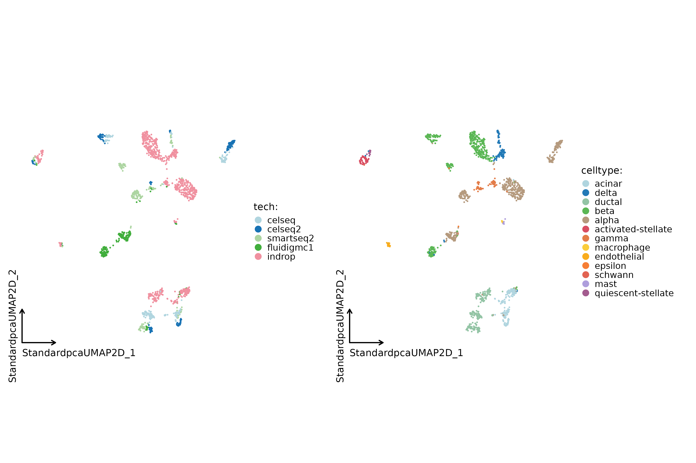
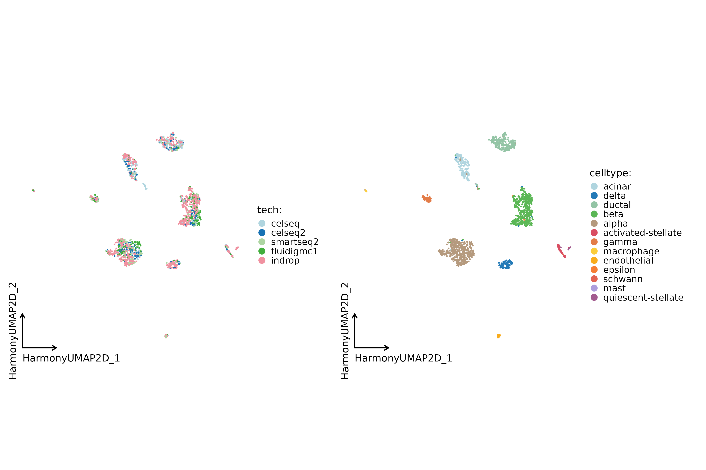
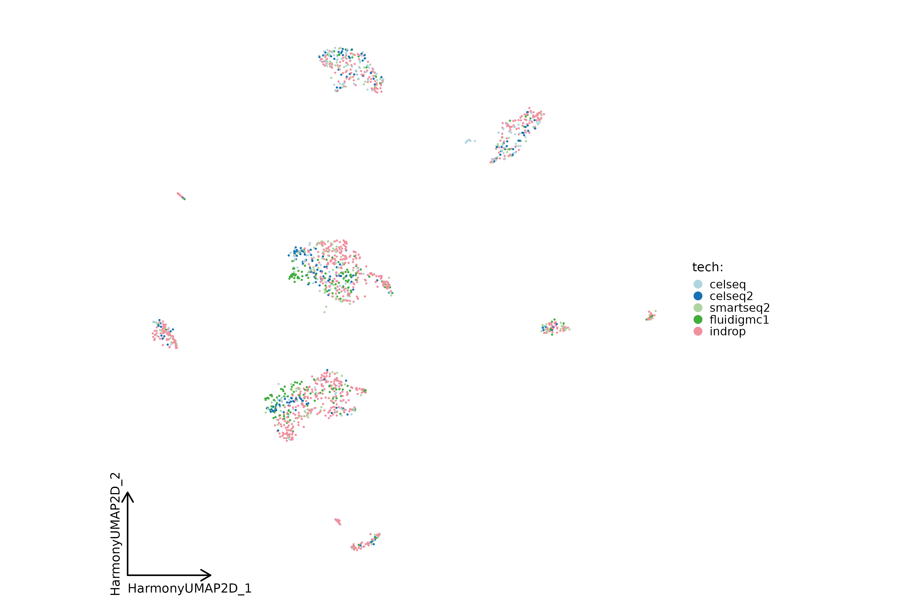
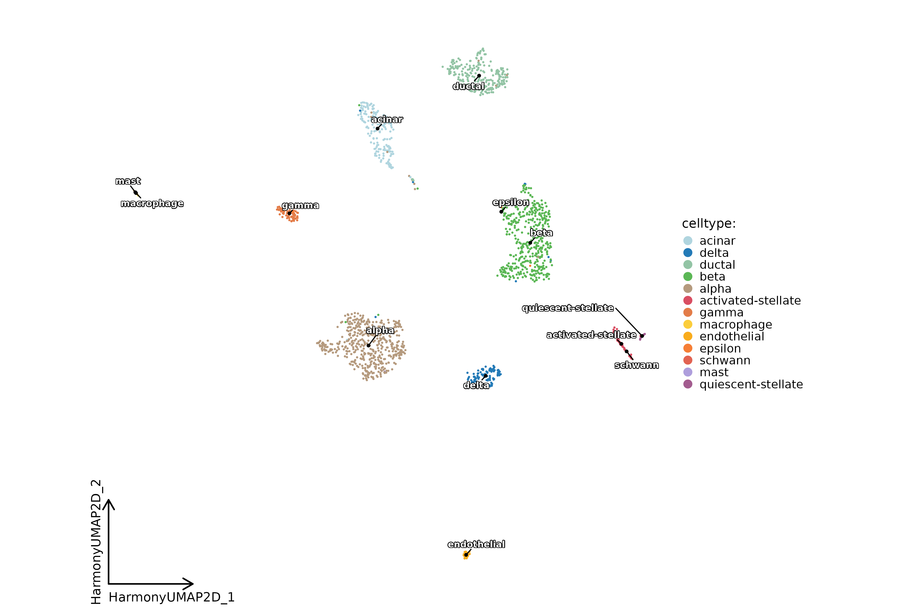
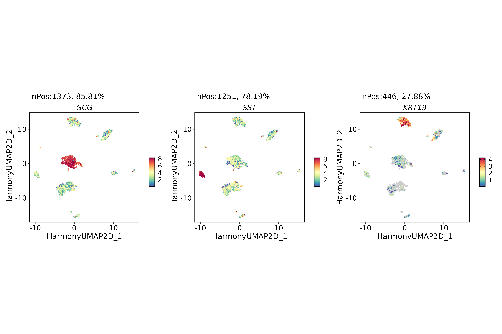

# Data integration workflow

## What you will do

- **Question:** does correction reduce technology effects while
  retaining cell types?
- **Input:** All 1,600 cells and 12,932 supplied genes in `panc8_sub`;
  `tech` identifies five technologies and `celltype` supplies evaluation
  labels.
- **Output:** Uncorrected and Harmony reductions on the same cells,
  marker checks and a reloadable integrated object.
- **How to run:** start a fresh R session and run the chunks in order.
  Printed tables and figures below are generated from that run;
  code-only alternatives are identified explicitly.

Use integration when technical structure prevents comparison across
samples or platforms, and retain an unintegrated baseline. If every
condition occurs in only one batch, batch and biology are confounded: no
attractive embedding can resolve that experimental-design problem.

## Prepare the required Harmony source

SCOP’s
[`RunHarmony2()`](https://mengxu98.github.io/scop/reference/RunHarmony2.md)
checks the official GitHub package origin. A CRAN installation with the
same package name does not satisfy that check and can trigger an
installation attempt in the middle of an analysis. Install the official
GitHub source before starting this page, then restart R:

``` r

remotes::install_github(
  "immunogenomics/harmony",
  upgrade = "never"
)
```

The tutorial’s dependency preflight is read-only. It fails with a clear
setup requirement instead of allowing an implicit installation during
fitting.

## Prepare a Merged Object

The example uses the bundled `panc8_sub` object, a subset of human
pancreas datasets. The `tech` column records the batch or technology
label. The `celltype` column is used as known biology for diagnostics,
not as a target to force during integration.

``` r

library(scop)
set.seed(11)
harmony_source <- utils::packageDescription("harmony")
stopifnot(
  identical(harmony_source$RemoteUsername, "immunogenomics"),
  identical(harmony_source$RemoteRepo, "harmony")
)
data.frame(
  package = "harmony", version = harmony_source$Version,
  source = paste(harmony_source$RemoteUsername, harmony_source$RemoteRepo, sep = "/"),
  revision = harmony_source$RemoteSha
)
#>   package version                 source
#> 1 harmony   2.1.0 immunogenomics/harmony
#>                                   revision
#> 1 7e21bd6629b628099735395f57a47d11f873b2ee

data(panc8_sub)
input_cells <- colnames(panc8_sub)
stopifnot(!anyNA(panc8_sub$tech), !anyNA(panc8_sub$celltype))
data.frame(genes = nrow(panc8_sub), cells = ncol(panc8_sub))
#>   genes cells
#> 1 12932  1600
table(panc8_sub$tech)
#> 
#>     celseq    celseq2 fluidigmc1     indrop  smartseq2 
#>        200        200        200        800        200
table(panc8_sub$celltype)
#> 
#>             acinar activated-stellate              alpha               beta 
#>                164                 50                483                428 
#>              delta             ductal        endothelial            epsilon 
#>                111                237                 26                  3 
#>              gamma         macrophage               mast quiescent-stellate 
#>                 67                  9                  7                 14 
#>            schwann 
#>                  1
```

Always inspect the unintegrated embedding or PCA first. This gives you a
baseline for deciding whether integration removes technical structure
without erasing cell-type structure.

``` r

panc8_sub <- RunStandardWorkflow(panc8_sub,
  assay = "RNA", seed = 11, cores = 1,
  verbose = FALSE
)

CellDimPlot(
  panc8_sub,
  group.by = c("tech", "celltype"),
  reduction = "UMAP",
  theme_use = "theme_blank"
)
```



## Run an Integration Method

Harmony is a common first pass when the object is already a merged
Seurat object with a batch column.

``` r

panc8_harmony <- RunIntegration(
  srt_merge = panc8_sub,
  batch = "tech",
  integration_methods = "Harmony",
  nonlinear_reduction_dims = 2,
  seed = 11, verbose = FALSE
)
#> Warning: Different features in new layer data than already exists for
#> scale.data

stopifnot(identical(colnames(panc8_harmony), input_cells))
SeuratObject::Reductions(panc8_harmony)
#> [1] "Standardpca"       "StandardpcaUMAP2D" "StandardUMAP2D"   
#> [4] "Harmonypca"        "Harmony"           "HarmonyUMAP2D"    
#> [7] "HarmonypcaUMAP2D"
```

Use the method-specific integrated UMAP for plotting. The exact
reduction name depends on the selected method; for Harmony, the examples
use `HarmonyUMAP2D`. When comparing methods, report the reduction name
explicitly. A plot labeled only as UMAP is ambiguous once an object
contains uncorrected and integrated embeddings.

``` r

CellDimPlot(
  panc8_harmony,
  group.by = c("tech", "celltype"),
  reduction = "HarmonyUMAP2D",
  theme_use = "theme_blank"
)
```



## Choose a Method

Use method choice to match the data and dependency budget:

- `Harmony`, `fastMNN`, `MNN`, `ComBat`, and `Seurat` methods are
  practical R-side choices for many scRNA-seq batch problems.
- `scVI`, `BBKNN`, `Scanorama`, `GLUE`, and `MultiMAP` require
  Python-side dependencies but can be useful for large datasets or
  multimodal settings.
- `WNN` and cross-modality methods are better suited to multimodal RNA +
  ATAC or paired-modality objects than to ordinary batch correction.
- `Uncorrected` is useful as a baseline and should be kept in reports
  when showing that integration changed the object.

The following alternatives are recipes, not additional measured results
in this page. To compare executed methods, use the [integration
benchmark](https://mengxu98.github.io/scop/articles/integration-benchmark-workflow.md).
Other methods follow the same entry-point pattern, but may require
additional runtime dependencies or matrix backends:

``` r

panc8_rpca <- RunIntegration(
  srt_merge = panc8_sub,
  batch = "tech",
  integration_methods = "RPCA"
)

panc8_fastmnn <- RunIntegration(
  srt_merge = panc8_sub,
  batch = "tech",
  integration_methods = "fastMNN"
)
```

## Inspect Integration Quality

Do not judge integration from batch mixing alone. Also check known
labels, marker genes, and whether rare cell types remain separated.

``` r

CellDimPlot(
  panc8_harmony,
  group.by = "tech",
  reduction = "HarmonyUMAP2D",
  theme_use = "theme_blank"
)
```



``` r


CellDimPlot(
  panc8_harmony,
  group.by = "celltype",
  reduction = "HarmonyUMAP2D",
  label = TRUE,
  label_repel = TRUE, label.size = 3,
  theme_use = "theme_blank"
)
```



``` r


FeatureDimPlot(
  panc8_harmony,
  features = c("GCG", "SST", "KRT19"),
  reduction = "HarmonyUMAP2D"
)
```



When comparing methods, keep the input object fixed and compare the same
metadata labels, marker genes, and diagnostic plots across methods. The
unintegrated baseline is useful because it shows what the integration
changed. Good integration mixes batches within the same biological state
while keeping distinct cell types and marker programs separated.
Overcorrection is visible when expected marker-defined groups collapse
together.

INS is absent from the supplied feature-filtered object, so this marker
check uses measured GCG, SST and KRT19. Missing input genes must not be
interpreted as measured zero expression.

## Save, reload, and check the hand-off

The code below saves to a temporary directory. Choose a persistent
output folder when saving your analysis. Save the object **and**
plain-text metadata; a figure alone cannot reproduce the analysis. No
cells are sampled for this export.

``` r

output_dir <- file.path(tempdir(), "integration-workflow")
dir.create(output_dir, recursive = TRUE, showWarnings = FALSE)
result_file <- file.path(output_dir, "analysis.rds")
saveRDS(panc8_harmony, result_file)
utils::write.csv(panc8_harmony@meta.data, file.path(output_dir, "cell-metadata.csv"))
reloaded <- readRDS(result_file)
stopifnot(
  identical(colnames(reloaded), colnames(panc8_harmony)),
  identical(reloaded@meta.data, panc8_harmony@meta.data),
  identical(
    SeuratObject::Reductions(reloaded),
    SeuratObject::Reductions(panc8_harmony)
  )
)
data.frame(
  file = basename(list.files(output_dir, full.names = TRUE)),
  bytes = file.info(list.files(output_dir, full.names = TRUE))$size
)
#>                file    bytes
#> 1      analysis.rds 48007419
#> 2 cell-metadata.csv   186170
```

## Use your own data and recover common errors

- Replace the `data(...)` input with `readRDS("your-object.rds")`, or
  create a Seurat object from a gene-by-cell raw-count matrix. Check
  that cell IDs are unique and metadata row names equal the expression
  column names.
- Set the assay and grouping columns explicitly. Species, gene
  identifiers and reference labels must match your experiment; do not
  copy pancreas labels to unrelated tissue.
- If a reduction or metadata column is missing, inspect
  `SeuratObject::Reductions(object)` and `colnames(object@meta.data)`,
  then run its producer chunk. A plot does not create the result it
  needs.
- If a dependency is unavailable, install it in the analysis
  environment, restart R and rerun from the input chunk. A skipped or
  failed method is not evidence that it worked. Preserve warnings and
  the exact error in your report.

## Analysis provenance

The receipt records the R seed. Python methods retain their documented
backend seeds and parameters; setting the R seed alone does not control
every backend. Package versions, BLAS libraries and backend changes can
alter numerical results. Keep this receipt with the exported object.

``` r

source_revision <- Sys.getenv("GITHUB_SHA")
if (!nzchar(source_revision) && nzchar(Sys.which("git"))) {
  source_revision <- tryCatch(system2("git", c("rev-parse", "HEAD"),
    stdout = TRUE,
    stderr = FALSE
  )[1], error = function(e) NA_character_)
}
article_source <- knitr::current_input(dir = TRUE)
build_receipt <- data.frame(
  article = "integration-workflow",
  built_utc = format(Sys.time(), tz = "UTC", usetz = TRUE),
  scop = as.character(utils::packageVersion("scop")),
  R = as.character(getRversion()),
  source_revision = source_revision,
  source_has_local_changes = if (nzchar(Sys.which("git"))) {
    length(system2("git", c("status", "--porcelain"), stdout = TRUE, stderr = FALSE)) > 0
  } else {
    NA
  },
  article_md5 = unname(tools::md5sum(article_source)),
  R_seed = 11,
  cells_retained = ncol(panc8_harmony),
  genes_in_active_assay = nrow(panc8_harmony),
  stringsAsFactors = FALSE
)
build_receipt
#>                article               built_utc  scop     R
#> 1 integration-workflow 2026-10-28 09:01:58 UTC 0.9.2 4.6.1
#>                            source_revision source_has_local_changes
#> 1 896e55b929953f0b1e16ebccd54e591ef3474b8f                    FALSE
#>                        article_md5 R_seed cells_retained genes_in_active_assay
#> 1 258fa719de827f5739c0606e0dfd1e7c     11           1600                 12932
utils::write.csv(build_receipt, file.path(output_dir, "build-receipt.csv"),
  row.names = FALSE
)
writeLines(capture.output(sessionInfo()), file.path(output_dir, "session-info.txt"))
```

Show the complete R session used for this page

``` r

sessionInfo()
#> R version 4.6.1 (2026-06-24)
#> Platform: x86_64-pc-linux-gnu
#> Running under: Ubuntu 24.04.5 LTS
#> 
#> Matrix products: default
#> BLAS:   /usr/lib/x86_64-linux-gnu/openblas-pthread/libblas.so.3 
#> LAPACK: /usr/lib/x86_64-linux-gnu/openblas-pthread/libopenblasp-r0.3.26.so;  LAPACK version 3.12.0
#> 
#> locale:
#>  [1] LC_CTYPE=C.UTF-8       LC_NUMERIC=C           LC_TIME=C.UTF-8       
#>  [4] LC_COLLATE=C.UTF-8     LC_MONETARY=C.UTF-8    LC_MESSAGES=C.UTF-8   
#>  [7] LC_PAPER=C.UTF-8       LC_NAME=C              LC_ADDRESS=C          
#> [10] LC_TELEPHONE=C         LC_MEASUREMENT=C.UTF-8 LC_IDENTIFICATION=C   
#> 
#> time zone: UTC
#> tzcode source: system (glibc)
#> 
#> attached base packages:
#> [1] stats     graphics  grDevices utils     datasets  methods   base     
#> 
#> other attached packages:
#> [1] scop_0.9.2
#> 
#> loaded via a namespace (and not attached):
#>   [1] deldir_2.0-4           pbapply_1.7-5          gridExtra_2.3.1       
#>   [4] rlang_1.3.0            magrittr_2.0.5         RcppAnnoy_0.0.23      
#>   [7] otel_0.2.0             spatstat.geom_3.8-3    matrixStats_1.5.0     
#>  [10] ggridges_0.5.7         compiler_4.6.1         png_0.1-9             
#>  [13] systemfonts_1.3.2      vctrs_0.7.3            reshape2_1.4.5        
#>  [16] stringr_1.6.0          pkgconfig_2.0.3        fastmap_1.2.0         
#>  [19] labeling_0.4.3         promises_1.5.0         rmarkdown_2.32        
#>  [22] ragg_1.5.2             purrr_1.2.2            xfun_0.62             
#>  [25] cachem_1.1.0           jsonlite_2.0.0         goftest_1.2-3         
#>  [28] later_1.4.8            spatstat.utils_3.2-5   irlba_2.4.1           
#>  [31] parallel_4.6.1         cluster_2.1.8.3        R6_2.6.1              
#>  [34] ica_1.0-3              spatstat.data_3.1-9    bslib_0.12.0          
#>  [37] stringi_1.8.9          RColorBrewer_1.1-3     reticulate_1.47.0     
#>  [40] spatstat.univar_3.2-0  parallelly_1.48.0      lmtest_0.9-40         
#>  [43] jquerylib_0.1.4        scattermore_1.2        Rcpp_1.1.2            
#>  [46] knitr_1.52             tensor_1.5.1           future.apply_1.21.0   
#>  [49] zoo_1.9-1              sctransform_0.4.3      httpuv_1.6.17         
#>  [52] Matrix_1.7-6           splines_4.6.1          igraph_2.3.4          
#>  [55] tidyselect_1.2.1       abind_1.4-8            thisplot_0.4.6        
#>  [58] dichromat_2.0-1        yaml_2.3.12            spatstat.random_3.5-2 
#>  [61] spatstat.explore_3.8-3 codetools_0.2-20       miniUI_0.1.2          
#>  [64] listenv_1.1.0          plyr_1.8.9             lattice_0.22-9        
#>  [67] tibble_3.3.1           withr_3.0.3            shiny_1.14.0          
#>  [70] S7_0.2.2               ROCR_1.0-12            evaluate_1.0.5        
#>  [73] Rtsne_0.17             future_1.80.0          fastDummies_1.7.6     
#>  [76] desc_1.4.3             survival_3.8-6         polyclip_1.10-7       
#>  [79] fitdistrplus_1.2-6     pillar_1.11.1          Seurat_5.6.0          
#>  [82] KernSmooth_2.23-26     plotly_4.12.1          generics_0.1.4        
#>  [85] thisutils_0.5.3        RcppHNSW_0.7.0         sp_2.2-4              
#>  [88] ggplot2_4.0.3          scales_1.4.0           globals_0.20.0        
#>  [91] xtable_1.8-8           RhpcBLASctl_0.23-42    glue_1.8.1            
#>  [94] proxyC_0.5.2           tools_4.6.1            data.table_1.18.6.1   
#>  [97] RSpectra_0.16-2        RANN_2.6.3             fs_2.1.0              
#> [100] dotCall64_1.2          cowplot_1.2.0          grid_4.6.1            
#> [103] tidyr_1.3.2            nlme_3.1-169           patchwork_1.3.2       
#> [106] cli_3.6.6              spatstat.sparse_3.2-0  textshaping_1.0.5     
#> [109] spam_2.11-4            viridisLite_0.4.3      dplyr_1.2.1           
#> [112] uwot_0.2.5             gtable_0.3.6           sass_0.4.10           
#> [115] digest_0.6.39          progressr_1.1.0        ggrepel_0.9.8         
#> [118] htmlwidgets_1.6.4      SeuratObject_5.4.0     farver_2.1.2          
#> [121] htmltools_0.5.9        pkgdown_2.2.1          lifecycle_1.0.5       
#> [124] httr_1.4.9             mime_0.13              harmony_2.1.0         
#> [127] MASS_7.3-66
```

## What to Report

A compact integration report should include:

- the batch column and biological annotation columns used for
  evaluation;
- the integration method and major parameters;
- the integrated reduction names used for plots;
- before and after plots colored by batch and biological labels;
- marker-gene checks for expected cell types;
- any method-specific dependencies or environment setup needed to
  reproduce the run.

Integration is a preprocessing decision, not a biological result by
itself. Use it only when the integrated representation improves
downstream interpretation without hiding real biological differences.
