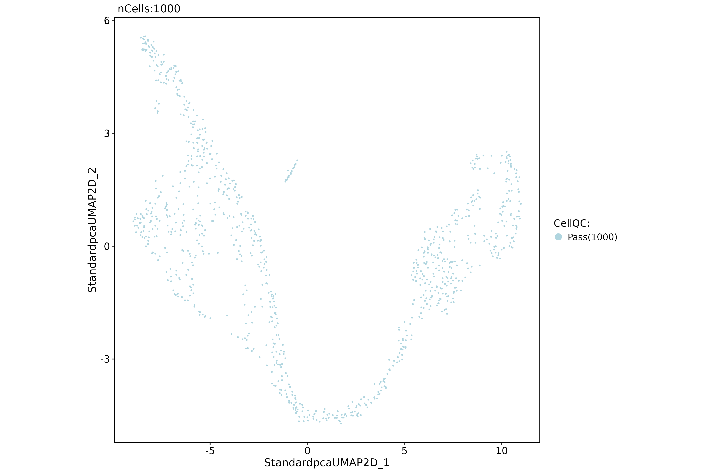
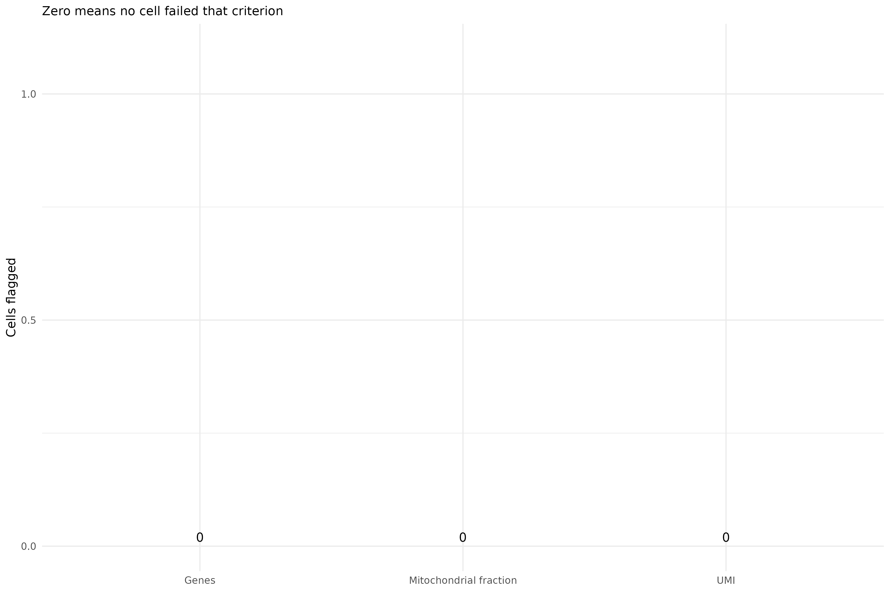
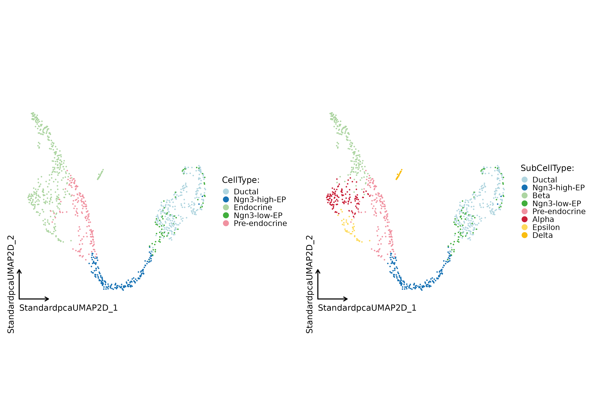
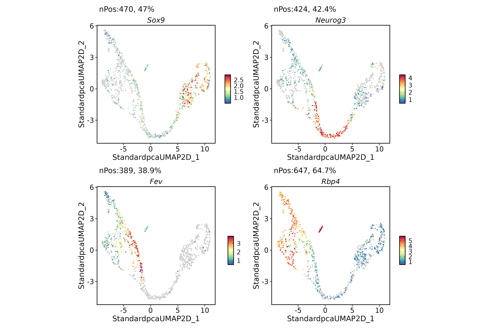
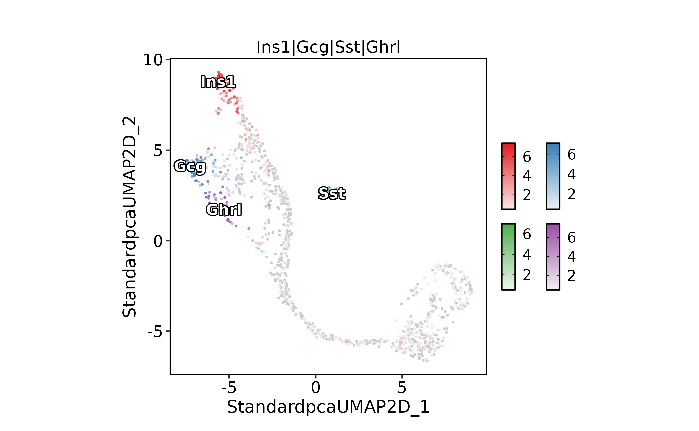
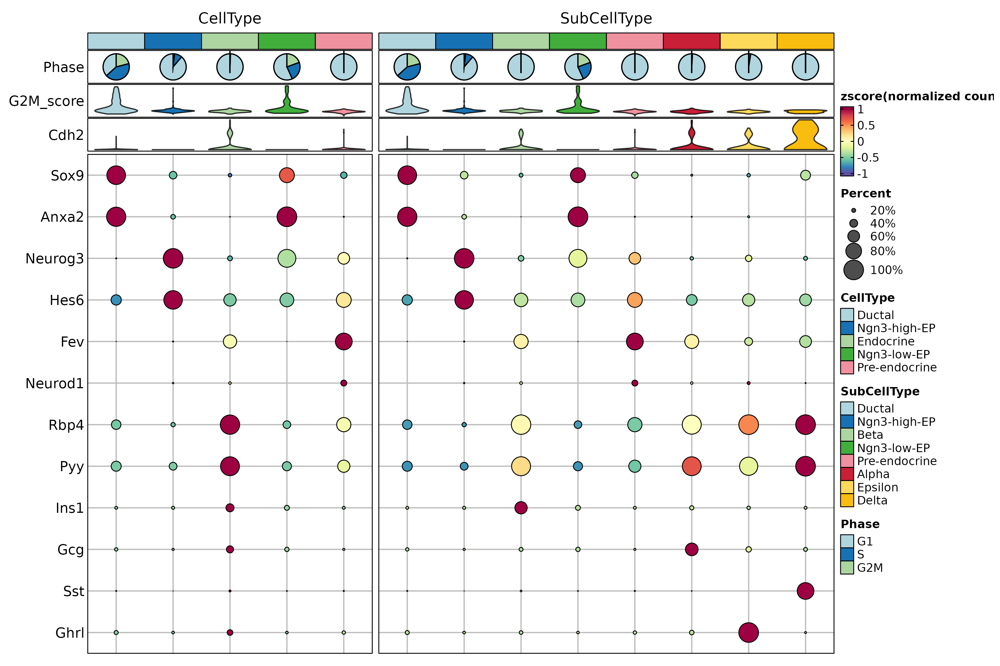

# Single-cell main workflow

## What you will do

- **Question:** can I trust the input and recognize its main cell
  states?
- **Input:** All 1,000 cells and 15,998 supplied genes in the bundled
  mouse pancreas object. The package dataset is already a subset of the
  study; this article does not sample it again.
- **Output:** QC flags, normalized RNA, PCA/UMAP, clusters, marker plots
  and a reloadable object.
- **How to run:** start a fresh R session and run the chunks in order.
  Printed tables and figures below are generated from that run;
  code-only alternatives are identified explicitly.

Start here before integration, annotation, trajectories or pathway
analysis. The counts and QC tables establish what was measured; marker
plots check the meaning of labels; the saved object is the input for the
specialist articles.

## Load and Inspect the Object

The examples use the bundled mouse pancreas subset. It contains RNA,
spliced, and unspliced assays, so the same object can later be used for
trajectory and RNA-velocity examples.

``` r

library(scop)
set.seed(11)

data(pancreas_sub)
pancreas_sub
#> An object of class Seurat 
#> 47994 features across 1000 samples within 3 assays 
#> Active assay: RNA (15998 features, 0 variable features)
#>  1 layer present: counts
#>  2 other assays present: spliced, unspliced
input_cells <- colnames(pancreas_sub)
counts <- GetAssayData5(pancreas_sub, assay = "RNA", layer = "counts")
stopifnot(identical(colnames(counts), rownames(pancreas_sub@meta.data)),
          !anyDuplicated(colnames(counts)), all(counts@x >= 0))
data.frame(genes = nrow(counts), cells = ncol(counts),
           mitochondrial_genes = sum(grepl("^mt-", rownames(counts))))
#>   genes cells mitochondrial_genes
#> 1 15998  1000                  10
```

Before running a full workflow, check the active assay, available
assays, metadata columns, and whether a previous dimensional reduction
already exists. These checks prevent a common documentation mistake:
plotting a reduction or metadata column left over from a previous run
without stating where it came from.

``` r

SeuratObject::DefaultAssay(pancreas_sub)
#> [1] "RNA"
SeuratObject::Assays(pancreas_sub)
#> [1] "RNA"       "spliced"   "unspliced"
head(pancreas_sub@meta.data)
#>                     orig.ident nCount_RNA nFeature_RNA     S_score  G2M_score
#> AAACCTGAGCCTTGAT SeuratProject       7071         2613 -0.01470664 -0.2326104
#> AAACCTGGTAAGTGGC SeuratProject       5026         2211 -0.17998111 -0.1260295
#> AAACGGGAGATATGGT SeuratProject       6194         2486 -0.16794573 -0.1666881
#> AAACGGGCAAAGAATC SeuratProject       6370         2581 -0.17434505 -0.2216024
#> AAACGGGGTACAGTTC SeuratProject       9182         2906 -0.18656224 -0.1571970
#> AAACGGGTCAGCTCTC SeuratProject       5892         2282 -0.12347911 -0.2298337
#>                  nCount_spliced nFeature_spliced nCount_unspliced
#> AAACCTGAGCCTTGAT           7071             2613              953
#> AAACCTGGTAAGTGGC           5026             2211             1000
#> AAACGGGAGATATGGT           6194             2486              721
#> AAACGGGCAAAGAATC           6370             2581             1544
#> AAACGGGGTACAGTTC           9182             2906             2262
#> AAACGGGTCAGCTCTC           5892             2282              935
#>                  nFeature_unspliced     CellType  SubCellType Phase
#> AAACCTGAGCCTTGAT                638       Ductal       Ductal    G1
#> AAACCTGGTAAGTGGC                623 Ngn3-high-EP Ngn3-high-EP    G1
#> AAACGGGAGATATGGT                550       Ductal       Ductal    G1
#> AAACGGGCAAAGAATC               1015    Endocrine         Beta    G1
#> AAACGGGGTACAGTTC               1096    Endocrine         Beta    G1
#> AAACGGGTCAGCTCTC                712  Ngn3-low-EP  Ngn3-low-EP    G1
SeuratObject::Reductions(pancreas_sub)
#> NULL
```

## Run the Standard Workflow

[`RunStandardWorkflow()`](https://mengxu98.github.io/scop/reference/RunStandardWorkflow.md)
runs the common preprocessing path: normalization, variable feature
selection, scaling, dimensional reduction, neighbor graph construction,
clustering, and UMAP. The result stays in the same Seurat object.

``` r

pancreas_sub <- RunStandardWorkflow(
  pancreas_sub,
  assay = "RNA",
  nHVF = 2000,
  linear_reduction_dims = 50,
  cluster_resolution = 0.8,
  seed = 11,
  cores = 1,
  verbose = FALSE
)

pancreas_sub
#> An object of class Seurat 
#> 47994 features across 1000 samples within 3 assays 
#> Active assay: RNA (15998 features, 2000 variable features)
#>  3 layers present: counts, data, scale.data
#>  2 other assays present: spliced, unspliced
#>  3 dimensional reductions calculated: Standardpca, StandardpcaUMAP2D, StandardUMAP2D
SeuratObject::Reductions(pancreas_sub)
#> [1] "Standardpca"       "StandardpcaUMAP2D" "StandardUMAP2D"
```

The stable contract is the Seurat object itself: normalized expression
layers are stored in the assay, reductions are stored in `@reductions`,
metadata columns are added to `@meta.data`, and method-specific
summaries are stored under `@tools` when a wrapper has additional
results.

For this object, `CellType` is a coarse biological label and
`SubCellType` contains finer developmental states. Those labels are
useful for examples, but they should still be checked with marker genes
before being used for biological claims.

## Check Cell Quality

Run quality control before interpreting clusters. This first pass
measures UMIs, detected genes and mitochondrial fraction on the supplied
RNA counts. It annotates every cell, without silently removing failures.
The object is already feature-filtered: these totals are not
original-library QC. Doublet and ambient-RNA models require separate
dependencies and are not part of this basic receipt. For production
data, run QC on the unfiltered count assay, justify thresholds and rerun
preprocessing after any filtering.

``` r

pancreas_sub <- RunCellQC(
  pancreas_sub, assay = "RNA",
  qc_metrics = c("umi", "gene", "mito"),
  UMI_threshold = 3000, gene_threshold = 1000, mito_threshold = 20,
  return_filtered = FALSE, verbose = FALSE
)
stopifnot(identical(colnames(pancreas_sub), input_cells))

table(pancreas_sub$CellQC)
#> 
#> Pass Fail 
#> 1000    0
names(pancreas_sub@tools)
#> NULL
data.frame(
  criterion = c("umi_qc", "gene_qc", "mito_qc"),
  failures = vapply(pancreas_sub@meta.data[c("umi_qc", "gene_qc", "mito_qc")],
                    function(x) sum(x == "Fail", na.rm = TRUE), integer(1))
)
#>         criterion failures
#> umi_qc     umi_qc        0
#> gene_qc   gene_qc        0
#> mito_qc   mito_qc        0
```

Plot the final QC label first, then inspect the individual failure
categories when too many cells fail.

``` r

CellDimPlot(
  pancreas_sub,
  group.by = "CellQC",
  reduction = "UMAP"
)
```



``` r


qc_failures <- data.frame(
  metric = c("UMI", "Genes", "Mitochondrial fraction"),
  failures = vapply(pancreas_sub@meta.data[c("umi_qc", "gene_qc", "mito_qc")],
                    function(x) sum(x == "Fail", na.rm = TRUE), integer(1))
)
ggplot2::ggplot(qc_failures, ggplot2::aes(metric, failures)) +
  ggplot2::geom_col() +
  ggplot2::geom_text(ggplot2::aes(label = failures), vjust = -0.5) +
  ggplot2::scale_y_continuous(limits = c(0, max(1, qc_failures$failures) * 1.1),
                            breaks = scales::breaks_pretty(n = 4)) +
  ggplot2::labs(x = NULL, y = "Cells flagged",
                subtitle = "Zero means no cell failed that criterion") +
  ggplot2::theme_minimal(base_size = 12)
```



## Plot Cell Groups and Features

Use
[`CellDimPlot()`](https://mengxu98.github.io/scop/reference/CellDimPlot.md)
to inspect discrete annotations and cluster structure.
[`FeatureDimPlot()`](https://mengxu98.github.io/scop/reference/FeatureDimPlot.md)
is the companion for gene expression or metadata-derived numeric
features.

``` r

CellDimPlot(
  pancreas_sub,
  group.by = c("CellType", "SubCellType"),
  reduction = "UMAP",
  label = FALSE, theme_use = "theme_blank"
)
```



``` r


FeatureDimPlot(
  pancreas_sub,
  features = c("Sox9", "Neurog3", "Fev", "Rbp4"),
  reduction = "UMAP"
)
```



When several marker genes define related states,
`compare_features = TRUE` blends feature-specific colours to show
overlapping expression. It does not identify the highest-abundance gene
or assign a cell type. In the pancreas example, `Ins1`, `Gcg`, `Sst`,
and `Ghrl` are hormone genes used to distinguish beta, alpha, delta, and
epsilon endocrine states.

``` r

FeatureDimPlot(
  pancreas_sub,
  features = c("Ins1", "Gcg", "Sst", "Ghrl"),
  compare_features = TRUE,
  label = TRUE,
  reduction = "UMAP"
)
#> Warning: No shared levels found between `names(values)` of the manual scale and the
#> data's colour values.
```



## Summarize Marker Patterns by Group

Use grouped heatmaps after the embedding looks coherent. This is usually
more readable than inspecting many feature plots one by one. Here dot
size summarizes the fraction of cells expressing each marker. Colour
shows row-standardized group-average expression: compare groups within a
gene, not absolute expression between genes. A marker should be
interpreted from both signals: strong average expression in very few
cells is different from broad expression across a group.

``` r

ht <- GroupHeatmap(
  pancreas_sub,
  features = c(
    "Sox9", "Anxa2",
    "Neurog3", "Hes6",
    "Fev", "Neurod1",
    "Rbp4", "Pyy",
    "Ins1", "Gcg", "Sst", "Ghrl"
  ),
  group.by = c("CellType", "SubCellType"),
  heatmap_palette = "Spectral",
  cell_annotation = c("Phase", "G2M_score", "Cdh2"),
  show_row_names = TRUE, nlabel = 0,
  row_names_side = "left",
  add_dot = TRUE,
  add_reticle = TRUE
)
#> Warning: No shared levels found between `names(values)` of the manual scale and the
#> data's colour values.
#> No shared levels found between `names(values)` of the manual scale and the
#> data's colour values.
#> No shared levels found between `names(values)` of the manual scale and the
#> data's colour values.
#> No shared levels found between `names(values)` of the manual scale and the
#> data's colour values.
#> No shared levels found between `names(values)` of the manual scale and the
#> data's colour values.
#> No shared levels found between `names(values)` of the manual scale and the
#> data's colour values.
#> No shared levels found between `names(values)` of the manual scale and the
#> data's colour values.
#> No shared levels found between `names(values)` of the manual scale and the
#> data's colour values.
#> No shared levels found between `names(values)` of the manual scale and the
#> data's colour values.
#> No shared levels found between `names(values)` of the manual scale and the
#> data's colour values.
#> No shared levels found between `names(values)` of the manual scale and the
#> data's colour values.
#> No shared levels found between `names(values)` of the manual scale and the
#> data's colour values.
#> No shared levels found between `names(values)` of the manual scale and the
#> data's colour values.
#> No shared levels found between `names(values)` of the manual scale and the
#> data's colour values.
#> No shared levels found between `names(values)` of the manual scale and the
#> data's colour values.
#> No shared levels found between `names(values)` of the manual scale and the
#> data's colour values.
#> No shared levels found between `names(values)` of the manual scale and the
#> data's colour values.
#> No shared levels found between `names(values)` of the manual scale and the
#> data's colour values.
#> No shared levels found between `names(values)` of the manual scale and the
#> data's colour values.
#> No shared levels found between `names(values)` of the manual scale and the
#> data's colour values.
#> No shared levels found between `names(values)` of the manual scale and the
#> data's colour values.
#> No shared levels found between `names(values)` of the manual scale and the
#> data's colour values.
#> No shared levels found between `names(values)` of the manual scale and the
#> data's colour values.
#> No shared levels found between `names(values)` of the manual scale and the
#> data's colour values.
#> No shared levels found between `names(values)` of the manual scale and the
#> data's colour values.
#> No shared levels found between `names(values)` of the manual scale and the
#> data's colour values.
print(ht$plot)
```



## Save, reload, and check the hand-off

The code below saves to a temporary directory. Choose a persistent
output folder when saving your analysis. Save the object **and**
plain-text metadata; a figure alone cannot reproduce the analysis. No
cells are sampled for this export.

``` r

output_dir <- file.path(tempdir(), "single-cell-main-workflow")
dir.create(output_dir, recursive = TRUE, showWarnings = FALSE)
result_file <- file.path(output_dir, "analysis.rds")
saveRDS(pancreas_sub, result_file)
utils::write.csv(pancreas_sub@meta.data, file.path(output_dir, "cell-metadata.csv"))
reloaded <- readRDS(result_file)
stopifnot(identical(colnames(reloaded), colnames(pancreas_sub)),
          identical(reloaded@meta.data, pancreas_sub@meta.data),
          identical(SeuratObject::Reductions(reloaded),
                    SeuratObject::Reductions(pancreas_sub)))
data.frame(file = basename(list.files(output_dir, full.names = TRUE)),
           bytes = file.info(list.files(output_dir, full.names = TRUE))$size)
#>                file    bytes
#> 1      analysis.rds 34270940
#> 2 cell-metadata.csv   236267
```

## Use your own data and recover common errors

- Replace the `data(...)` input with `readRDS("your-object.rds")`, or
  create a Seurat object from a gene-by-cell raw-count matrix. Check
  that cell IDs are unique and metadata row names equal the expression
  column names.
- Set the assay and grouping columns explicitly. Species, gene
  identifiers and reference labels must match your experiment; do not
  copy pancreas labels to unrelated tissue.
- If a reduction or metadata column is missing, inspect
  `SeuratObject::Reductions(object)` and `colnames(object@meta.data)`,
  then run its producer chunk. A plot does not create the result it
  needs.
- If a dependency is unavailable, install it in the analysis
  environment, restart R and rerun from the input chunk. A skipped or
  failed method is not evidence that it worked. Preserve warnings and
  the exact error in your report.

## Analysis provenance

The receipt records the R seed. Python methods retain their documented
backend seeds and parameters; setting the R seed alone does not control
every backend. Package versions, BLAS libraries and backend changes can
alter numerical results. Keep this receipt with the exported object.

``` r

source_revision <- Sys.getenv("GITHUB_SHA")
if (!nzchar(source_revision) && nzchar(Sys.which("git"))) {
  source_revision <- tryCatch(system2("git", c("rev-parse", "HEAD"), stdout = TRUE,
                                      stderr = FALSE)[1], error = function(e) NA_character_)
}
article_source <- knitr::current_input(dir = TRUE)
build_receipt <- data.frame(
  article = "single-cell-main-workflow",
  built_utc = format(Sys.time(), tz = "UTC", usetz = TRUE),
  scop = as.character(utils::packageVersion("scop")),
  R = as.character(getRversion()),
  source_revision = source_revision,
  source_has_local_changes = if (nzchar(Sys.which("git")))
    length(system2("git", c("status", "--porcelain"), stdout = TRUE, stderr = FALSE)) > 0 else NA,
  article_md5 = unname(tools::md5sum(article_source)),
  R_seed = 11,
  cells_retained = ncol(pancreas_sub),
  genes_in_active_assay = nrow(pancreas_sub),
  stringsAsFactors = FALSE
)
build_receipt
#>                     article               built_utc  scop     R
#> 1 single-cell-main-workflow 2026-10-25 21:52:57 UTC 0.9.2 4.6.1
#>                            source_revision source_has_local_changes
#> 1 e445500810bc982823927fdb936188657af45d7e                    FALSE
#>                        article_md5 R_seed cells_retained genes_in_active_assay
#> 1 e1fa3652792fa3594fa9ebdfa336c418     11           1000                 15998
utils::write.csv(build_receipt, file.path(output_dir, "build-receipt.csv"),
                 row.names = FALSE)
writeLines(capture.output(sessionInfo()), file.path(output_dir, "session-info.txt"))
```

Show the complete R session used for this page

``` r

sessionInfo()
#> R version 4.6.1 (2026-06-24)
#> Platform: x86_64-pc-linux-gnu
#> Running under: Ubuntu 24.04.5 LTS
#> 
#> Matrix products: default
#> BLAS:   /usr/lib/x86_64-linux-gnu/openblas-pthread/libblas.so.3 
#> LAPACK: /usr/lib/x86_64-linux-gnu/openblas-pthread/libopenblasp-r0.3.26.so;  LAPACK version 3.12.0
#> 
#> locale:
#>  [1] LC_CTYPE=C.UTF-8       LC_NUMERIC=C           LC_TIME=C.UTF-8       
#>  [4] LC_COLLATE=C.UTF-8     LC_MONETARY=C.UTF-8    LC_MESSAGES=C.UTF-8   
#>  [7] LC_PAPER=C.UTF-8       LC_NAME=C              LC_ADDRESS=C          
#> [10] LC_TELEPHONE=C         LC_MEASUREMENT=C.UTF-8 LC_IDENTIFICATION=C   
#> 
#> time zone: UTC
#> tzcode source: system (glibc)
#> 
#> attached base packages:
#> [1] stats     graphics  grDevices utils     datasets  methods   base     
#> 
#> other attached packages:
#> [1] scop_0.9.2
#> 
#> loaded via a namespace (and not attached):
#>   [1] RColorBrewer_1.1-3     jsonlite_2.0.0         shape_1.4.6.1         
#>   [4] magrittr_2.0.5         spatstat.utils_3.2-5   farver_2.1.2          
#>   [7] rmarkdown_2.32         GlobalOptions_0.1.4    fs_2.1.0              
#>  [10] ragg_1.5.2             vctrs_0.7.3            ROCR_1.0-12           
#>  [13] spatstat.explore_3.8-3 htmltools_0.5.9        sass_0.4.10           
#>  [16] thisutils_0.5.3        sctransform_0.4.3      parallelly_1.48.0     
#>  [19] KernSmooth_2.23-26     bslib_0.12.0           htmlwidgets_1.6.4     
#>  [22] desc_1.4.3             ica_1.0-3              plyr_1.8.9            
#>  [25] plotly_4.12.1          zoo_1.9-1              cachem_1.1.0          
#>  [28] igraph_2.3.4           iterators_1.0.14       mime_0.13             
#>  [31] lifecycle_1.0.5        pkgconfig_2.0.3        Matrix_1.7-6          
#>  [34] R6_2.6.1               fastmap_1.2.0          clue_0.3-68           
#>  [37] fitdistrplus_1.2-6     future_1.80.0          shiny_1.14.0          
#>  [40] digest_0.6.39          thisplot_0.4.6         colorspace_2.1-4      
#>  [43] ggnewscale_0.5.2       S4Vectors_0.50.3       patchwork_1.3.2       
#>  [46] Seurat_5.6.0           tensor_1.5.1           RSpectra_0.16-2       
#>  [49] irlba_2.4.1            textshaping_1.0.5      labeling_0.4.3        
#>  [52] progressr_1.1.0        spatstat.sparse_3.2-0  httr_1.4.9            
#>  [55] polyclip_1.10-7        abind_1.4-8            compiler_4.6.1        
#>  [58] doParallel_1.0.17      withr_3.0.3            S7_0.2.2              
#>  [61] fastDummies_1.7.6      MASS_7.3-66            proxyC_0.5.2          
#>  [64] rjson_0.2.23           tools_4.6.1            lmtest_0.9-40         
#>  [67] otel_0.2.0             httpuv_1.6.17          future.apply_1.21.0   
#>  [70] goftest_1.2-3          glue_1.8.1             nlme_3.1-169          
#>  [73] promises_1.5.0         grid_4.6.1             Rtsne_0.17            
#>  [76] cluster_2.1.8.3        reshape2_1.4.5         generics_0.1.4        
#>  [79] gtable_0.3.6           spatstat.data_3.1-9    tidyr_1.3.2           
#>  [82] data.table_1.18.6.1    sp_2.2-4               BiocGenerics_0.58.1   
#>  [85] spatstat.geom_3.8-3    RcppAnnoy_0.0.23       foreach_1.5.2         
#>  [88] ggrepel_0.9.8          RANN_2.6.3             pillar_1.11.1         
#>  [91] stringr_1.6.0          spam_2.11-4            RcppHNSW_0.7.0        
#>  [94] later_1.4.8            circlize_0.4.18        splines_4.6.1         
#>  [97] dplyr_1.2.1            lattice_0.22-9         survival_3.8-6        
#> [100] deldir_2.0-4           tidyselect_1.2.1       ComplexHeatmap_2.28.0 
#> [103] miniUI_0.1.2           pbapply_1.7-5          knitr_1.52            
#> [106] gridExtra_2.3.1        IRanges_2.46.0         scattermore_1.2       
#> [109] stats4_4.6.1           xfun_0.62              matrixStats_1.5.0     
#> [112] stringi_1.8.9          yaml_2.3.12            evaluate_1.0.5        
#> [115] codetools_0.2-20       tibble_3.3.1           cli_3.6.6             
#> [118] uwot_0.2.5             xtable_1.8-8           reticulate_1.47.0     
#> [121] systemfonts_1.3.2      jquerylib_0.1.4        dichromat_2.0-1       
#> [124] Rcpp_1.1.2             globals_0.20.0         spatstat.random_3.5-2 
#> [127] png_0.1-9              spatstat.univar_3.2-0  parallel_4.6.1        
#> [130] pkgdown_2.2.1          ggplot2_4.0.3          dotCall64_1.2         
#> [133] listenv_1.1.0          viridisLite_0.4.3      scales_1.4.0          
#> [136] ggridges_0.5.7         crayon_1.5.3           SeuratObject_5.4.0    
#> [139] purrr_1.2.2            GetoptLong_1.1.1       rlang_1.3.0           
#> [142] cowplot_1.2.0
```

## What to Report

A compact first-pass report should include:

- the object source, assay, and expression layer used;
- the cell and feature counts before and after filtering;
- the preprocessing parameters that affect interpretation, especially
  variable features, PCs, clustering resolution, and UMAP reduction
  name;
- QC pass or fail summaries and the dominant failure categories;
- the annotation column used for plots and any marker genes used to
  validate it;
- the output locations used downstream: assay layers, reductions,
  metadata, and `srt@tools`.

Keep this article as the short entry point. Use the specialized articles
for batch integration, annotation transfer, trajectories, differential
expression, pathway analysis, and deployment.
