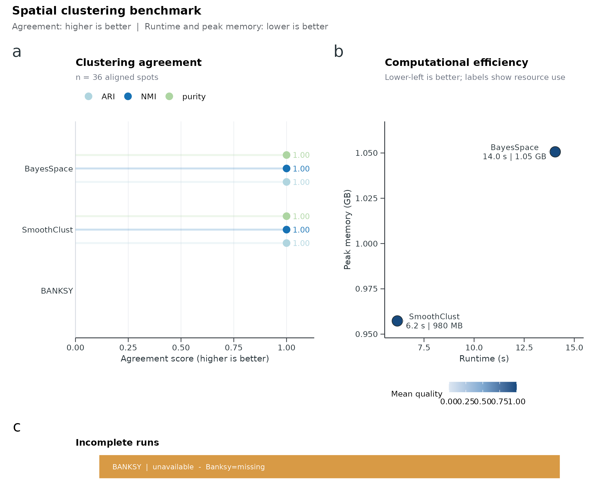

# Spatial domain benchmark workflow

This article compares spatial domain clustering methods with
\[RunSpatialBenchmark()\]. Each method runs in an isolated R process;
results include ARI, NMI, purity, runtime, and peak memory against a
gold-standard label column. Visualize the result with
\[SpatialBenchmarkPlot()\].

Supported producers include `BayesSpace`, `BANKSY`, and `SmoothClust`.
This workflow is separate from scRNA batch integration benchmarking
(\[RunIntegrationBenchmark()\]).

## Load data and define a gold standard

This workflow uses a small simulated spatial object with three regions
and region-specific expression signals. It demonstrates the benchmark
interface; replace the simulated labels with tissue annotations for real
analyses.

``` r

library(scop)
#>           ⬢          .        ⬡             ⬢     .
#>                      _____ _________  ____
#>                     / ___// ___/ __ ./ __ .
#>                    (__  )/ /__/ /_/ / /_/ /
#>                   /____/ .___/.____/ .___/
#>                                   /_/
#>       ⬢               .      ⬡        .          ⬢
#> ------------------------------------------------------------
#> Version: 0.9.2 (2026-10-28 update)
#> Website: https://mengxu98.github.io/scop/
#> ------------------------------------------------------------

set.seed(42)
n_spots <- 36L
n_genes <- 60L
grid <- expand.grid(x = 1:6, y = 1:6)
spatial_domain <- factor(ifelse(grid$x <= 2, "left", ifelse(grid$x <= 4, "middle", "right")))
counts <- matrix(rpois(n_genes * n_spots, 2),
  nrow = n_genes,
  dimnames = list(paste0("Gene", seq_len(n_genes)), paste0("spot", seq_len(n_spots)))
)
signal <- split(seq_len(n_genes), rep(c("left", "middle", "right"), each = 20))
for (label in names(signal)) {
  counts[signal[[label]], spatial_domain == label] <-
    counts[signal[[label]], spatial_domain == label] + rpois(sum(spatial_domain == label) * 20, 5)
}
spatial <- SeuratObject::CreateSeuratObject(counts)
#> Warning: Data is of class matrix. Coercing to dgCMatrix.
spatial$x <- grid$x
spatial$y <- grid$y
spatial$gold_domain <- spatial_domain
table(spatial$gold_domain)
#> 
#>   left middle  right 
#>     12     12     12
```

## Run the benchmark

Methods share the same spot set. Tune per-method arguments through
`method_params` when backends need different PCA counts or layers. This
36-spot example uses 10 expression neighbors for BANKSY: its default of
50 exceeds the number of available spots. This is a small simulated
interface example, not evidence of performance on real tissue.

``` r

bench <- RunSpatialBenchmark(
  spatial,
  gold_standard = "gold_domain",
  method_params = list(
    BayesSpace = list(n.PCs = 5, n.HVGs = 20, coord.cols = c("x", "y")),
    BANKSY = list(layer = "counts", coord.cols = c("x", "y"), k_neighbors = 10),
    SmoothClust = list(layer = "counts", min_spots = 1, coord.cols = c("x", "y"))
  ),
  verbose = FALSE
)

bench$summary
#>        method      workflow ARI NMI purity runtime_s baseline_memory_mb
#> 1  BayesSpace SpatialDomain   1   1      1    14.633           291.1250
#> 2      BANKSY SpatialDomain  NA  NA     NA        NA                 NA
#> 3 SmoothClust SpatialDomain   1   1      1     6.474           291.1133
#>   peak_memory_mb memory_delta_mb n_evaluated n_clusters      status
#> 1      1074.8750        783.7500          36          3     success
#> 2             NA              NA           0         NA unavailable
#> 3       982.2031        691.0898          36          3     success
#>            error
#> 1               
#> 2 Banksy=missing
#> 3
```

## Inspect the result object

[`RunSpatialBenchmark()`](https://mengxu98.github.io/scop/reference/RunSpatialBenchmark.md)
returns a `spatial_benchmark_result` list:

- `$summary`: quality and resource metrics per method;
- `$predictions`: aligned domain labels per spot;
- `$metrics`: long metric table for custom plots.

``` r

str(bench$summary, max.level = 1)
#> 'data.frame':    3 obs. of  13 variables:
#>  $ method            : chr  "BayesSpace" "BANKSY" "SmoothClust"
#>  $ workflow          : chr  "SpatialDomain" "SpatialDomain" "SpatialDomain"
#>  $ ARI               : num  1 NA 1
#>  $ NMI               : num  1 NA 1
#>  $ purity            : num  1 NA 1
#>  $ runtime_s         : num  14.63 NA 6.47
#>  $ baseline_memory_mb: num  291 NA 291
#>  $ peak_memory_mb    : num  1075 NA 982
#>  $ memory_delta_mb   : num  784 NA 691
#>  $ n_evaluated       : int  36 0 36
#>  $ n_clusters        : int  3 NA 3
#>  $ status            : chr  "success" "unavailable" "success"
#>  $ error             : chr  "" "Banksy=missing" ""
head(bench$predictions)
#>   spot_id gold_standard     method prediction
#> 1   spot1          left BayesSpace          1
#> 2   spot2          left BayesSpace          1
#> 3   spot3        middle BayesSpace          3
#> 4   spot4        middle BayesSpace          3
#> 5   spot5         right BayesSpace          2
#> 6   spot6         right BayesSpace          2
```

## Plot benchmark views

For a `spatial_benchmark_result`, `plot_type = "auto"` selects the
publication-oriented overview that combines clustering agreement with
runtime and peak-memory efficiency. For an ordinary summary table,
`auto` selects the stable native bar view; it does not depend on whether
the optional `funkyheatmap` package happens to be installed.

``` r

SpatialBenchmarkPlot(data = bench, plot_type = "overview")
```



Other views:

``` r

SpatialBenchmarkPlot(data = bench, plot_type = "quality")
SpatialBenchmarkPlot(data = bench, plot_type = "efficiency")
SpatialBenchmarkPlot(data = bench, plot_type = "heatmap")
SpatialBenchmarkPlot(data = bench, plot_type = "funkyheatmap")
```

`funkyheatmap` is an explicit optional view. If its dependency is
unavailable, the call reports that availability condition; it is never
selected implicitly by `auto`.

## What to report

A spatial benchmark report should include:

- the gold-standard column and number of domains;
- methods compared and any `method_params` overrides;
- `$summary` with ARI, NMI, purity, runtime, and peak memory;
- the overview or quality plot;
- failed or unavailable methods (status column) when backends are
  missing.

Agreement metrics are higher when better; runtime and peak memory are
lower when better.
