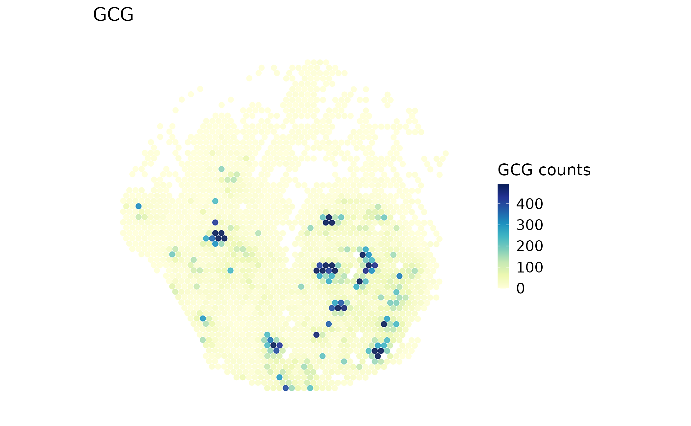

# Spatial framework bridges

Use this page when an analysis needs a different data container. You
will convert a real Visium dataset to SpatialExperiment, verify what
survived, convert back to Seurat, and save a reloadable result. A
separate Giotto section shows the same task with the optional
GiottoClass backend. Conversion does not run either framework’s
biological analysis.

Start with the [main spatial
workflow](https://mengxu98.github.io/scop/articles/spatial-main-workflow.md)
for analysis, or the [platform
page](https://mengxu98.github.io/scop/articles/spatial-platform-workflows.md)
for vendor imports and assay/image choices.

## Inputs and preservation boundaries

The executable input is the complete bundled `visium_human_pancreas_sub`
object: 5,000 genes and all 1,986 packaged tissue spots from human PanIN
sample GSM8058244, study
[GSE254829](https://www.ncbi.nlm.nih.gov/geo/query/acc.cgi?acc=GSE254829).
The package has already selected genes shared with `panc8_sub`; this
article performs no additional feature or spot subsampling. `coda_label`
is supplied microanatomical annotation, not a predicted cell type.

| Field | Seurat ↔︎ SpatialExperiment | Seurat ↔︎ Giotto |
|----|----|----|
| Expression | One selected assay/layer becomes `scop_input`; reverse conversion places it in Seurat `counts` | The official GiottoClass converter controls layer and assay naming |
| IDs and metadata | Expression columns and coordinate rows are aligned by ID; `include_meta = TRUE` exports metadata | Check returned IDs and metadata against the selected input; do not assume names are unchanged |
| Coordinates | Raw coordinates by default; an explicit legacy display export stores an invertible transform | Official converter’s coordinate convention; validate before distance-based analysis |
| Other Seurat content | Does not round-trip images, reductions, graphs, tools, or all assays | Retention follows the installed GiottoClass converter |
| Analysis | No target-framework analysis is run | No Giotto analysis or Python environment is initialized |

The reverse SpatialExperiment bridge treats its selected expression
assay as counts. Therefore this round-trip exports raw counts. Do not
export a normalized layer and then describe the returned `counts` layer
as raw data.

``` r

library(scop)
#>           ⬢          .        ⬡             ⬢     .
#>                      _____ _________  ____
#>                     / ___// ___/ __ ./ __ .
#>                    (__  )/ /__/ /_/ / /_/ /
#>                   /____/ .___/.____/ .___/
#>                                   /_/
#>       ⬢               .      ⬡        .          ⬢
#> ------------------------------------------------------------
#> Version: 0.9.2 (2026-10-16 update)
#> Website: https://mengxu98.github.io/scop/
#> ------------------------------------------------------------
data(visium_human_pancreas_sub)
spatial <- visium_human_pancreas_sub
assay_name <- "Spatial"
image_name <- "slice1"
counts_before <- GetAssayData5(spatial, assay = assay_name, layer = "counts")
raw_before <- SpatialCoordinates(spatial, image = image_name, space = "raw")
#> Loading required namespace: Seurat

stopifnot(
  identical(dim(counts_before), c(5000L, 1986L)),
  !anyDuplicated(colnames(counts_before)),
  setequal(colnames(counts_before), raw_before$data$cell_id)
)
raw_xy <- as.matrix(raw_before$data[colnames(counts_before), c("x", "y")])
input_receipt <- data.frame(
  source = "GSE254829 / GSM8058244 / complete bundled object",
  features = nrow(counts_before), observations = ncol(counts_before),
  assay = assay_name, layer = "counts", image = image_name,
  coordinate_space = "raw", coordinate_units = "full-resolution pixels"
)
input_receipt
#>                                             source features observations
#> 1 GSE254829 / GSM8058244 / complete bundled object     5000         1986
#>     assay  layer  image coordinate_space       coordinate_units
#> 1 Spatial counts slice1              raw full-resolution pixels
raw_before$source
#> $image
#> [1] "slice1"
#> 
#> $coord.cols
#> [1] "x" "y"
#> 
#> $image_policy
#> [1] "strict"
#> 
#> $coordinate_space
#> [1] "raw"
#> 
#> $image_class
#> [1] "VisiumV2"
#> attr(,"package")
#> [1] "Seurat"
#> 
#> $image_width
#> [1] 600
#> 
#> $image_height
#> [1] 340
#> 
#> $scale_name
#> [1] "lowres"
#> 
#> $scale_factor
#> [1] 0.078125
#> 
#> $coordinate_contract_version
#> [1] 3
```

The dimension assertion protects this particular example. Replace it
with your own expected dimensions when adapting the code. The ID check
is general: stop and resolve any mismatch instead of assigning
coordinates by row position.

## Round-trip through SpatialExperiment

``` r

spe <- srt_to_spe(
  spatial, assay = assay_name, layer = "counts", image = image_name,
  include_meta = TRUE, coordinate_space = "raw"
)
spatial_roundtrip <- spe_to_srt(spe, assay = assay_name, layer = "scop_input")
counts_after <- GetAssayData5(spatial_roundtrip, assay = assay_name, layer = "counts")

# Coordinate columns are checked separately because reverse conversion writes x/y.
metadata_columns <- setdiff(colnames(spatial@meta.data), c("x", "y"))
spe_checks <- c(
  observation_order = identical(colnames(spatial_roundtrip), colnames(counts_before)),
  feature_order = identical(rownames(counts_after), rownames(counts_before)),
  counts = isTRUE(all.equal(counts_after, counts_before)),
  metadata = isTRUE(all.equal(
    spatial_roundtrip@meta.data[, metadata_columns, drop = FALSE],
    spatial@meta.data[, metadata_columns, drop = FALSE]
  )),
  raw_coordinates = isTRUE(all.equal(
    as.matrix(spatial_roundtrip@meta.data[, c("x", "y")]), raw_xy,
    check.attributes = FALSE
  )),
  provenance = identical(
    spatial_roundtrip@misc$spatial_coordinate_import,
    S4Vectors::metadata(spe)$scop_spatial_coordinates
  )
)
data.frame(check = names(spe_checks), passed = unname(spe_checks))
#>               check passed
#> 1 observation_order   TRUE
#> 2     feature_order   TRUE
#> 3            counts   TRUE
#> 4          metadata   TRUE
#> 5   raw_coordinates   TRUE
#> 6        provenance   TRUE
stopifnot(all(spe_checks))
SummarizedExperiment::assayNames(spe)
#> [1] "scop_input"
SeuratObject::Images(spatial_roundtrip)
#> NULL
```

Every displayed check must be `TRUE`. An empty image list is expected:
the lightweight conversion keeps coordinates in metadata but does not
reconstruct the raster. The selected count matrix and original metadata
are checked, not just the number of spots. Existing Seurat analysis
results are outside this bridge’s contract; keep the original object if
you need them.

``` r

stopifnot("GCG" %in% rownames(counts_after))
SpatialSpotPlot(
  spatial_roundtrip, image = NULL, coord.cols = c("x", "y"),
  features = "GCG", assay = assay_name, layer = "counts",
  overlay_image = FALSE, palette = "YlGnBu", legend.title = "GCG counts"
)
```



This is the measured GCG count map after conversion, drawn from
preserved raw coordinates without a tissue raster. A spatially localized
signal is not by itself a cell-type assignment, and the count range is
not normalized expression.

### Verify a legacy display export can be inverted

Use raw coordinates for new distance-sensitive work. This compatibility
check is useful when an older workflow explicitly expects display-scaled
and vertically flipped coordinates.

``` r

spe_display <- srt_to_spe(
  spatial, assay = assay_name, layer = "counts", image = image_name,
  coordinate_space = "legacy_display"
)
display_provenance <- S4Vectors::metadata(spe_display)$scop_spatial_coordinates
display_provenance
#> $source
#> $source$image
#> [1] "slice1"
#> 
#> $source$coord.cols
#> [1] "x" "y"
#> 
#> $source$image_policy
#> [1] "strict"
#> 
#> $source$coordinate_space
#> [1] "legacy_display"
#> 
#> $source$image_class
#> [1] "VisiumV2"
#> attr(,"package")
#> [1] "Seurat"
#> 
#> $source$image_width
#> [1] 600
#> 
#> $source$image_height
#> [1] 340
#> 
#> $source$scale_name
#> [1] "lowres"
#> 
#> $source$scale_factor
#> [1] 0.078125
#> 
#> $source$coordinate_contract_version
#> [1] 3
#> 
#> 
#> $transform
#> $transform$scale
#> [1] 0.078125
#> 
#> $transform$scale_name
#> [1] "lowres"
#> 
#> $transform$y_flip
#> [1] TRUE
#> 
#> $transform$image_width
#> [1] 600
#> 
#> $transform$image_height
#> [1] 340
#> 
#> $transform$raw_x_col
#> [1] "x"
#> 
#> $transform$raw_y_col
#> [1] "y"
#> 
#> $transform$image_class
#> [1] "VisiumV2"
#> attr(,"package")
#> [1] "Seurat"
#> 
#> $transform$coordinate_contract_version
#> [1] 3
from_display <- spe_to_srt(spe_display, assay = assay_name, layer = "scop_input")
display_error <- max(abs(
  as.matrix(from_display@meta.data[, c("x", "y")]) - raw_xy
))
data.frame(max_raw_coordinate_error = display_error, tolerance = 1e-8)
#>   max_raw_coordinate_error tolerance
#> 1                        0     1e-08
stopifnot(is.finite(display_error), display_error < 1e-8)
```

The error is measured in original pixel units and should be zero or
numerical round-off. Preserve the saved transform when passing this
object to another person. External SpatialExperiment objects without
SCOP provenance are treated as raw coordinates in their supplied units;
verify those units yourself.

## Optional: round-trip through Giotto

SCOP chooses the official `GiottoClass` v4/v5 converters for the
installed Seurat major version. A single image can be resolved
automatically; multiple images require `image =`. Normalize before
export because the official reverse converter needs a nonempty
normalized layer. This does not replace raw counts.

Install GiottoClass separately following the [official Giotto
instructions](https://github.com/giotto-suite/GiottoClass) before
running this section. This optional recipe is not evaluated when the
page is rendered. Conversion errors are reported directly by the called
functions.

``` r

giotto_input <- Seurat::NormalizeData(spatial, assay = assay_name, verbose = FALSE)
native <- srt_to_giotto(giotto_input, image = image_name)
restored <- giotto_to_srt(native)
restored_assay <- SeuratObject::DefaultAssay(restored)
restored_counts <- GetAssayData5(restored, assay = restored_assay, layer = "counts")
stopifnot(setequal(colnames(restored_counts), colnames(counts_before)),
          setequal(rownames(restored_counts), rownames(counts_before)))
restored_counts <- restored_counts[rownames(counts_before), colnames(counts_before)]
restored_xy <- SpatialCoordinates(restored, space = "raw")$data
checks <- c(
  counts = isTRUE(all.equal(restored_counts, counts_before)),
  coda_annotation = "coda_label" %in% colnames(restored@meta.data) &&
    identical(as.character(restored@meta.data[colnames(counts_before), "coda_label"]),
              as.character(spatial$coda_label)),
  coordinates = isTRUE(all.equal(
    as.matrix(restored_xy[colnames(counts_before), c("x", "y")]), raw_xy,
    check.attributes = FALSE
  ))
)
print(data.frame(check = names(checks), passed = unname(checks)))
stopifnot(all(checks))
giotto_result <- list(
  native = native, restored = restored, assay = restored_assay, checks = checks,
  metadata_columns_retained = intersect(colnames(spatial@meta.data), colnames(restored@meta.data)),
  metadata_columns_missing = setdiff(colnames(spatial@meta.data), colnames(restored@meta.data))
)
giotto_result[c("metadata_columns_retained", "metadata_columns_missing")]
```

The checks verify counts, annotation, and coordinates for the converted
object. Read the metadata retention lists before relying on other
columns. These checks do not establish that Giotto’s own analysis or
plotting pipeline has run.

## Save, reload, and recheck

Save both the portable object and the receipt. Set
`SCOP_BRIDGE_OUTPUT_DIR` to a persistent output directory; the default
is a temporary directory.

``` r

output_dir <- Sys.getenv("SCOP_BRIDGE_OUTPUT_DIR", file.path(tempdir(), "scop-bridges"))
dir.create(output_dir, recursive = TRUE, showWarnings = FALSE)
bridge_file <- file.path(output_dir, "panin-spatialexperiment-roundtrip.rds")
bridge_bundle <- list(
  spatial_experiment = spe, seurat = spatial_roundtrip,
  input = input_receipt, checks = spe_checks, session = utils::sessionInfo()
)
saveRDS(bridge_bundle, bridge_file)
reloaded <- readRDS(bridge_file)
reload_checks <- c(
  file_exists = file.exists(bridge_file),
  observations = identical(colnames(reloaded$seurat), colnames(spatial)),
  counts = isTRUE(all.equal(
    GetAssayData5(reloaded$seurat, assay = assay_name, layer = "counts"), counts_before
  )),
  coordinates = identical(SpatialExperiment::spatialCoords(reloaded$spatial_experiment),
                         SpatialExperiment::spatialCoords(spe)),
  receipt = identical(reloaded$checks, spe_checks)
)
data.frame(check = names(reload_checks), passed = unname(reload_checks))
#>          check passed
#> 1  file_exists   TRUE
#> 2 observations   TRUE
#> 3       counts   TRUE
#> 4  coordinates   TRUE
#> 5      receipt   TRUE
stopifnot(all(reload_checks))
```

The saved `seurat` object can be passed directly to the earlier plot
call. Reloading or plotting does not rerun conversion, normalization, or
a model.

## Adapt to your data and recover from errors

1.  Replace the [`data()`](https://rdrr.io/r/utils/data.html) input with
    your imported Seurat object and choose one image with
    [`SeuratObject::Images()`](https://satijalab.github.io/seurat-object/reference/Images.html).
    Select its matching assay and inspect
    [`SeuratObject::Layers()`](https://satijalab.github.io/seurat-object/reference/Layers.html)
    before choosing `counts`.
2.  Keep the entire selected image unless exclusion has a scientific/QC
    reason. With a multi-image source, derive expected IDs from the
    selected image and compare the exported object with that same
    image’s expression columns.
3.  Replace the fixed example dimension check and `GCG` with your
    expected dimensions and an actual feature. Keep the ID, count, and
    coordinate checks.
4.  Record platform, units, sample, assay/layer, image, input selection,
    package versions, and whether each bridge completed. Keep the
    original Seurat object for images and analysis fields that do not
    cross the bridge.

| Symptom | Check and recovery |
|----|----|
| SpatialExperiment is missing | Install it with Bioconductor in your analysis environment, restart R, and rerun the input section |
| Multiple spatial images | Supply one valid `image =`; export each sample separately rather than merging unrelated coordinate systems |
| IDs do not match | Compare [`colnames()`](https://rdrr.io/r/base/colnames.html) and coordinate row names; align by verified IDs, never rename by row position |
| An assay/layer is missing | Inspect `Assays()`/`Layers()`; restore the intended raw count source instead of relabeling normalized data |
| Display import needs a scale or height | Restore the original SCOP provenance or export raw coordinates again; do not invent a transform |
| Giotto conversion fails on normalized data | Run [`NormalizeData()`](https://mengxu98.github.io/scop/reference/NormalizeData.md) on the input count assay and check compatible converter exports and versions |
| No image after the SPE round-trip | Expected: use metadata coordinates with `image = NULL`, or retain the original Seurat object when a raster is required |

``` r

data.frame(
  package = c("scop", "Seurat", "SeuratObject", "SpatialExperiment"),
  version = vapply(c("scop", "Seurat", "SeuratObject", "SpatialExperiment"),
                   function(p) as.character(utils::packageVersion(p)), character(1))
)
#>                             package version
#> scop                           scop   0.9.2
#> Seurat                       Seurat   5.6.0
#> SeuratObject           SeuratObject   5.4.0
#> SpatialExperiment SpatialExperiment  1.22.0
```

## Analysis provenance

Save the analysis provenance beside the exported object.

``` r

source_revision <- Sys.getenv("GITHUB_SHA")
if (!nzchar(source_revision) && nzchar(Sys.which("git"))) {
  source_revision <- system2("git", c("rev-parse", "HEAD"), stdout = TRUE,
                             stderr = FALSE)[1]
}
build_receipt <- data.frame(
  article = "spatial-framework-bridges", built_utc = format(Sys.time(), tz = "UTC", usetz = TRUE),
  source_revision = source_revision,
  source_has_local_changes = if (nzchar(Sys.which("git")))
    length(system2("git", c("status", "--porcelain"), stdout = TRUE,
                   stderr = FALSE)) > 0 else NA,
  article_md5 = unname(tools::md5sum(knitr::current_input(dir = TRUE))),
  R = as.character(getRversion()), scop = as.character(utils::packageVersion("scop")),
  retained_observations = ncol(spatial_roundtrip), genes = nrow(spatial_roundtrip)
)
build_receipt
#>                     article               built_utc
#> 1 spatial-framework-bridges 2026-10-26 15:38:35 UTC
#>                            source_revision source_has_local_changes
#> 1 799930e97b8b7a8f42ae03464fcd816ff1ada845                    FALSE
#>                        article_md5     R  scop retained_observations genes
#> 1 f7d8e04695d2490e0d5558c3b84abe23 4.6.1 0.9.2                  1986  5000
utils::write.csv(build_receipt, file.path(output_dir, "build-receipt.csv"), row.names = FALSE)
writeLines(capture.output(sessionInfo()), file.path(output_dir, "session-info.txt"))
```
