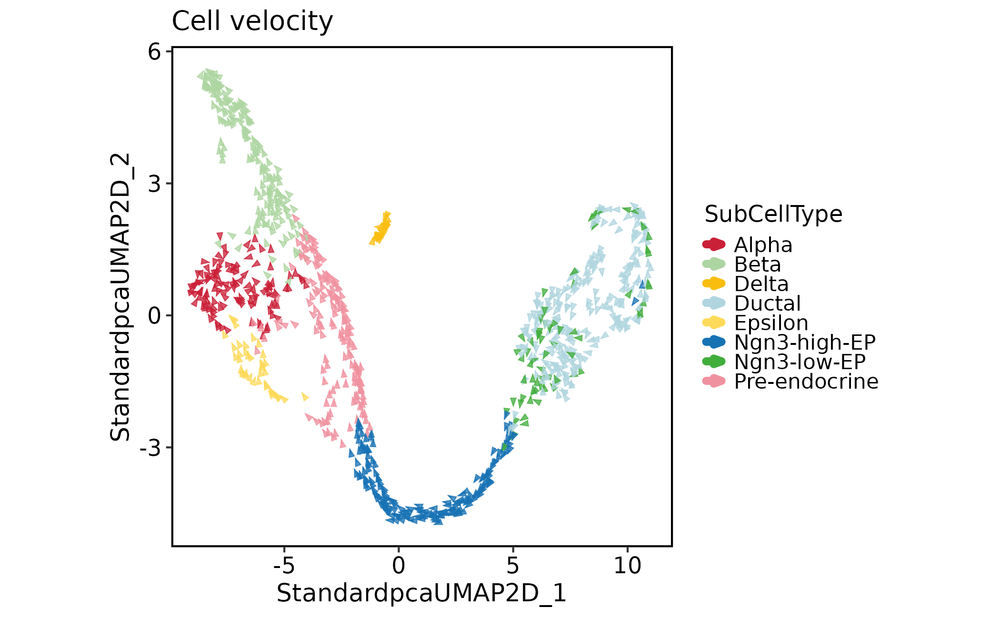
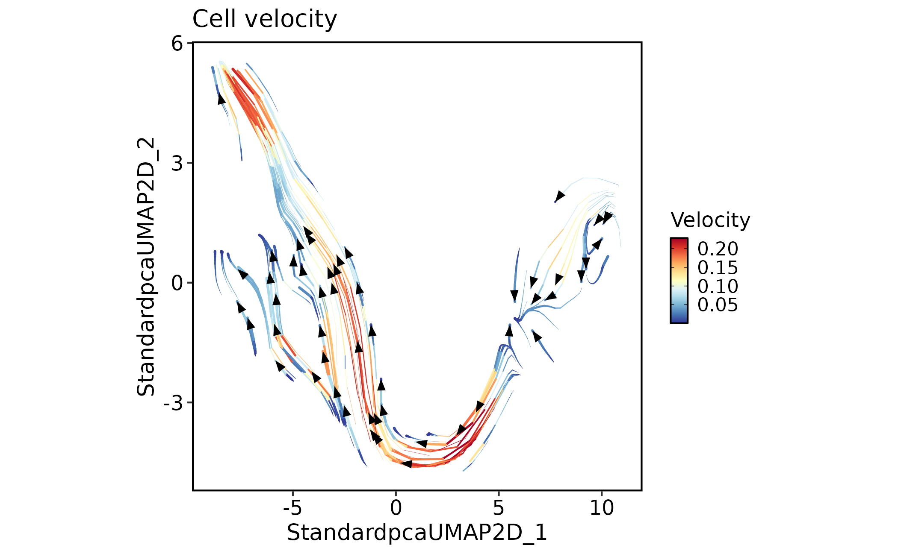
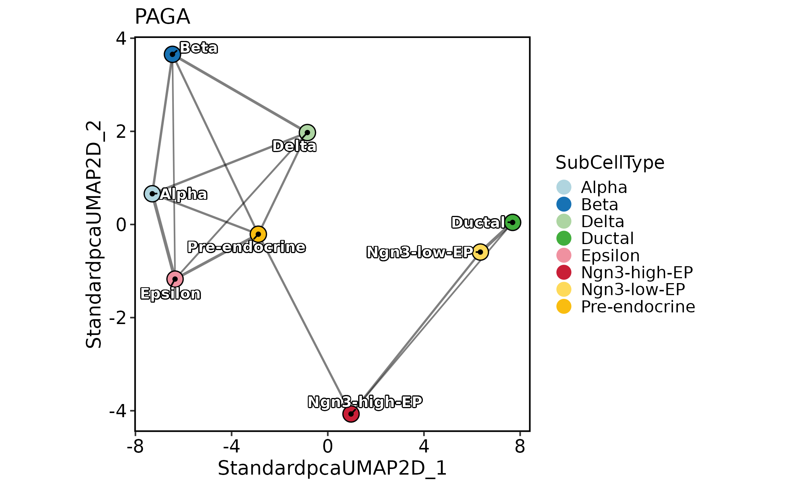
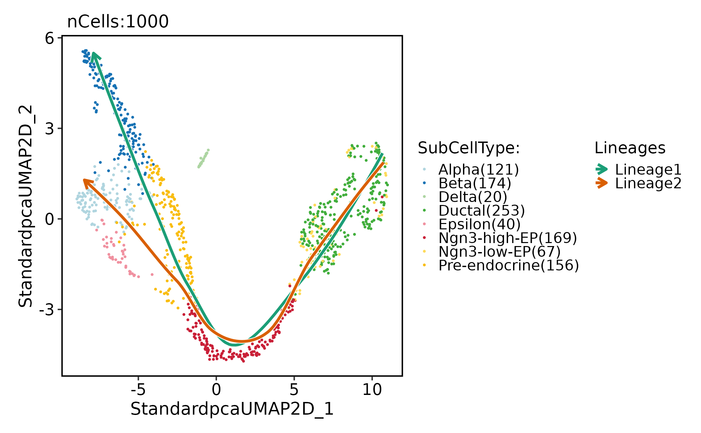
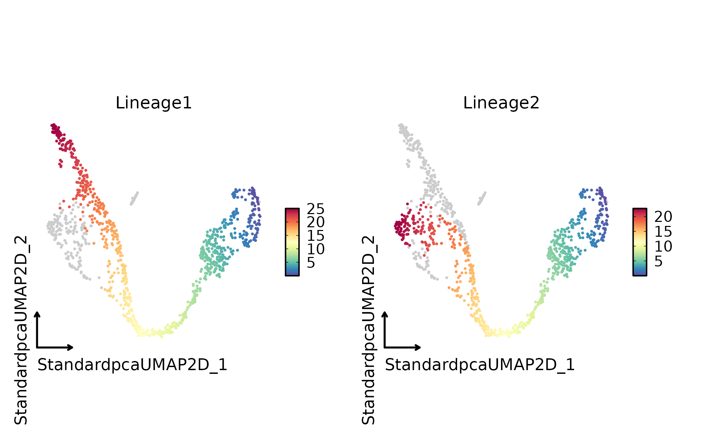
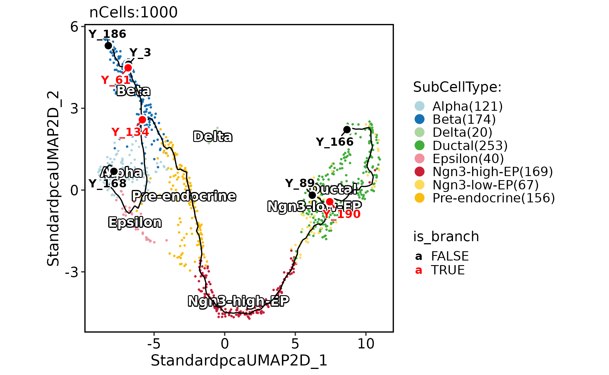
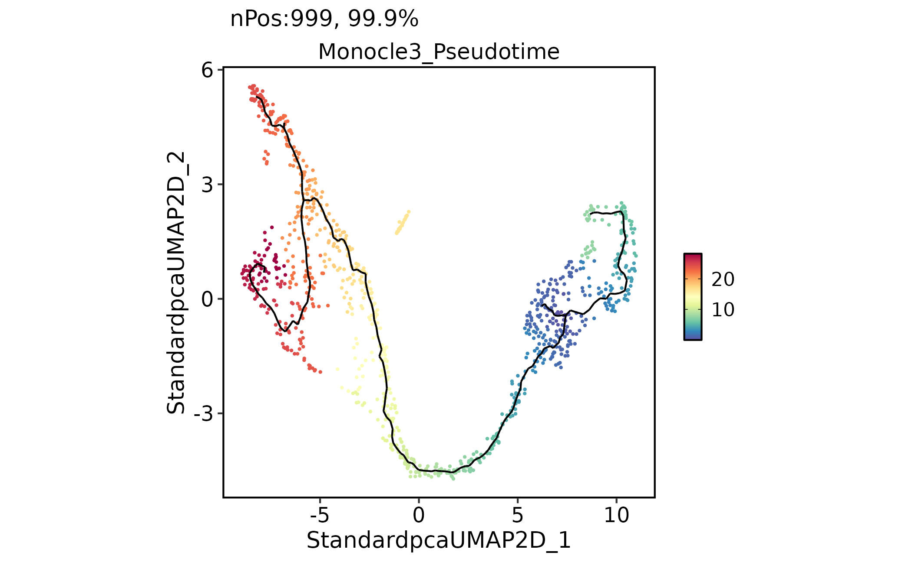
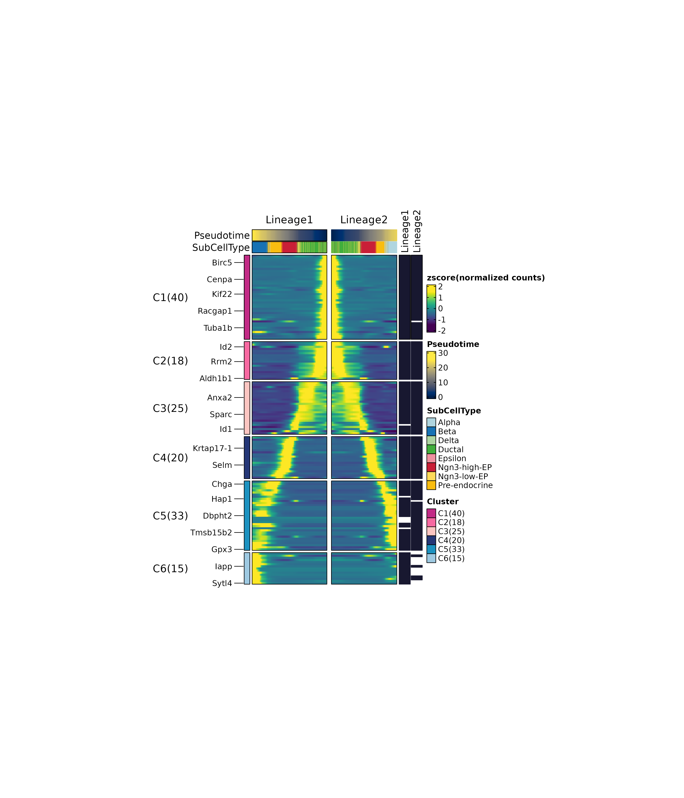
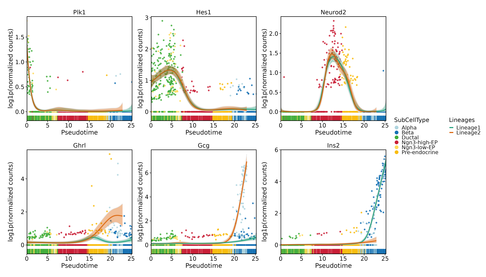

# Trajectory and dynamic feature workflow

This page executes the complete bundled pancreas object and displays
velocity, connectivity, pseudotime and dynamic-expression results. The
velocity and PAGA examples explicitly select SCOP’s native C++ backend;
they are not executions of the Python scVelo or Scanpy packages.
Slingshot and Monocle3 use their R backends. Keep the backend with every
result when comparing implementations.

Install the optional R backends before rendering this article. The
examples use the existing environment; Python reference implementations
can be selected with `backend = "python"` after preparing their separate
environment. Dynamic fitting also requires a current `thisutils` build
exporting `fit_trends`; older builds can have the same version number
without this API.

This article shows how to organize trajectory, RNA-velocity, and
dynamic-feature analyses in `scop`. These methods answer related but
distinct questions: connectivity between cell states, pseudotime
ordering, directional flow, and features that vary along inferred
lineages.

Use trajectory methods only after the basic embedding and annotation are
stable. Most trajectory errors are interpretation errors caused by
unstable labels, missing root states, or incompatible input assays.

The methods below should be read as complementary evidence layers, not
as interchangeable trajectory labels. PAGA describes group-level
connectivity, Slingshot and Monocle3 assign pseudotime, RNA velocity
estimates local direction, and dynamic-feature models test genes against
the chosen ordering.

## Prepare the Object

The bundled pancreas object contains spliced and unspliced assays,
making it a convenient example for both ordinary trajectory inference
and RNA velocity.

``` r

library(scop)
stopifnot(
  all(unlist(thisutils::check_r("slingshot", install = FALSE, verbose = FALSE))),
  all(unlist(thisutils::check_r("cole-trapnell-lab/monocle3", install = FALSE, verbose = FALSE))),
  "fit_trends" %in% getNamespaceExports("thisutils")
)
set.seed(11)

data(pancreas_sub)
input_cells <- colnames(pancreas_sub)
pancreas_sub <- RunStandardWorkflow(pancreas_sub,
  assay = "RNA", seed = 11,
  cores = 1, verbose = FALSE
)
stopifnot(identical(colnames(pancreas_sub), input_cells))

SeuratObject::Assays(pancreas_sub)
#> [1] "RNA"       "spliced"   "unspliced"
table(pancreas_sub$SubCellType)
#> 
#>         Alpha          Beta         Delta        Ductal       Epsilon 
#>           121           174            20           253            40 
#>  Ngn3-high-EP   Ngn3-low-EP Pre-endocrine 
#>           169            67           156
```

## RNA Velocity

RNA velocity requires spliced and unspliced matrices. Generate those
matrices outside `scop` with tools such as velocyto, bustools, or
alevin-fry, then store them as separate `spliced` and `unspliced` assays
for the native C++ example below. With `backend = "python"`, `assay_y`
also accepts extra layers of the `RNA` assay; the C++ backend requires
separate assays.

``` r

pancreas_sub <- RunSCVELO(
  pancreas_sub,
  group.by = "SubCellType",
  linear_reduction = "PCA",
  nonlinear_reduction = "UMAP",
  backend = "cpp", cores = 1, show_plot = FALSE
)

VelocityPlot(
  pancreas_sub,
  reduction = "UMAP",
  group.by = "SubCellType"
)
```



``` r


VelocityPlot(
  pancreas_sub,
  reduction = "UMAP",
  plot_type = "stream"
)
```



Interpret velocity as a local directional estimate. It should agree with
marker genes, developmental knowledge, and trajectory structure before
being used as evidence for cell-state transitions. Velocity arrows or
streams do not define cell types by themselves. They are most useful
when their direction agrees with known early and terminal marker genes.

## PAGA Connectivity

PAGA summarizes coarse connectivity between annotated groups. It is
useful for checking whether a graph-based topology matches known or
expected transitions.

``` r

pancreas_sub <- RunPAGA(
  pancreas_sub,
  group.by = "SubCellType",
  linear_reduction = "PCA",
  nonlinear_reduction = "UMAP",
  backend = "cpp", cores = 1, show_plot = FALSE
)

PAGAPlot(
  pancreas_sub,
  reduction = "UMAP",
  label = TRUE,
  label_repel = TRUE,
  edge_size = c(0.5, 1),
  edge_color = "black"
)
```



Use PAGA to reason about group-level graph structure. Use pseudotime
methods when the question requires an ordering of individual cells.

## Slingshot Lineages

Slingshot is a practical choice when the embedding has clear branching
and root or terminal groups can be specified.

``` r

pancreas_sub <- RunSlingshot(
  pancreas_sub,
  group.by = "SubCellType",
  reduction = "UMAP",
  start = "Ductal",
  end = c("Alpha", "Beta"),
  show_plot = FALSE, seed = 11
)

CellDimPlot(
  pancreas_sub,
  group.by = "SubCellType",
  lineages = paste0("Lineage", 1:2),
  reduction = "UMAP"
)
#> Warning: Removed 6 rows containing missing values or values outside the scale range
#> (`geom_path()`).
#> Removed 6 rows containing missing values or values outside the scale range
#> (`geom_path()`).
```



``` r


FeatureDimPlot(
  pancreas_sub,
  features = paste0("Lineage", 1:2),
  reduction = "UMAP",
  theme_use = "theme_blank"
)
```



The lineage pseudotime columns can be used directly by dynamic-feature
methods and plotting functions. `Lineage1` and `Lineage2` are numeric
pseudotime columns written to metadata by the Slingshot wrapper. They
are method-specific coordinates, not absolute time.

## Monocle3 Trajectories

Monocle3 learns a trajectory graph and stores trajectory layers that can
be added to ordinary `scop` plots.

``` r

pancreas_sub <- RunMonocle3(
  pancreas_sub,
  group.by = "SubCellType",
  use_partition = FALSE,
  root_cells = colnames(pancreas_sub)[pancreas_sub$SubCellType == "Ductal"][1]
)
#>   |                                                                              |                                                                      |   0%  |                                                                              |======================================================================| 100%

trajectory <- pancreas_sub@tools$Monocle3$trajectory
milestones <- pancreas_sub@tools$Monocle3$milestones

CellDimPlot(
  pancreas_sub,
  group.by = "SubCellType",
  reduction = "UMAP",
  label = TRUE
) +
  trajectory +
  milestones
```



``` r


FeatureDimPlot(
  pancreas_sub,
  features = "Monocle3_Pseudotime",
  reduction = "UMAP"
) +
  trajectory
```



Check partitions, clusters, roots, and pseudotime direction before
interpreting branch-specific changes. `Monocle3_Pseudotime` is another
numeric ordering derived from the Monocle3 principal graph. It can agree
with Slingshot but does not have to use the same scale or branch
assignment.

## Dynamic Features

After a lineage has been selected, use dynamic-feature analysis to find
genes that vary along one or more lineages.

``` r

pancreas_sub <- RunDynamicFeatures(
  pancreas_sub,
  lineages = c("Lineage1", "Lineage2"),
  features = unique(c(
    head(SeuratObject::VariableFeatures(pancreas_sub), 200),
    "Plk1", "Hes1", "Neurod2", "Ghrl", "Gcg", "Ins2"
  )),
  fit_method = "gam", cores = 1, seed = 11
)
```

Use
[`DynamicHeatmap()`](https://mengxu98.github.io/scop/reference/DynamicHeatmap.md)
for module-like changes and
[`DynamicPlot()`](https://mengxu98.github.io/scop/reference/DynamicPlot.md)
for a small set of known features. The fitted feature set is the first
200 variable features plus the six named genes shown below; all input
cells are retained. This is an explicitly selected illustrative gene
set, not a genome-wide screen. The heatmap displays fitted expression
without downloading a gene-set database. Module colors summarize
expression shapes and do not establish regulatory or pathway membership.

``` r

ht <- DynamicHeatmap(
  pancreas_sub,
  lineages = c("Lineage1", "Lineage2"),
  use_fitted = TRUE,
  n_split = 6,
  reverse_ht = "Lineage1",
  species = "Mus_musculus",
  db = "GO_BP",
  anno_terms = FALSE,
  anno_keys = FALSE,
  anno_features = FALSE,
  heatmap_palette = "viridis",
  cell_annotation = "SubCellType"
)
print(ht$plot)
```



``` r

DynamicPlot(
  pancreas_sub,
  lineages = c("Lineage1", "Lineage2"),
  group.by = "SubCellType",
  features = c("Plk1", "Hes1", "Neurod2", "Ghrl", "Gcg", "Ins2")
)
```



## Save and inspect the executed result

``` r

stopifnot(identical(colnames(pancreas_sub), input_cells))
output_dir <- tempfile("trajectory-workflow-")
dir.create(output_dir)
saveRDS(pancreas_sub, file.path(output_dir, "analysis.rds"))
utils::write.csv(pancreas_sub@meta.data, file.path(output_dir, "cell-metadata.csv"))
writeLines(capture.output(sessionInfo()), file.path(output_dir, "session-info.txt"))
data.frame(
  cells = ncol(pancreas_sub), genes = nrow(pancreas_sub),
  velocity_backend = "cpp", paga_backend = "cpp"
)
#>   cells genes velocity_backend paga_backend
#> 1  1000 15998              cpp          cpp
names(pancreas_sub@tools)
#> [1] "SCVELO"                              
#> [2] "PAGA"                                
#> [3] "Slingshot_SubCellType_StandardUMAP2D"
#> [4] "Monocle3"                            
#> [5] "DynamicFeatures_Lineage1"            
#> [6] "DynamicFeatures_Lineage2"
```

The temporary directory is for website builds. Choose a new persistent
output directory for your own analysis. Save the fitted object and
package versions; pseudotime is a relative model coordinate, not
measured developmental time.

## What to Report

A compact trajectory report should include:

- the object, embedding, and annotation used to define cell states;
- whether spliced and unspliced assays were available for velocity;
- the selected method and root or terminal groups;
- pseudotime or lineage columns written to metadata;
- graph, velocity, and pseudotime plots with the same annotation labels;
- dynamic genes and any functional annotations used to interpret them.

Do not mix method outputs as if they measure the same quantity. Report
connectivity, directionality, pseudotime, and dynamic expression as
separate evidence layers.
